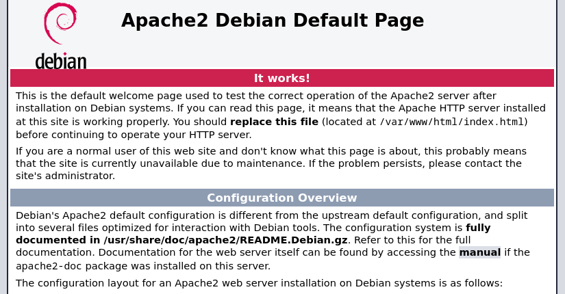
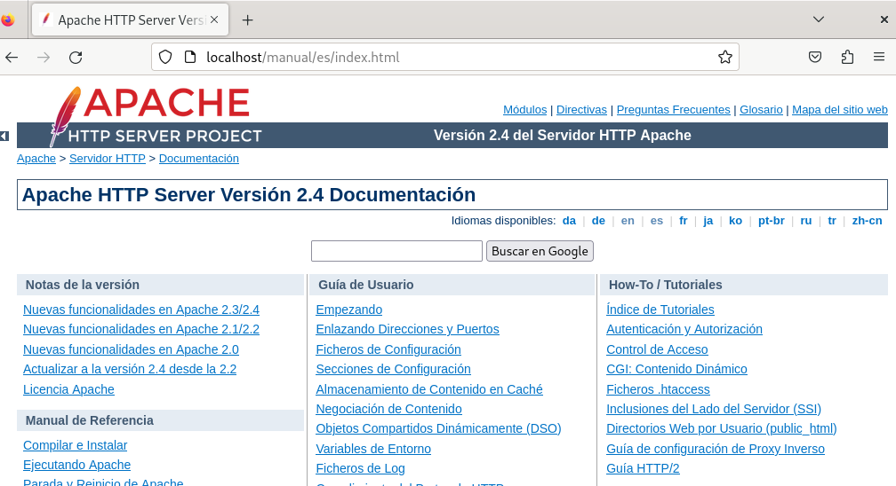

  **INSTALACIÓN DE SERVIDORES DE APLICACIONES WEB**

0. [Introducción](#introduccion)
1. [Análisis de requerimientos](#an%C3%A1lisis-de-requerimientos)
    1. [La URL. Acceso a recursos](#la-url-acceso-a-recursos)
    1. [HTTP: comunicación entre servidor y cliente](#http-comunicaci%C3%B3n-entre-servidor-y-cliente)
    1. [Contenedores web](#contenedores-web)
2. [Servidores web](#servidores-web)
    1. [Servidor web Apache](#servidor-web-apache)
    1. [Instalación de Apache](#instalaci%C3%B3n-de-apache)
    1. [Configuración básica de Apache](#configuraci%C3%B3n-b%C3%A1sica-de-apache)
    1. [Configuración de directorios personales](#configuraci%C3%B3n-de-directorios-personales)
    1. [Configuración de módulos](#configuraci%C3%B3n-de-m%C3%B3dulos)
    1. [Control de accesos](#control-de-accesos)
3. [Lenguajes script](#lenguajes-script)
    1. [Lenguajes script de cliente](#lenguajes-script-de-cliente)
    1. [Lenguajes script de servidor](#lenguajes-script-de-servidor)
    1. [Instalación de PHP](#instalaci%C3%B3n-de-php)
4. [Bases de Datos](#bases-de-datos)    
    1. [MySQL](#mysql)
5. [Gestión de bases de datos](#gesti%C3%B3n-de-bases-de-datos)
    1. [mysql cliente](#mysql-cliente)
    2. [phpMyAdmin](#phpmyadmin)
6. [Pruebas de funcionamiento](#pruebas-de-funcionamiento)
    1. [Utilidades de prueba.](#utilidades-de-prueba)
7. [Stacks de productividad](#stacks-de-productividad)
8. [Control de versiones](#control-de-versiones)
9. [Editores y entornos de desarrollo](#editores-y-entornos-de-desarrollo) 
10. [Servicios](#servicios)
11. [Documentación](#documentaci%C3%B3n)


# Introduccion

Internet se ha convertido en la principal herramienta de intercambio de información a la sociedad actual. La conexión de los ordenadores a las redes locales y estas redes a otros de grandes dimensiones ha posibilitado la comunicación global de información entre los ordenadores en todo el mundo. Para poder ofrecer servicios web, los servidores tienen que tener instalados una serie de servicios. El servidor web permite el envío de contenidos a otros ordenadores a través de la red. Los preprocesadores de hipertexto (cómo PHP) permiten crear contenidos web de forma dinámica. Los servidores de bases de datos permiten almacenar información de forma estructurada que se puede usar para generar contenido web. Estos servicios tienen que ser instalados y configurados correctamente antes de empezar a crear el contenido web dinámico de nuestro web.

# Análisis de requerimientos

Un servidor web es una pieza de software que responde a las peticiones de los navegadores y entrega la página para el navegador a través de Internet. Cuando se llama en una página web por la dirección –la URL (*uniform resource locator*), por ejemplo, www.ioc.org/index.html–, la comunicación entre el navegador y el servidor es posible gracias a tres protocolos:

- **TCP**(*Transmission Control Protocol*, protocolo de control de transmisión): es el responsable de hacer que el mensaje llegue al destino sin errores.

- **IP**(*Internet Protocol*): es el responsable de hacer que el mensaje encuentre el camino hasta el servidor.

- **HTTP**(*Hypertext Transfer Protocol*, protocolo de transferencia de hipertexto): es el protocolo que ha indicado el usuario a la hora de pedir el recurso al servidor. La primera parte de un recurso URL corresponde al protocolo que utilizarán cliente y servidor para intercambiar datos.

## La URL. Acceso a recursos

Una dirección URL tiene la finalidad de acceder a un recurso en un servidor.

Todas las direcciones URL tienen diferentes partes; cogemos como ejemplo

<https://aules.edu.gva.es/fp/login/index.php>:

- **Protocolo**: se indica antes de :// y en este caso es HTTPS. Hay otros como son FTP o HTTP
- **Dirección del servidor**: el lugar de donde se quiere obtener el recurso (aules.edu.gva.es).
- **Puerto**: el puerto del servidor destinado a la aplicación encargada de gestionar las peticiones HTTP (puerto del servidor web). En caso de que no esté especificado se usa el puerto estándar:
    - HTTPS: 443
    - HTTP: 80
    - Puedes consultar en sitios como https://es.wikipedia.org/wiki/Anexo:Puertos_de_red la lista de puertos por defecto en internet y como se clasifican en bloques.
- **Ruta hasta el recurso:** corresponde a la ruta en la carpeta dentro del servidor web donde se encuentra el recurso (fp/login/).
- **Recurso:** es el recurso o fichero que pedimos al servidor (index.php). En el caso que esté vacío, el servidor web entrega el recurso configurado por defecto.

Lo primero que hace el navegador es comunicarse con un servidor de nombres (DNS) para obtener la dirección IP que corresponde al dominio aules.edu.gva.es. Con esta IP se conecta a la máquina servidor. A continuación, el navegador crea una conexión con la dirección IP del servidor al puerto 443. Una vez el cliente y el servidor están conectados, “hablan” usando el protocolo HTTPS para que el cliente indique qué recursos quiere del servidor.

El servidor enviará estos recursos al cliente a través de la conexión establecida.

## HTTP/HTTPS: comunicación entre servidor y cliente

Una vez establecida la conexión entra en juego el protocolo HTTPS: el navegador envía una petición al servidor en que solicita el recurso index.php (figura 1.1). El servidor procesa esta petición y devuelve la página solicitada al navegador, que interpreta las etiquetas HTML y la presenta al usuario.


La información que el cliente envía al servidor en la petición es la siguiente:

- El método de petición (GET) y la URL
- Una **cabecera de solicitud**, que incluye elementos importantes como el tipo de navegador empleado o si se acepta el contenido de la respuesta comprimido.

La información que el servidor envía en la respuesta tiene dos partes muy diferenciadas:

- La **cabecera de respuesta** contiene el código que indica si la petición se ha cumplido, el tipo de contenido que enviará al cliente, la fecha en la que fue modificado, entre otras.
- El **contenido** (texto, código HTML, imágenes, etc.) del recurso pedido.


**Métodos GET y POST**

La primera parte de una petición HTTP/HTTPS es el tipo de método, que sirve para indicarle el tipo de petición que se ha hecho. Los métodos pueden ser HEAD, TRACE, DELETE, OPTIONS, CONNECT, GET y POST . Estos dos últimos son los que realmente utilizaréis.

Tanto con GET cómo con POST se puede enviar información del cliente al servidor, pero hay algunas diferencias.

La información enviada con el método GET se envía después de la dirección URL, por ejemplo: *aules.edu.gva.es/fp/login/index.php?lang=es*.

La información de usuario son los datos que hay a partir del símbolo ?. Este hecho implica que la cantidad de datos que se pueden enviar con GET esté limitada. Además, la información que se ha enviado de este modo es pública puesto que aparece a la propia URL, que es fácilmente accesible. Por lo tanto no se puede usar para enviar datos privados, como una clave de acceso, por ejemplo.

Con el método POST, en cambio, la información se envía como parte del contenido y no es visible de manera directa para el usuario.

## Contenedores web

El problema de los primeros servidores web es que solamente entregaban recursos estáticos. Recibían una petición, miraban si el recurso estaba disponible y lo enviaban.

La ventaja de las páginas web dinámicas es que el contenido se genera dinámicamente y, por lo tanto, no existe estática y previamente, en el servidor.

Los servidores web sin configurar tan sólo sabe enviar páginas estáticas. Para que un servidor web pueda trabajar con contenido dinámico, es necesario instalar otra **aplicación que ayude el servidor web a servir contenido dinámico**.

En algunas ocasiones bastará añadir el correspondiente módulo en el servidor web, como en el caso de Apache y PHP. En este caso, cuando el servidor reciba una petición de un archivo de extensión PHP, esta solicitud pasa al módulo o a un procceso especializado correspondiente. Este último es el que generará la salida estática correspondiente.


Por el contrario, en caso de aplicaciones java es necesario utilizar **contenedores web**, que gestionan el ciclo de vida de los componentes web. Para este lenguaje de programación es muy común utilizar el contenedor Apache Tomcat.


Figura 1.2

En la figura 1.2 podéis observar el funcionamiento de un servidor web junto con el contenedor. Cuando el servidor encuentra un recurso que no es estático, traspasa la petición al contenedor web. Este contenedor procesa la petición, genera dinámicamente una respuesta en forma de contenido web y la pasa al servidor. El funcionamiento, de manera esquemática, es similar a lo que va a ocurrir con una página en php.

Finalmente el servidor envía el contenido al cliente.

# Servidores web

Los servidores web pueden estar implementados dentro del *kernel* del sistema operativo o dentro del espacio de memoria de usuario (como cualquier otra aplicación del sistema).

Los **servidores web dentro del *kernel***, como por ejemplo el IIS de Windows, generalmente se ejecutan más rápido puesto que son parte integrando del sistema y pueden usar todos los recursos de hardware directamente cuando los necesitan (como por ejemplo la memoria sin paginar o la memoria caché).


Los **servidores web que se ejecutan en modo de usuario** tienen que pedir al sistema cuando tienen necesidades de memoria o recursos de CPU. Estas peticiones tardan en realizarse y no siempre pueden ser satisfechas, puesto que el sistema reserva los recursos para su uso y lo tiene que repartir entre todo el resto de aplicaciones en ejecución.

Cómo se puede ver en la figura 1.3 y la tabla 1.1, a pesar de que hoy en día hay muchos servidores web diferentes, nginx es el servidor web más popular en Internet con un 34% de cuota de mercado seguido muy de cerca de Apache.


**1.3**

**Taula 1.1. Servidores web más utilizados por las páginas web a nivel mundial hasta 2023**

| **Desarrollador** | Porcentatge |
| :- | :- |
| **Nginx** | 33.7% |
| **Apache** |20.6% |
| **Microsoft** | 5,6% |
 
Estas cifras suelen cambiar constantemente para la última referencia visitar [W3Techs](https://w3techs.com/) sección Web Servers

Aqui podemos comparar con el estado en el 2012 para constatar los cambios

**Taula 1.1.old Servidors web més utilitzats per les pàgines web més visitades d’Internet a Juliol de 2012**

| **Desarrollador** | Juny 2012 | Porcentatge | Julio 2012 | Porcentatge | Cambio |
| :- | :- | :- | :- | :- | :- |
| **Apache** | 448.452.703 | 64,33% | 409.185.675 | 61,45% | -2.89 |
| **Microsoft** | 95.891.537 | 13,76% | 97.385.377 | 14,62% | 0,87 |
| **nginx** | 72.881.755 | 10,46% | 73.833.173 | 11.09% | 0,63 |


## Características más generales de los servidores Web:


- Software de código abierto y gratuito
- Funciones incorporadas para autentificación y validación de users
- Es uno de los servidores más utilizados
- Es multiplataforma, o sea compatible con Windows, Linux, iOS, Unix, etc.
- Es flexible y personalizable, por lo cual se pueden activas o desactivar sus funcionalidades
- Tiene soporte para múltiples lenguajes de programación, como PHP, Python y Perl.
- Arquitectura está basada en módulos, que le permiten ampliar la funcionalidad.
- Fácil de configurar e instalar
- Seguridad al software por los módulos de Autorización y Autenticación


- Software de código abierto
- Alto rendimiento
- Gestiona sitios web de alto tráfico
- Uno de los servidores web más usados
- Soporte PHP a través de PHP-FPM
- Arquitectura basada en eventos
- Manejo de conexiones asíncrona
- Bajo consumo de recursos
- Multiplataforma compatible con Windows, Linux, iOS, Unix, etc.
- Cuenta con una versión de pago


- Software de pago
- Tiene 3 licencias: Free Starter, Site Ownes y Web Host
- Alto rendimiento y escalabilidad
- Arquitectura basada en eventos
- Puede atender miles de consultas de forma segura
- Se planteó como una alternativa a Apache, esto para mejorar el rendimiento en momentos de alto tráfico.
- Compatibilidad con los archivos .htaccess y las aplicaciones web diseñadas para Apache


- Desarrollado por Microsoft y fue creado solamente para el sistema operativo de la misma marca
- Se ejecuta con gracias a la tecnología IIS (Internet Information Services)
- Compatible con páginas programadas en ASP o .net
- Integración de lenguajes y tecnologías limitada
- Modelo de proceso único: un solo proceso maneja todas las peticiones.
- La arquitectura es modular
- Es posible agregar funciones adicionales
- Se puede configurar para utilizar PHP, VBScript, Perl y Java
- Cuenta con múltiples características de seguridad y mecanismos de autenticación integrados


- Aunque no es concretamente un servidor, es sistema gratuito que actúa como un proxy entre los usuarios web y el servidor, por lo cual guarda contenido de los sitios, disminuyendo el número de peticiones a los servidores web, pero todavía es posible acceder al sitio.
- Al contar con estos servidores proxy en diferentes puntos globales, es posible acceder más rápido a las páginas web. CloudFlare es el sitio más rápido gracias a sus servidores proxy
- Puede identificar amenazas y detener ataques antes de que lleguen al destino. También evita los comentarios spam
- Se puede navegar en modo offline en caso de que alguno de los servidores no esté disponible.
- De igual forma, contar un servidor web que cumpla con las necesidades de empresas se volvió un punto a tratar, de tal forma que las compañías grandes en el mundo de la tecnología optaron por desarrollar sus propios servidores web.
- Ecommerce, Apps, RFID, Beacons, IoT


- Pensado para programadores que usen Java, Python, Ruby
- Soporta grandes cantidades de trabajo
- Recomendado para quieres poseen conocimientos en administración de sistemas
- Herramienta para programadores


- Servidor exclusivo para Google
- A pesar de su uso limitado, es uno de los más usados
- Sostiene toda la infraestructura de Google
- Brinda servicio simúltaneo
- Se ejecuta en sistemas UNIX

## Servidor web Apache

El servidor HTTP Apache es un servidor web de código abierto para plataformas Une (BSD, GNU/Linux, etc.), Windows, Macintosh y otros sistemas operativos que implementa el protocolo HTTP y que utiliza el concepto de lugar virtual.

El Apache empezó como una serie de módulos desarrollados para un servidor web en el cual trabajaban en el Centro Nacional de Supercomputación de Aplicaciones de los Estados Unidos (NCSA). Un golpe acabó este proyecto, programadores de todo el mundo encontraron que había la necesidad de tener un repositorio central en que se pudiera mantener el código y los módulos que se habían desarrollado para poder continuar trabajando en el desarrollo del servidor. Así surgió la Fundación de Software Apache (Apache Software Foundation).

El Apache fue diseñado desde el principio de forma modular, de forma que el software podía ser ampliado por otros desarrolladores que escribían pequeñas partes del código de una manera fácil. La clave de este éxito es la creación de una API (interfaz de programación de aplicaciones) modular y una serie de fases muy definidas que atraviesa cada petición que llega al servidor. Estas fases van desde la inicialización del servidor (el Apache cuando lee los ficheros de configuración), hasta la traducción de una dirección URL en un nombre de fichero del ordenador.

## Instalación de Apache sobre Debian 12.7

Para instalar paquetes en distribuciones basadas en Debian GNU/Linux, se tiene que ejecutar con los derechos de root o un usuario del grupo sudo

La forma general de instalar paquetes en los sistemas basados en Debian es:

``` # sudo apt-get install {nombre_del_paquete} ```

Para instalar el servidor web tenéis que instalar el paquete **apache2**. Por defecto el servidor usa el directorio **/var/www** para contener las páginas que servirá.

Si nos fijamos bien la instalación incorporá los siguientes paquetes adicionales:
* apache2-data: que contiene archivos comunes independiente de la arquitectura, como iconos, páginas de error y archivos estáticos de índice.
* apache2-utils: incluye una serie de herramientas esenciales para la administración de servidores  como:
    * ab: para realizar pruebas de rendimiento
    * rotatelogs: para abrir nuevos ficheros de log de forma periódica


Y nos sugiere la instalación de los siguientes paquetes:
* apache2-doc: documentación oficial del servidor
* apache2-suexec-pristine | apache2-suexec-custom: que se utilizan en el modulo `mod_suexec`, que sirve para ejecutar scripts CGI y SSI bajo diferentes IDs de usuario y grupo, en lugar de usar el ID del usuario que ejecuta el servidor web (www-data).

Al final de la instalación podremos ver los módulos que ha instalado:
- **mod_event**: Permite el procesamiento múltiple, con el objetivo de manejar conexiones concurrentes de manera más eficiente
- **mod_access_compat**: Proporciona compatibilidad con las directivas de control de acceso de versiones anteriores de Apache.
- **mod_auth_basic**: Implementa la autenticación básica HTTP.
- **mod_log_config**: Configura el registro de acceso, permitiendo personalizar los formatos de los logs.
- **mod_logio**: Registra la cantidad de datos transferidos en cada solicitud.
- **mod_env**: Permite la configuración de variables de entorno.
- **mod_setenvif**: Configura variables de entorno basadas en las características de la solicitud.
- **mod_mime**: Determina el tipo de contenido de los archivos servidos.
- **mod_status**: Proporciona una página de estado del servidor, útil para monitoreo.
- **mod_autoindex**: Genera listados de directorios cuando no hay un archivo de índice presente.
- **mod_negotiation**: Maneja la negociación de contenido, permitiendo servir diferentes versiones de un recurso.
- **mod_dir**: Proporciona la funcionalidad de búsqueda de archivos de índice como `index.html`.
- **mod_alias**: Permite la creación de alias para directorios.
- **mod_so**: Permite la carga dinámica de otros módulos.

Una vez instalado podéis comprobar su funcionamiento modificando el fichero **/var/www/index.html** y comprobando que se muestra correctamente si abrís desde el navegador web la dirección http://localhost tal como se puede ver a la figura 1.4.



**Figura 1.4.** Comprobación del funcionamiento del servidor Apache

## Configuración básica de Apache

El control del arranque y parada del servidor Apache 2 puede variar en función de la versión del sistema operativo instalado.

 En versiones más antiguaes se utilizaba un script que se encontraba dentro de la carpeta **/etc/init.d**. La sintaxis de este script era la siguiente:

**# /etc/init.d/apache2 ordre**

en el cual ***ordre*** puede ser alguna de las siguientes opciones:

• start: para iniciar el servidor
• stop: para parar el servidor
• restart: para reiniciar el servidor. Para y pone en marcha el servidor.

En versiones de Debian o ubuntu más modernas:

**# systemctl ordre apache2**

Recordáis que tenéis que trabajar con permisos de superusuario para modificar la ejecución del servidor, así que usáis ***sudo*** o trabajáis como usuario *root*. Podéis comprobar como el servidor se para y pone en marcha entrando a la página de localhost .

En el caso de los servidores web, el puerto de funcionamiento estándar es el 80 (que queda implícito, no hay que escribirlo en la url).

Considerando que, en el supuesto de que hayamos instalado la documentación, tendremos que volver a arrancar el servidor web, también podemos acceder a la documentación mediante la página principal predefinida en el servidor web Apache. Por lo tanto, desde cualquier navegador web nos podremos documentar sobre el funcionamiento del servidor web escribiendo en la barra de navegación <http://localhost/manual/>.
Pasos:
* sudo apt-get install apache2-doc
* sudo a2enconf apache2-doc  (para habilitar la configuración. Podemos consultar la carpeta /etc/apache2/conf-available/ para revisar como queda configurado)
* sudo systemctl restart apache2 (para que funcione el cambio)



A partir de ahora, cualquier fichero que ponemos en **/var/www/html/** se tiene que visualizar cuando escribimos en el navegador **http://localhost/fichero.extension**. En lugar de localhost podríamos utilizar la IP de la máquina, la IP de loopback o un nombre que declaremos en **/etc/hosts/**


## Configuración de directorios personales


Podéis **activar el directorio personal de los usuarios** de la siguiente manera:

1. Creáis una carpeta dentro del directorio personal del usuario denominada **public\_html.** Lo tenéis que hacer con vuestro usuario, **no uséis el usuario *root* o sudo.**
2. Debemos activar con el comando **sudo a2enmod userdir** el módulo de Apache. Este comando crea dentro de la carpeta **/etc/apache2/mods-enable** los ficheros **userdir.conf**

```apache
<IfModule mod_userdir.c>
    UserDir public_html
    UserDir disabled root

    <Directory /home/*/public_html>
        AllowOverride FileInfo AuthConfig Limit Indexes
        Options MultiViews Indexes SymLinksIfOwnerMatch IncludesNoExec
        Require method GET POST OPTIONS
    </Directory>
</IfModule>
```
y **userdir.load**
```
LoadModule userdir_module /usr/lib/apache2/modules/mod_userdir.so
```

## Explicación Detallada:

### <IfModule mod_userdir.c>
Este bloque de configuración solo se aplicará si el módulo `userdir` está habilitado. Es una forma de asegurarse de que las directivas dentro del bloque no causen errores si el módulo no está presente.

### UserDir public_html
Esta directiva especifica el nombre del directorio que se utilizará para los archivos web de los usuarios. En este caso, se usa `public_html`, lo que significa que los archivos web de cada usuario estarán en `/home/usuario/public_html`.

### UserDir disabled root
Deshabilita el uso del directorio `public_html` para el usuario root. Esto es una medida de seguridad para evitar que el usuario root tenga un directorio web accesible públicamente.

### <Directory /home/*/public_html>
Este bloque de configuración se aplica a todos los directorios `public_html` dentro de los directorios home de los usuarios (`/home/usuario/public_html`).

#### AllowOverride FileInfo AuthConfig Limit Indexes
Permite que los archivos `.htaccess` en los directorios `public_html` sobrescriban las configuraciones de `FileInfo`, `AuthConfig`, `Limit` e `Indexes`. Esto da a los usuarios cierta flexibilidad para personalizar la configuración de sus directorios web.

#### Options MultiViews Indexes SymLinksIfOwnerMatch IncludesNoExec
Establece varias opciones para los directorios `public_html`:
- **MultiViews**: Permite la negociación de contenido, lo que puede ser útil para servir diferentes versiones de un recurso basado en las preferencias del cliente.
- **Indexes**: Permite la generación de listados de directorios si no hay un archivo `index` presente.
- **SymLinksIfOwnerMatch**: Permite el uso de enlaces simbólicos solo si el propietario del enlace es el mismo que el del destino, lo que mejora la seguridad.
- **IncludesNoExec**: Permite el uso de SSI (Server Side Includes) pero deshabilita la ejecución de comandos, lo que también mejora la seguridad.

#### Require method GET POST OPTIONS
Restringe el acceso a los métodos HTTP `GET`, `POST` y `OPTIONS`. Esto limita los métodos que pueden ser utilizados para acceder a los recursos en los directorios `public_html`.


5. Podemos crear una página de prueba con el siguiente código

```bash
echo "Página de prueba de UserDir" > ~/public_html/index.html
```

6. Ajustamos los permisos de las carpetas
```bash
sudo chmod 711 /home
sudo chmod 711 /home/tu_usuario
sudo chmod 755 /home/tu_usuario/public_html
```

6. Reiniciáis el servidor.

A partir de este momento el usuario puede meter el contenido web personal dentro de la carpeta public\_html que ha creado en su directorio personal. Esta será accesible a través de la dirección http://localhost/~nombreusuario. Por defecto mostrará el fichero index.html o un listado de los ficheros del directorio si no encuentra este fichero.


## Configuración de módulos

Apache es un servidor modular. Esto quiere decir que en el cuerpo del servidor está incluido únicamente las funcionalidades más básicas. Las funcionalidades extras están disponibles mediante los módulos que se pueden cargar al Apache. Si el servidor está compilado para usar los módulos dinámicamente, este se pueden añadir en cualquier momento. Si no es así, Apache se tiene que recompilar para añadir o sacar los módulos. Podéis instalar módulos de Apache con la orden apt-get.

En algunos casos el módulo viene instalado, pero no está activo. Por ejemplo el módulo **authn_dbd** nos permite autenticar a través de bases de datos. Si lo que queremos es utilizar una base de datos MySQL para autenticar hay que tener en cuenta que tendremos que complementar la instalación con un paquete extra:

```sudo apt libaprutil1-dbd-mysql ```

En particular este módulo ya suele estar disponible en ***/etc/apache2/mods-available .*** y al activarlo pasará a ***/etc/apache2/mods-enabled**.*


 ``` # sudo a2enmod authn_dbd ```

Para **desactivar el módulo** podéis usar:

``` #sudo a2dismod authn_dbd ```

Podéis mirar los módulos que está usando Apache mirando directamente el contenido del directorio de módulos activos (**/etc/apache2/mods-enabled**) o con la orden:

``` #sudo apache2ctl -M | sort ```

Si observas bien los diferentes módulos existentes verás que hay varios que empiezan por auth.
* **mod_auth_**: Estos módulos implementan mecanismos básicos de autenticación HTTP. Los veremos en el siguiente apartado.
* **mod_authn_**: actúan como proveedores de autenticación, es decir, manejan la verificación de credenciales contra diferentes backends, por ejemplo contra Mysql, como vimos antes.
* **mod_authz_**: manejan la autorización, es decir, determinan si un usuario autenticado tiene permiso para acceder a un recurso específico, por ejemplo a través de la ip del usuario.
* **mod_authnz_**: combinan los dos métodos anteriores.


## Control de accesos en módulos mod_auth_*

Para autenticar a los usuarios a Apache se puede hacer de dos maneras **Básica y Digest.** A la **Básica** el usuario introduce en el navegador web su **nombre de usuario y contraseña** y se envían al servidor **sin cifrar**, también es la más sencilla de configurar. A la **Digest** el **usuario y contraseña** y se envían al servidor **cifrados.**

Estos métodos **controlan** el acceso a los **recursos**, pero **no cifran la comunicación cliente-servidor** una vez se ha validado el acceso.

**Autenticación básica**

El módulo de Apache que controla este método de autenticación es **mod\_auth\_basic.**

- Está soportado por todos los navegadores web.
- El usuario y la contraseña no van cifradas del navegador web al servidor.

Podemos decidir qué directorios queremos proteger. Para ello podemos añadir la configuración a los ficheros de configuración de sitios ubicados en **/etc/apache2/sitesavailable/default**. También puedes crear un archivo llamado ```.htaccess``` en el directorio que quieres proteger. Las lineas que hay que añadir son como las que siguen:

```
<Directory "/var/www/privado">
 AuthType Basic
 AuthName "Directorio privado"
 AuthUserFile /etc/apache2/passwd/.htpasswd
 Require valid user
</ Directory>
```
En el cual:

- **AuthName**: indica el nombre del dominio de autenticación y es texto que se le presentará al usuario en el momento de autenticarse.
- **AuthType**: indica el método de autenticación a usar.
- **AuthUserFile**: indica la ruta al archivo de texto que contendrá los nombres de usuario y contraseñas usadas en la autenticación HTTP básica.
- **Require**: indica restricciones sobre los usuarios que tienen acceso a los recursos especificados. Puede ser *valid-user* que identifica cualquier usuario incluido al archivo de contraseñas *.htpasswd* o user *<lista de usuarios>* que especifica la lista de usuarios de .htpasswd que pueden acceder.

Para que esto funcione es necesario:
* Que el módulo esté habilitado
* Que tengamos configurado el fichero de contraseñas de apache. Para ello puedes utilizar la herramienta htpasswd:
```bash
sudo htpasswd -c /etc/apache2/.htpasswd tu_usuario
sudo htpasswd /etc/apache2/.htpasswd otro_usuario
```


# Lenguajes script

Un lenguaje de script (guiones) es un lenguaje de programación basado en guiones que son seguidos línea por línea por un procesador.

Un script es un conjunto de instrucciones que afectan en la página web, si estas instrucciones afectan al navegador se encuentran junto al cliente y si afectan al servidor se encuentran al ordenador servidor. Si pensáis en páginas web que habéis visitado recientemente que cambian cada vez que las visitáis o incluso que pueden cambiar mientras las estáis visitando es posible que utilicen algún script.

Por ejemplo, cuando buscáis una palabra al buscador Google, este utiliza scripts para sugerir palabras relacionadas, para poner anuncios y para encontrar el que estáis buscando. Cuando compráis en una tienda virtual, esta utiliza scripts para mostrar los productos y para guardar vuestro carro de compra.

A continuación veréis las características principales de los dos tipos de lenguajes de guiones.

## Lenguajes script de cliente

Los lenguajes script de cliente se ejecutan al sistema en el cual se encuentra el navegador web (Firefox, Chrome, Opera, Safari, etc.) del usuario y pueden formar parte del código HTML del documento o encontrarse en archivos adjuntos. Los lenguajes script de cliente dan interactividad a las páginas HTML, el código es ligero y al llegar al navegador es interpretado (es decir, los scripts se ejecutan sin una compilación preliminar) por el navegador.  

El proceso de un navegador al sistema del cliente es:

1. El usuario pide una página web a un servidor desde su navegador.
2. El servidor busca la página y, si la encuentra, la devuelve al navegador del usuario.
3. El navegador muestra la página y al mismo tiempo ejecuta los scripts de cliente para crear la salida HTML.

Los lenguajes de script de cliente modifican la página web una vez llega al navegador. La ventaja principal de los scripts de cliente es que al no ejecutarse al servidor no consumen CPU del servidor ni ancho de banda. Se utilizan para tareas que ahorran trabajo al servidor, como por ejemplo validar los campos de un formulario, o para mejorar la apariencia y la interacción con el usuario.

El lenguaje de referencia para programar código en el lado del cliente es **Javascript**. No se necesita ninguna licencia para utilizarlo. Al ejecutarse en la máquina del cliente, si ésta es lenta los scripts se pueden ejecutar lentamente, o incluso no se llegarán a ejecutar si el navegador no entiende el lenguaje de script. A las preferencias de los navegadores modernos se puede activar o desactivar la ejecución de Javascript. Cómo el código está en el ordenador del cliente, el usuario lo puede ver para copiarlo o manipularlo.

Con la tecnología **AJAX** y el **Javascript,** la mejora de funcionalidad de las páginas web al navegador hace que se asemejen cada vez más a aplicaciones normales del ordenador.

## Lenguajes script de servidor

Las aplicaciones web desarrolladas con lenguajes script de servidor se ejecutan en el servidor web y por lo tanto el usuario no tiene acceso al código fuente del servidor. El  servidor contiene estos scripts que son interpretados cada vez que se recibe una petición de una página web. El proceso es el siguiente:

1. El usuario a través de su navegador pide una página al servidor.
2. El script de servidor es interpretado montando el contenido a devolver (la página web).
3. Cuando el script acaba, el contenido montado se devuelve al cliente.

Al esquema de la figura 1.6 se ilustra una máquina cliente que envía una petición de página web a un servidor que ejecuta un script de servidor que requiere consultar una base de datos. Como respuesta, el cliente recibe una página web HMTL.


Entre las características más significativas de los lenguajes script de servidor se encuentran las de permitir a los usuarios tener cuentas individuales y la de comunicarse con bases de datos (MySQL, PostgreSQL, SQL Server, Oracle, etc). Permiten un nivel de personalización, privacidad y recuperación de información muy importante.

Las páginas web de comercio electrónico y las páginas web sociales hacen un uso intensivo de los scripts de servidor.

Como ejemplos de los principales lenguajes script de servidor tenemos el PHP (páginas con extensión php) y la ASPE/Asp.net (páginas con extensión asp/aspx).

Otros lenguajes son Perl (páginas con extensión pl), Java Server Pages (páginas con extensión jsp), ColdFusion (páginas con extensión cfm) y Python (páginas con extensión py).

AJAX Son las siglas de *Asynchronous Javascript And Xml*, (Javascript asíncrono y XML), un conjunto de tecnologías que permiten actualizar partes de una página web sin tener que volverla a cargar entera
    
## Instalación de PHP

En las diferentes distribuciones de linux nos encontraremos diferentes formas de instalar el php y deberemos seguir las instrucciones dependientdo del sistema operativo, distribución y versión. Como ejemplo utilizaremos Ubuntu , en sus diferentes versiones suele llevar un metapaquete denominado php que no es más que un paquete que instala otros paquetes , según la versión estos haran referencia a la versión de php recomendada por la distribución en el momento, lo cual no quiere decir que no podamos forzar una versión concreta de php a la hora de  instalar o hacer una instalación manual.

En nuestro caso nos servira una versión 8 de php por tanto apt-get install php normalmente veremos que instalba una versión 7 en algunas de su subversiones dependiendo de lo actualizado que tengamos el sistema

### Instalación de PHP 8 en Debian 12.7

Hay una serie de paquetes necesarios para trabajar con PHP y Apache. Si utilizamos el comando ```sudo apt-get install php```nos instalará varios paquetes necesarios, como php8.2, php8.2-common, php8.2-opcache, php8.2-readline, php8.2-cli, libapache2-mod-php8.2. Hay otros paquetes que pueden servir en entornos de producción como el php8.2-fpm.

Una vez instalados tenéis que reiniciar el servidor Apache porque los cambios sean efectivos De manera opcional podéis instalar del PHP los paquetes
referenciados aquí para apoyar en diferentes utilidades. Si sólo necesitáis una instalación básica del PHP, no hace falta instalar los paquetes siguientes, aunque son recomendables.

- php7-gd: biblioteca para el uso de imágenes.
- libphp-adodb: biblioteca adodb para PHP.
- php-pear: bibliotecas Pear para PHP.
- php7-odbc: para conexiones odbc.

**NOTA:**  Para poder ejecutar php en el directorio de usuario debeis comentar las lineas que están en el directorio /etc/apache2/mods-available/php8.2.conf

``` # Running PHP scripts in user directories is disabled by default
#
# To re-enable PHP in user directories comment the following lines
# (from <IfModule ...> to </IfModule>.) Do NOT set it to On as it
# prevents .htaccess files from disabling it.
#<IfModule mod_userdir.c>
#    <Directory /home/*/public_html>
#        php_admin_flag engine Off
#    </Directory>
#</IfModule>

```

# Bases de Datos
  Tenemos multiples gestores de bases de datos cada uno con sus peculiaridades. Los más conocidos son los tradicionales Sistemas de bases de datos relacionales (Mysql,Oracle,Postgres,..) pero tambien tenemos los no relacionales como mongodb y ultimanente han aparecido los nativos en la nube.

  


    
    De todos ellos haremos sólo haremos un repaso del que utilizaremos más adelante con nuestros ejemplos que es el MySQL
    
## MySQL

El MySQL es un sistema de gestión de base de datos relacional. Se calcula que tiene más de 6 millones de instalaciones. El programa se ejecuta como un servidor multiusuario y proporciona acceso a una serie de bases de datos.

El proyecto de código fuente está disponible en los términos de la licencia pública general GNU, a pesar de que el MySQL es propiedad de una empresa con ánimo de lucro, que también lo patrocina. El MySQL era propiedad de la compañía sueca MySQL AB, una empresa que Sun Microsystems compró el 2008. El abril de 2009, Oracle *compró Sun e indirectamente MySQL AB, uno de los principales competidores en* algunos de sus productos.

El MySQL es utilizado por una gran cantidad de proyectos que requieren una base de datos con funciones completas, sistema de gestión, administración y es usado, entre otros, por WordPress, phpBB, Google y Facebook.

Muchas veces se hace referencia a la combinación de Linux, el servidor web Apache, el contenedor web de PHP y MySQL con el acrónimo *LAMP*.

[Instalación de MySQL en sistemas basados en Debian 12](mysql.md)

Finalmente si queremos conectar mysql con php nos hará falta instalar el módulo de php para mysql

```
sudo apt-get install php-mysql
```
    
# Gestión de bases de datos
    
   Una vez instalado un gestor de base de datos necesitamos herramientas para poder crear bases de datos, tablas, registros,...
   Casi todas los gestores tienen alguna herramienta que nos proporciona esta funcionalidad. En el caso de mysql tenemos el propio cliente de mysql con el que podremos interactuar en la barra de comandos suficiente para crear nuestras pruebas aunque tenemos tanto aplicaciones especificas como gestores en la web , un ejemplo de este en mysql es el phpmyadmin

## mysql cliente

Es un programa cliente que ejecutamos en el terminal para poder gestionar operaciones sobre la base de datos 

[Comandos mysql](climysql.md)
    
## phpMyAdmin

**El phpMyAdmin** es un programa de distribución libre en PHP, creado por una comunidad sin ánimo de lucro. Es una herramienta muy completa que permite acceder a todas las funciones típicas de la base de datos MySQL por medio de una interfaz web muy intuitiva, tal como se puede ver a la figura 1.7.


Figura 1.7.

[phpmyadmin](phpmyadmin.md)

## Pruebas de funcionamiento.

Para **comprobar si funciona la instalación de Apache2 y PHP:**

- Creáis un documento a la raíz en /var/www, denominado info.php y rellenadlo con

la información siguiente:

```<?php phpinfo ();?>```

- A continuación, guarda el archivo.
- Probáis el servidor con el navegador y la dirección del tipo siguiente:

<http://localhost/info.php>

Si todo ha ido bien, os mostrará una pantalla con información del PHP (ver figura 1.9):

**Figura 1.9.** Información de configuración de PHP

Para comprobar, una vez acabada la instalación de MySQL, que podéis acceder al entorno, entraréis como usuario *root* y **ejecutaréis la orden** ***show Databases*.** Veréis las dos bases de datos que instala MySQL y ejecutaréis *quit* para salir del entorno.

A un terminal escribiréis la petición siguiente:

```$ mysql -h localhost -u root -p ```

**Enter password:** 
```
Welcome tono the MySQL monitor. Commands end with ; or g.
Your MySQL connection id is 41
Server version: 8.4.2 MySQL Community Server - GPL
Copyright (c) 2000, 2024, Oracle and/oro its affiliates.
Oracle is a registered trademark of Oracle Corporation and/or its affiliates. Other names may be trademarks of therir respective owners.

Type ’help;’ or ’h’ for help. Type ’c’ to clear the current input statement.
```
```mysql> show databases;```

```
Database 
information_schema 
mysql
rows in siete (0.00 seco)
mysql> quit
Bye

```    


# Stacks de productividad
    
La instalación y posterior configuración de un servidor web Apache, de un servidor de bases de datos MySQL y del lenguaje de programación PHP es una tarea compleja que sólo pueden emprender usuarios con buenos conocimientos informáticos.

Los llamados paquetes LAMP,WAMP o MAMP simplifican la tarea de instalar y configurar automáticamente Apache, PHP y MySQL en Linux, Windows o Mac OS

Estos paquetes proporcionan:

- Servidor Web Apache
- Base de datos MySQL
- Lenguaje de programación PHP
- Accesos por el arranque y la parada de los servicios
- Facilitados para la configuración de los servicios

El paquete XAMPP es un paquete de software libre que tiene versiones por Linux, Windows, Solaris y Mac OSX, además de ofrecer los servicios básicos de un paquete integrado (es decir, Servidor web Apache + Servidor de bases de datos MySQL + Lenguaje PHP). Así pues, ofrece:

- ProFTPD como servidor de archivos por FTP
- Lenguaje Perl
- Servidor de datos SQLite
- SSL por páginas seguras HTTPS (OpenSSL)
- Estadísticas de acceso (Webalizer)

Podéis encontrar la última versión de XAMPP a [www.apachefriends.org/en/xampp.html](http://www.apachefriends.org/en/xampp.html)
    
   
# Control de versiones

Hay varios
- [Git](git.md)
- Subversion
    
- Compartición de control de versiones
- Github
    
# Editores y entornos de desarrollo
    
Para editar código sería necesario un simple editor de texto pero podemos utilizar un editor de código o incluso un IDE integrado para mejorar la productividad.
    
[Visual Studio Code](vsc.md)
    
    
# Servicios

## Entorno local

   La instalación del servicio se realiza en el mismo sistema operativo de la máquina

## Entorno local virtual
    
### Máquinas virtuales con hipervisores

Con el objetivo de reutilizar mejor los recursos de las máquinas físicas  aparece  los hipervisores una forma de virtualizar los sistemas operativos y separar los servicios necesarios en su interior. Podemos por tanto especializar un mv para mantener un servidor web, otra para una base de datos  manteniendo aislado y con sus dependecias. (Referenciar apuntes de Sistemas Operativos)
    
### Contenedores
    
Con el fin de agilizar la distribución de aplicaciones con sus dependencias y proporcionar escalabilidd en los despliegues de software aparecen los contenedores , consiguiendo mayor ligereza que las mv  nosotros los podemos utilzar para disponer de los servicios necesarios
    
 (Referenciar apuntes de Servicios docker) 
 (Compartición de docker con dockerhub)

[Servicios](servicios.md)


# **Documentación**
Deprecated    
[Documentación](documentacion.md)
