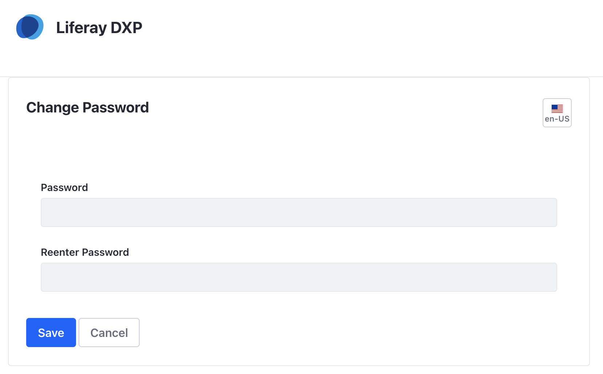

# Gestores de contenidos

El gestor de contenidos es una herramienta que puede trabajar de forma autónoma o, y esta es la manera más habitual, como herramienta web. Para poder trabajar con el gestor de contenidos como herramienta web, necesitará preparar el sistema para trabajar como un servidor web completo. Esto implica instalar un servidor de páginas web dinámicas (Apache y PHP) o servidores de aplicaciones (Tomcat (JSP) y un servidor de base de datos (MySQL, Postgres).

El trabajo de administrador de un gestor de contenidos no termina con la instalación y la administración del sistema. Una parte fundamental del trabajo de cualquier administrador informático es la documentación del trabajo en el momento en que se están llevando a cabo. Instalarlos un sistema wiki en su servidor para poder crear la documentación paralelamente al trabajo hecho sobre el servidor y tenerla ordenada y accesible.

## **1. Instalación de un gestor de contenidos**

*Un gestor de contenidos (en inglés Content Management System o CMS) es una aplicación informática utilizada para crear, editar, gestionar, buscar y publicar diferentes tipos de contenido multimedia.*

Los gestores de contenidos se utilizan a menudo para publicar documentación específica, tales como artículos de noticias o manuales técnicos, aunque en general se pueden utilizar para crear cualquier tipo de portal web. Son capaces de gestionar contenido en diferentes formatos, como texto, imágenes, vídeos, sonidos, animaciones y cualquier otro contenido web.

Un gestor de contenidos puede tener, entre otras, alguna de las características siguientes:

- Identificar diferentes tipos de usuario y sus roles (lo que podrán ver y hacer estos usuarios).
- Crear contenidos de forma rápida y sencilla.
- Separar el contenido de su presentación. Esto permite modificar fácilmente la apariencia, sin tener que cambiar los contenidos. Además, nos permite aprovechar los contenidos para diferentes usos (por ejemplo para visualizar una misma web desde un ordenador de mesa o desde un teléfono móvil).

Hay diferentes tipos de gestores de contenidos en función de cuál es el resultado final que se quiere obtener (un centro de recursos de una empresa, la documentación de un proyecto ...). Nos centraremos en los gestores de contenidos enfocados a obtener como resultado un portal web.

Los gestores de contenidos web surgieron a mediados del noventa. Suelen estar implantados como aplicaciones web: una web que sirve para configurar y crear contenidos que da como resultado otra web. Son herramientas muy sencillas de usar, por lo que usuarios sin ningún tipo de conocimiento de programación son capaces de crear contenido con facilidad.


Aunque los gestores de contenidos en línea (online) son los más populares, también hay gestores de contenidos fuera de línea (offline) e híbridos que combinan las dos aproximaciones.

Los gestores suelen tener los contenidos almacenados dentro de bases de datos. Posteriormente, a esta información se le dará un formato para mantener un aspecto homogéneo dentro de la web.

### 1.1. Selección de un gestor de contenidos
En el mercado hay una multitud de gestores de contenidos, tanto de código abierto y gratuitos, como de software comercial y privativo. Esta es una pequeña lista de los gestores de contenidos de código abierto más populares:

- **Drupal (http://drupal.org)** tiene todas las funcionalidades básicas de un gestor de contenidos y, además, permite añadir foros, encuestas, votaciones, noticias ... Está implantado en PHP y SQL.
- **WordPress (http://wordpress.org)** es un gestor de contenidos muy popular enfocado a la creación de blogs.
- **Joomla (www.joomla.org)** es uno de los gestores de contenidos más popular y reconocido, creado con PHP, MySQL y con licencia GPL. Una de sus características más importantes es que dispone de muchas extensiones existentes que añaden nuevas funcionalidades y características y se integran fácilmente.
- **Liferay (https://www.liferay.com/es)** es uno de los gestores de contenidos más robustos y escalables del mercado, creado en java , con licencias de pago para empresa y  GPL en su versión libre para al comunidad. Una de sus características más importantes es que constituye una marco de trabajo para realizar todo tipo de proyectos con funcionalidades de base y que se integran fácilmente con otras plataformas y tecnologías.

Hay una infinidad de otros gestores de contenidos, tales como *Alfresco, Plone, Symphony, Django, PostNuke .*.. No haremos una descripción de cada uno, pero tienen unas características similares. Los gestores de contenidos se pueden diferenciar en la forma en que se administran los contenidos, su implementación interna (lenguaje de programación y base de datos utilizada) o qué sector están orientados (empresarial, educativo ...).

Aunque uno de los gestores de contenido más populares es Wordpress basado en php escogeremos *Liferay* como gestor de contenidos basado en java para este curso para ver varias tecnolgias, es fácil de instalar, hay muchas extensiones y es uno de los gestores de contenidos más robustos, por tanto, los que tienen unn a comunidad de desarrolladores más activa.


Las empresas siguientes han incorporado con Liferay soluciones a sus problemas y sirven de ejemplo explicando sus casos de uso:

https://www.liferay.com/es/resources/case-studies

[Ejemplo Olympus](http://www.olympus.com.au/)


Como puede observarse, los resultados pueden ser de lo más variados y profesionales.

Liferay está publicado bajo una licencia GNU Lesser General Public License, version 2.1.
http://www.gnu.org/licenses/lgpl-2.1.html

### 1.2. Requisitos mínimos de instalación

Vamos a realizar la instalación básica de Liferay Portal 7.4.3, con esta instalación podremos realizar pruebas que nos ayuden a conocer la herramienta.

Antes de iniciar el manual vamos a explicar brevemente que es Liferay Portal; Liferay es un gestor de portales web y contenidos, que nos permite desde la creación de un pequeño sitio web personal, hasta la creación de varios sitios web para empresas de una forma rápida y sencilla, utilizando las funcionalidades que el propio producto nos proporciona y/o permitiéndonos desarrollar nuestro portal totalmente a medida.

Liferay Portal, proporciona varios tipos de productos con sus respectivas licencias:

- Liferay portal, totalmente gratuita y descargable desde la propia página de Liferay. Tras ella hay una gran comunidad OpenSource que prueba y mejora el producto de forma continua.
- Liferay Dxp, a la que Liferay ofrece servicios de soporte ante incidencias del producto, con la entrega continua de parches de seguridad y corrección de otro tipo de incidencias.

Antes de empezar la instalación de cualquier CMS debemos conocer sus dependencias y compatibilidad. En este caso las comprobaremos en el enlace [Matríz de Compatibilidad](https://help.liferay.com/hc/es/articles/4411310034829-Liferay-DXP-Quarterly-Releases-Compatibility-Matrix) donde podemos detectar que este producto en la versión deseada esta certificado o soportado en unos sistemas operativos sobre unas versiones de java y compatible con unas versiones de bases de datos.

Con el fin de tener los menos imprevistos posibles lo ideal sería cumplir todos los requisitos a las versiones certificadas que nos proponen aunque normalmente suele funcionar con alguna versión soportada o superior siempre que no cambien mucho el api. Pero es importante recordar que si nos salimos de estas versiones alguna funcionalidad o el portal entero puede no funcionar.

Para un administrador de sistemas no es fácil cumplir todos los requerimientos del vesionado ya que los mismos sistemas se suelen utizar para varios despliegues aunque poco a poco con la utilización de tecnologías de contenedores se empiezan a aislar mejor las diferentes aplicaciones que corren en los servidores.

Modelos de instalación

Tenemos varios modelos de instalación

La computación ha conseguido muchos avances para optimizar los recursos asignados a las aplicaciones cada una con sus ventajas e inconvenientes.Hablaremos de unas opciones generales y luego de una recomedada para nuestras pruebas

- Clásica (instalación en sistema físico real como nuestra computadora) (No recomendada)
- Maquina virtual en nuestra computadora
- Contendedor en nuestra computadora (recomendado)
- Software as a Service 
- Servicios Cloud


Empezaremos con la instalación en contenedor recomendada aunque es interesate los detalles de una instalación clásica ya que los conceptos nos pueden ayudar a resolver posteriormente problemas en la instalación

#### Contenedores

##### Contenedor de prueba de liferay

- El primer requisito será tener docker en nuestro sistema aunque en funcion de la versión de docker instalada puede que las últimas versiones de liferay no funcionen.

- Una vez con docker en nuestro sistema tenemos que ejecutar

El contenedor escucha en el puerto 8080 y arranca como todos los conteneores tipo docker.

1. ejecuta un contenedor que mapea el puerto (e.g., 8080) del ordenador hacia el puerto 8080 del contenedor.

 1. Empezando por la última version (probada en un docker 20.10.21)

```
docker run -it -m 8g -p 8080:8080 -e LIFERAY_LOCALES_PERIOD_ENABLED=en_US,es_ES -e LIFERAY_COMPANY_PERIOD_DEFAULT_PERIOD_LOCALE=es_ES --name  liferaytest1 liferay/portal:7.4.3.120-ga120
```

 2. En caso de tener versiones de docker anteriores o actualizamos la versión o podemos ejecutar una versión anterior de liferay

```
docker run -it -m 8g -p 8080:8080 -e JAVA_VERSION=zulu11 -e LIFERAY_LOCALES_PERIOD_ENABLED=en_US,es_ES -e LIFERAY_COMPANY_PERIOD_DEFAULT_PERIOD_LOCALE=es_ES --name liferaytest2 liferay/portal:7.1.0-ga1-201809012030
```

Con esto tenemos una instancia de test para poder probar lo básico


El contenedor se ejecuta e imprime mensajes de log , incluyendo un mensaje de arranqque final de Tomcat:

```
INFO [main] org.apache.catalina.startup.Catalina.start Server startup in [xx,xxx] milliseconds
```

2. Registrate en Liferay en <http://localhost:8080> usando el correo  test@liferay.com y el password test


3. Cuando se muestre, cambia tu password (e.g. test) y guarda.




Arrancando de esta manera el contenedor la base de datos que utiliza es una base de datos en memoria por tanto no adecuada para sistemas de producción

Notas recordatorias para manejar el contenedor recien creado

```
docker container ls lista cada contenedor en ejecución, incluyendo su ID y nombre.
docker container ls -a lista todos tus contenedores, incluyendo aquellos que no están en ejecución.

Viendo los Logs de Liferay

docker logs commands
El comando de docker logs imprime los mensajes de log del contenedor.

Resultado de los comando
docker logs [container]	Imprime los mensajes actuales
docker logs -f [container]	lleva el flujo de errores, como tail -f [file] lo hace
docker logs -t [container]	Añade una marca de timepo a cada mensaje de error
docker cp command
Puedes usar el comando docker cp como este de bajo para copiar el fichero de log a tu máquina.

docker cp [container]:/opt/liferay/logs/liferay.[timestamp].log .

Parar un Contenedor
Aquí tienes dos maneras de parar un contenedor.

Métodos	Pros	Cons
docker exec [container] /opt/liferay/tomcat/bin/shutdown.sh	Permite a Liferay, Tomcat, y otras aplicaciones a liberar recursos. El entry point del contenedor ejecuta cualquier post-shutdown scripts.


Ctrl-C en la sesión de terminal donde tu estás corriendo el contenedor con el argumento -i.

Note, Esto envia una señal SIGINT or SIGKILL al respectivo contenedor.
	Es el método más rápido para parar el contenedor.	Liferay, Tomcat, y el entry point del contenedor para inmediatamente, sin liberar recursos. La fase del entry point post-shutdown es no se produce. No uses este método en entornos de producción

Reiniciar un Contenedor
El contenedor se puede reiniciar como otros contenedores de Docker.

docker start [container]
Cuidado
Cuando un contenedor es reiniciado, su entry point runs se ejecuta de nuevo (Revisa el ciclo de vida de un contenedor y su API). Asegurate que cada script del entrypoint se ejecutan de forma segura.

Consejo
Ejecuta docker container ls -a para descubrir el nombre del contenedor y ID.

Ahora tu sabes lo básico para arrancar, parar, y monitorizar un contenedor de.

```

##### Contenedor de liferay , base de datos y sistema de archivos

Ahora vamos con los ajustes para personalizar aspectos de la instalación del portal y convertirlo en una versión más operativa para producción añadiendo una base de datos y volúmenes de montajes.

Mediante variables de ejecución de docker y variables de entorno de Liferay podemos conseguir un grado de personalización adecuado pero trabajaremos con la herramienta docker-compose que trata archivos yml que nos permite hacer estas configuraciones de forma más efectiva.
Ya que tenemos el Visual Studio Code instalado lo recomendable es instalar el plugin de docker para gestionarlo desde el IDE de trabajo


Crearemos una carpeta de trabajo llamada liferay con la siguiente estructura

```
mnt/
   /deploy
   /files
        portal-setup-wizard.properties
   /patching
   /scripts
mysql-volumes
docker-compose.yml 
```
El contenido que ponemos en el docker-compose.yml lo añadimos a continuación y contendra las declaraciones para lanzar dos contenedores relacionados y unos montajes a nuestro sistema de archivos

```
version: '3.5'
services:
    liferay-7.4:
        image: liferay/portal:7.4.3.120-ga120
        container_name: liferay
        depends_on:
          - mysql.8
        environment:
            JAVA_VERSION: zulu11
            LIFERAY_RETRY_PERIOD_JDBC_PERIOD_ON_PERIOD_STARTUP_PERIOD_DELAY: 10
            LIFERAY_RETRY_PERIOD_JDBC_PERIOD_ON_PERIOD_STARTUP_PERIOD_MAX_PERIOD_RETRIES: 10
            LIFERAY_JVM_OPTS: "-Xms2560m -Xmx4096m"
        ports:
            - '8080:8080'
        deploy:
            resources:
                limits:
                    memory: 8g
        volumes:
            - ./mnt:/mnt/liferay
            - liferay-data:/opt/liferay/data
            - liferay-osgi-configs:/opt/liferay/osgi/configs
            - liferay-osgi-marketplace:/opt/liferay/osgi/marketplace
            - liferay-osgi-modules:/opt/liferay/osgi/modules
            - liferay-osgi-war:/opt/liferay/osgi/war
        networks:
            - liferaynet

    mysql.8:
        image: mysql:8.0.40-debian
        container_name: mysql_liferay
        environment:
            MYSQL_ROOT_PASSWORD: root
            TZ: Europe/Madrid
            MYSQL_DATABASE: lportal
            MYSQL_USER: lportal
            MYSQL_PASSWORD: lportal
        ports:
            - '23306:3306'
        volumes:
            - ./mysql-volumes:/var/lib/mysql
        networks:
            - liferaynet
networks:
    liferaynet:
        driver: bridge
volumes:
  liferay-data:
  liferay-osgi-configs:
  liferay-osgi-marketplace:
  liferay-osgi-modules:
  liferay-osgi-war:
```

Este archivo tiene dos servicios principales
El primero de ellos el contenedor de liferay
- Ajusta la imagen de liferay en una versión determinada
- Asociamos un nombre al contenedor
- Establece una depencia de un servicio, en este caso una base de datos mysql.8.
- Establecemos unas variables de entorno que ajustan la versión de java y parámetros de Liferay.
- Publicamos los puertos abiertos en nuestro host y enlazados a los que proporciona el contenedor.
- Limitamos los recursos que el contenedor utilizará en nuestro sistema
- Asociamos las carperas de nuestro sistema a las internas del contenedor mediante volúmenes
- Creamos una red de comunicación para que exista comunicación entre los contenedores

El segundo de ellos es la base de datos en este caso mysql

- Ajusta la imagen de mysql en una versión determinada
- Asociamos un nombre al contenedor
- Establecemos unas variables de entorno que ajustan el password de root y una base de datos a crear junto con un usuario y password con derechos sobre esta base de datos.
- Publicamos los puertos abiertos en nuestro host y enlazados a los que proporciona el contenedor.
- Asociamos las carperas de nuestro sistema a las internas del contenedor mediante volúmenes donde se guardarán los datos de la base de datos
- Creamos una red de comunicación para que exista comunicación entre los contenedores

El contenido del archivo portal-setup-wizard.properties que pondremos dentro de la carpeta files
contendra los parámetros inicales para el arranque de la instancia

```
jdbc.default.driverClassName=com.mysql.cj.jdbc.Driver
jdbc.default.url=jdbc:mysql://mysql.8/lportal?useUnicode=true&characterEncoding=UTF-8&useFastDateParsing=false
jdbc.default.username=lportal
jdbc.default.password=lportal
locales.enabled=es_ES,en_US
company.default.locale=es_ES
```

##### Arrancando el contenedor

La forma más facil de arrancar el contenedor es comprobar que los puertos que necesitamos no estan siendo ocupadas por nada en nuestro sistema.
Una vez instalado el plugin docker en visual studio code nos situamos en el archivo docker-compose.yml  y con el clic boton de ratón derecho tenemos uno menus contextuale (Compose up ) Lanza el servicio para crearlo (Esta creación y primer arraque puede tardar más de 5 minutos)

Una vez lanzado en el icono izquierdo de docker podremos ver el estado de los contenedores  y podremos parar y rearancar los contenedores.

Recordar que una vez finalizada la carga sólo nos queda disfrutar del gestor via web.


#### Instalación Clásica

- Clásica (instalación en sistema físico real como nuestra computadora) (No recomendada)

Siguiendo las recomendaciones de compatibilidad deberiamos realizar las siguientes acciones muy similares en el caso de el uso de la máquina virtual

Requisitos de instalación:
- Sistema Operativo (Hay varios pero como sugerencia aunque la compatibilidad soportada la establece con varios sistemas entre ellos un ubuntu 18.04 a 24.04 tomariamos una 20.04)
- Respecto a la versión de Java a instalar la certificada es la versión de Oracle JDK 21 (Se descarga de oracle y requiere registro)


Install Oracle Java 21
Instalar Oracle Java Runtime Environment 21 (JRE 21)
Asumimos que tienes descargado el tar.gz file from [Java archive download page](https://www.oracle.com/es/java/technologies/downloads/#java21).
```
Extraemos el contenido
$ tar xzf jdk-21_linux-x64_bin.tar.gz
Extraemos el contenioc
Movemos al directorio /opt. Instalamos en Oracle JRE 21 to /opt directorio  reservado para aplicacioines nos distribuidas en el propio s.o.
$ sudo mv jdk-21.0.5/ /opt/
Cambiamos el propietario del directorio y todo su contenido al usuario root grupo rootoot.
$ sudo chown -R root:root /opt/jdk-21.0.5/
Anadimos el jdk 21 como default java
$ sudo update-alternatives --install /usr/bin/java java /opt/jdk-21.0.5/bin/java 100

Finalmente hay que actualizar la variable de entorno JAVA_HOME a la ruta donde tenemos instalado java
$ sudo nano /etc/environment
Añadimos 
JAVA_HOME="/opt/jdk-21.0.5"
$ source /etc/environment
$ echo $JAVA_HOME
/opt/jdk-21.0.5
```
- Respecto a la base de datos compatible nos propone entre otroas de forma certificada mysql o MariaDB (comprobar en ubuntu 21.04 si viene empaquetada una versión compatible (instalar desde repositorio) sino descargar e instalar una compatible
- Respecto al servidor de Aplicaciones si ya tenemos uno instalado deberemos comprobar la versión pero lo mejor es descargar el bundle que incluye el servidor de aplicaciones por tanto no nos preocupamos de instalarlo.
- Descargar la última versión 7.4 del [bundle de Liferay + Tomcat](https://www.liferay.com/es/downloads-community) aunque no sea la última incorpora la tecnología suficiente y requiere menos recursos.

Creamos la carpeta liferay, “*liferay*” en nuestro home de usuario /home/nombreusuario/, donde copiaremos el zip del bundle descargado.

Una vez copiado, descomprimimos el zip y se creará el directorio “*liferay/liferay-portal-7.4.3.*”.

A continuación, accedemos a través de la línea de comandos a la ejecución de tomcat en la ruta “/home/nombreusuario/liferay/liferay-portal-version/tomcat-version/bin*” y ejecutamos el comando “startup.sh”. Previamente le tenemos que haber dado permisos de ejecución.

De forma similar y para pararlo tenemos el comando shutdown.sh en el mismo directorio

“/home/nombreusuario/liferay/liferay-portal-version/tomcat-version/bin>”

Al efectuarlo desde la línea de comandos, donde veremos como arranca el servidor. Al ser la primera vez que lo ejecutamos puede tardar varios minutos.

Durante el arranque, Liferay comprueba si tiene alguna base de datos configurada y verifica que las tablas están creadas correctamente, y en caso de no estarlo las crea de forma automática. Si no tenemos ninguna base de datos instalada, Liferay trae embebida una base de datos llamada HSQLDB (Hypersonic) con la que podremos realizar pruebas, nunca debemos usar esta base de datos en entornos productivos.

Una vez finalizado el arranque se abrirá el navegador automáticamente, y nos aparecerá la ventana de configuración básica del portal. En caso de que no se abra el navegador de forma automática, accederemos manualmente poniendo la url “[http://localhost:8080](http://localhost:8080/)”.


### 1.3 Preparación de la instalación sobre una base de datos Mysql

Ya hemos comentado que liferay viene con una base de datos Hypersonic de pruebas pero si queremos considerar una instalación más estable debemos optar por otro gestor de base de datos por tanto veremos como configurar nuestra instalación de Liferay con Tomcat contra una base de datos MySQL. Con esto conseguiremos hacer que la información que generemos en nuestro portal sea persistente.
#### Requisitos previos:
Antes de empezar a configura nuestra instalación de Liferay contra MySQL deberemos haber realizado los siguientes pasos:

1. Instalación de Liferay 7.4
1. Crear esquema de base de datos en instalación MySQL con nombre ‘lportal’
2. En caso de que mysql root no permita crear el esquema por el método de conexión a la base de datos   
     - sudo mysql
     - SELECT user,authentication_string,plugin,host FROM mysql.user;
     - ALTER USER 'root'@'localhost' IDENTIFIED WITH mysql_native_password BY 'password';
     - FLUSH PRIVILEGES;
3. Creación del esquema
     - mysql -u root -p
     - CREATE DATABASE lportal CHARACTER SET utf8 COLLATE utf8_general_ci;

Para configurar MySQL existen dos formas en Liferay, pasamos a explicar ambas:

#### Configuración a través de properties.
La mayor parte de las configuraciones que se pueden hacer en Liferay son vía properties, uno de los principales es el “portal.properties” el cual puede consultarse en el siguiente enlace:

[portal.properties](https://docs.liferay.com/portal/7.4-ga112/propertiesdoc/portal.properties.html)

En el nos aparece un ejemplo de como configurar la conexión a base de datos.

Para poder sobreescribir los valores por defecto de este fichero, Liferay permite extenderlo. Para ello es necesario crear un fichero properties que llamaremos “portal-ext.properties” y lo podemos alojarlo en dos sitios:

- {LIFERAY\_HOME}, en el ejemplo usaremos *“/home/nombreusuario/liferay/liferay-portal-version”*
- {LIFERAY\_HOME}/tomcat-version/webapps/ROOT/WEB-INF/classes

En el portal-ext.properties añadimos la configuración de nuestra base de datos, por ejemplo:

#Configuración del Driver para la BD MySQL
jdbc.default.driverClassName=com.mysql.jdbc.Driver
#Ruta de conexión donde indicamos el esquema de BD donde se crearan las tablas de Liferay
jdbc.default.url=jdbc:mysql://localhost/lportal?useUnicode=true&characterEncoding=UTF-8&useFastDateParsing=false
#Usuario y password que usaremos (debe tener permisos de creación y edición de tablas)
jdbc.default.username=liferay
jdbc.default.password=liferay

Una vez arranquemos nuestro Liferay con esta configuración podremos comprobar que las tablas se han creado en nuestro esquema.
#### Configuración a través de la pantalla de inicio.
Cuando arrancamos nuestro Liferay por primera vez sin ninguna configuración de base de datos, se mostrará una pantalla de configuración principal, en la que podremos configurar nuestra base de datos.

Ademas de los datos de configuración básica de nuestro portal, nos permite cambiar la conexión por defecto de base de datos:


Seleccionamos en el combo la opción MySQL.


Configuramos los datos de conexión con nuestra base de datos, esquema, usuario y contraseña.


Por último, damos a finalizar configuración y tras unos minutos, podremos comprobar que las tablas se han creado en nuestra base de datos.

Si vamos a nuestra instalación Liferay “{LIFERAY\_HOME}/” comprobaremos que se ha generado un fichero con nombre “portal-setup-wizard.properties” en el que se han incluido 4 entradas con la configuración de la base de datos.

### 1.4 Configuración general

La configuración en general para adaptarlo a nuestras necesidades se hace a través de un archivo de configuración o propiedades que debe ser sobrescrito para adaptarlo.

La documentación de todos sus parámetros se puede encontrar en su referencia documental

<https://docs.liferay.com/portal/7.4-ga112/propertiesdoc/portal.properties.html>

Uno de los archivos que más información nos proporciona de las capacidades de Liferay es el archivo portal.properties que está incluido en el portal-impl.jar de Liferay. A partir de ese archivo podemos crear uno personalizado en la $HOME de Liferay y configurar cosas como el pool de conexiones con la base de datos, los indices de lucene, las cachés, el jackrabbit, el ldap, el cas, ntml....

Se puede extraer de esta manera:

cd $LIFERAY\_HOME

jar -xvf ./tomcat-version/webapps/ROOT/WEB-INF/lib/portal-impl.jar portal.properties

mv portal.properties portal-ext.properties


Hay una documentación completa del portal en un espacio dedicado al aprendizaje[learn](https://learn.liferay.com/)

Debes abrir con un navegador como chrome y activar la traducción simultánea
Os dejo los enlaces más concretos que os ayudará a realizar la parte práctica pero todo conocimiento adquirido mejorará mas nuestras destrezas sobre el portal

- [Admin](https://learn.liferay.com/w/dxp/getting-started/introduction-to-the-admin-account)

- [Navegación](https://learn.liferay.com/w/dxp/getting-started/navigating-dxp)

- [Users](https://learn.liferay.com/w/dxp/users-and-permissions/users)

- [Blogs](https://learn.liferay.com/w/dxp/content-authoring-and-management/blogs)


### Referencias
Liferay 7.X
- [imagénes docker liferay](https://learn.liferay.com/w/dxp/installation-and-upgrades/installing-liferay/using-liferay-docker-images)

- [dockerizando bundle liferay](https://liferay.dev/blogs/-/blogs/dockerizing-a-liferay-bundle-part-1)

