# Construyendo  Sitios Web Empresariales con Liferay (Primera Parte)


- [Introducción: Construyendo el sitio web de la empresa Clarity](#introducción-construyendo-el-sitio-web-de-la-empresa-clarity)
- [Creación de usuarios](#creación-de-usuarios)
- [Creación y asignación de grupos de usuarios](#creación-y-asignacion-de-grupos-de-usuarios)
- [Creación y asignación de roles de usuario](#creación-y-asignacion-de-roles-de-usuario)
- [Definición de permisos de roles](#definición-de-permisos-de-roles)
- [Permisos del administrador de ajuste fino (bonificación)](#permisos-de-administrador-de-ajuste-fino)

- [Crear un sitio](#crear-un-sitio)
- [Agregar usuarios a un sitio](#agregar-usuarios-a-un-sitio)
- [Configuración del sitio](#configuración-del-sitio)
- [Agregar páginas de contenido](#agregar-páginas-de-contenido)
- [Agregar plantillas de página de visualización](#agregar-plantillas-de-páginas-de-visualización)

---

## Introducción Construyendo el sitio web de la empresa Clarity

A lo largo de este tema, aprenderemos de forma práctica a construir un sitio web de marketing empresarial para la empresa Clarity proponiendo ejemplos que paralelamente se realizaran para la parte de la práctica del tema.
Este sitio está destinado a aumentar el conocimiento de la marca, mostrar sus productos y convertir a los visitantes en clientes. Partiremos de una instancia docker nueva con liferay pero añadiendo a nuestro docker-compose la persistencia del sistema de ficheros como volúmenes en caso de no tenerlo ya en las dos secciones mostradas .

```
...
        volumes:
            - ./mnt:/mnt/liferay
            - liferay-data:/opt/liferay/data
            - liferay-osgi-configs:/opt/liferay/osgi/configs
            - liferay-osgi-marketplace:/opt/liferay/osgi/marketplace
            - liferay-osgi-modules:/opt/liferay/osgi/modules
            - liferay-osgi-war:/opt/liferay/osgi/war
        networks:
...

...
networks:
    liferaynet:
        driver: bridge
volumes:
  liferay-data:
  liferay-osgi-configs:
  liferay-osgi-marketplace:
  liferay-osgi-modules:
  liferay-osgi-war:

```

 En el camino, actuará como diferentes usuarios de Clarity para demostrar cómo pueden contribuir a la solución.

Antes de pasar a la próxima lección,

1. Revisa los diseños de Clarity [Figma.](https://www.figma.com/design/vLkKooAPBSwVzQ8QDqJ7NM/Clarity---Public-Enterprise-Website?node-id=606-2&t=H8Uw4T29g2Kz0Z9i-0) Para tener una idea del sitio que está construyendo.
1. Visita <https://clarityvisionsolutions.com> para explorar una implementación completa del sitio en Liferay.
1. Descarga en una carpeta local los recursos necesarios para seguir las instruciones del temario
[Carpeta con recursos para el tema](https://github.com/Ies2asixiaw/apuntes/tree/main/ejercicios/liferay/)

¡Ahora está listo para comenzar a contribuir al sitio web de Clarity Public Enterprise!

## Creación de usuarios

Mientras construimos el sitio web de la empresa, utilizaremos estos usuarios que contribuyen al sitio final:

| **Nombre de registro de usuario** |**Correo electrónico** |**Nombre** |**Apellido** |**Cargo** |
|:- |:- |:- |:- |:- |
|christiancarter|christian.carter@clarityvisionsolutions.com|Christian|Carter| Marketing Coordinator |
|claramurphy|clara.murphy@clarityvisionsolutions.com|Clara|Murphy| Marketing Manager |
|harperroberts|harper.roberts@clarityvisionsolutions.com|Harper|Rober|Recursos Humanos
|ianmiller|ian.miller@clarityvisionsolutions.com|Ian|Miller|it gerente |
|walterdouglas|walter.douglas@clarityvisionsolutions.com|Walter|Douglas|web desarrollador |


Empezaremos creando el usuario
Christian Carter. Aquí lo agregará manualmente como el usuario administrador .

**Nota**: En escenarios del mundo real, grandes organizaciones como Clarity se beneficiarían al usar un sistema de gestión de identidad y acceso (por ejemplo, LDAP) para agregar usuarios a su instancia de Liferay. Con fines prácticos, una vez arrancada una instacia y registrado como administrador creará el usuario pedido manualmente.

Para hacer esto,

1. Abra el *menú global* (![Menú global]), vaya a la pestaña *Panel de control* y haga clic en *Usuarios y organizaciones*.

    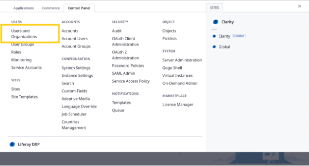

    Aquí puede ver y administrar a todos los usuarios para la instancia actual de Liferay. Esto finalmente y acabada la práctica debería incluir el usuario administrador de Clarity junto con Walter Douglas, Ian Miller, Clara Murphy y Harper Roberts.

    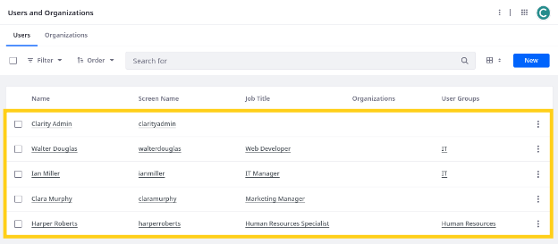

1. Haga clic en *Nuevo*.
1. Para configurar la imagen de perfil del usuario, haga clic en el botón *Cambiar imagen*(![Cambiar el botón de imagen]), haga clic en *Seleccionar*, navegue a la carpeta donde descargasete [Carpeta con recursos para el tema Lección 3](https://github.com/Ies2asixiaw/apuntes/tree/main/ejercicios/liferay/lesson-3) en el espacio de trabajo de entrenamiento, seleccione Christian-CARTER.png y haga clic en *Hecho*.

    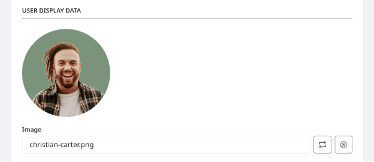

1. Ingrese estos detalles para Christian Carter:

    | **Campo** |**Valor** |
    |:- |:- |
    | Nombre de registro de usuario | christiancarter |
    | Dirección de correo electrónico | christian.carter@clarityvisionsolutions.com |
    | Título del trabajo | Coordinador de marketing |
    | Nombre | Christian |
    | Apellido | Carter |

    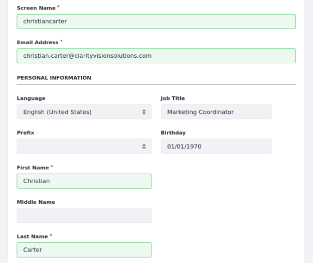

1. Haga clic en *Guardar*.

    Ahora puede acceder a opciones de configuración adicionales para Christian Carter.

1. En el menú izquierdo, haga clic en *Contraseña*.
1. Ingrese aprender para su contraseña.

    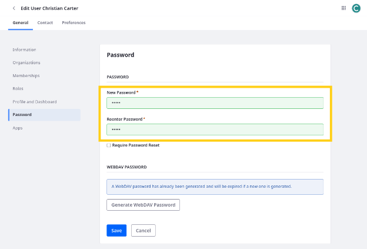

1. Haga clic en *Guardar*.

¡Excelente! Has agregado Christian Carter a la instancia de Liferay de Clarity. A continuación, creará un grupo de usuarios para ayudar a organizar y administrar los usuarios de Clarity.

## Creación y asignacion de grupos de usuarios 

En un escenario del mundo real, las organizaciones como Clarity tienen cientos de usuarios, y administrarlos individualmente es imposible. Para ayudar a reducir la carga de la gestión de usuarios, Liferay proporciona grupos de usuarios para asignar fácilmente roles a los usuarios relacionados. El próximo ejercicio explorará los roles con más detalle.

Para empezar, Clarity necesita estos grupos de usuarios:
|**Nombre del grupo** |**Descripción** |
|:- |:- |
| Recursos humanos | Miembros del Departamento de Recursos Humanos de Clarity.
| IT | Miembros del Departamento de TI de Clarity.
| Marketing | Miembros del departamento de marketing en Clarity.

Aquí creará y asignará el grupo de usuarios *Marketing* de Clarity como usuario administrador de Clarity.

Para hacer esto,

1. Abra el *menú global*(![Menú global]), vaya a la pestaña *Panel de control* y haga clic en *Grupos de usuarios*.

    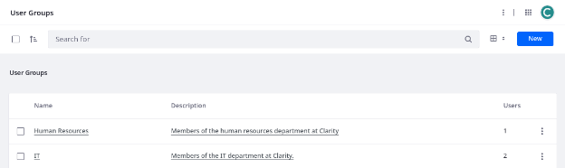

1. Haga clic en *Nuevo*.
1. Ingrese estos detalles para el grupo de usuarios:

    | **Campo** |**Valor** |
    |:- |:- |
    | Nombre | Marketing |
    | Descripción | Miembros del departamento de marketing en Clarity.

    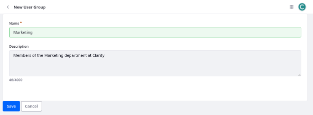

1. Haga clic en *Guardar*.

    Esto crea el grupo de usuarios, por lo que ahora puede agregarle a los usuarios de marketing de Clarity.

1. Haga clic en el grupo de usuarios *Marketing*.
1. Haga clic en *Nuevo*.
1. Seleccione *Christian Carter* y *Clara Murphy*.

    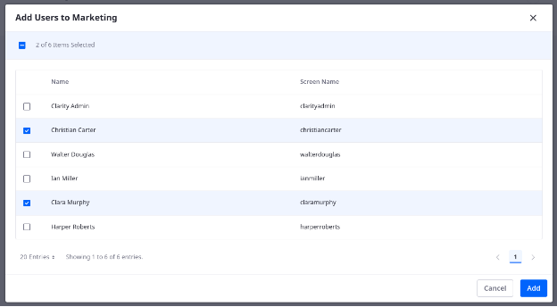

1. Haga clic en *Agregar*.

¡Excelente! Ahora, cualquier rol asignado al grupo de usuarios de marketing se asignará automáticamente a todos los miembros del equipo. A continuación, aprenderá cómo definir y asignar roles personalizados.

## Creación y asignacion de roles de usuario

Cada usuario de la empresa pertenece a diferentes equipos con diferentes responsabilidades. Puede usar roles de Liferay para modelar esta estructura. Un rol es una lista de permisos que capacitan a los usuarios para realizar acciones específicas dentro de la instancia de Liferay.

Si bien se puede aprovechar muchos de los roles predefinidos de Liferay, también quieren estos roles personalizados:

| **Tipo** |**Título** |**Descripción** |
|:- |:- |:- |
| Regular | Administrador de contenido | Para aquellos que administran contenido en Liferay.
| Regular | Gerente de TI | Para un gerente dentro del departamento de TI.
| Regular | Desarrollador web | Rol para un desarrollador front-end dentro del Departamento de TI.
| Regular | Coordinador de marketing | Contribuyente individual del equipo de marketing.
| Sitio | Contribuidor de contenido del sitio | Rol basado en el sitio para aquellos que contribuyen al sitio.|

 Aquí creará y asignará el rol del coordinador de marketing como Administrador.

Para comenzar,

1. Abra el *menú global*(![Menú global]), vaya a la pestaña *Panel de control* y haga clic en *Roles*.
1. Haga clic en *Nuevo*.
1. Ingrese estos detalles para el rol:

    | **Campo** |**Valor** |
    |:- |:- |
    | Tipo | Regular (Normal)|
    | Título | Coordinador de marketing |
    | Descripción | Contribuyente individual del equipo de marketing.
    | Clave | Coordinador de marketing |

    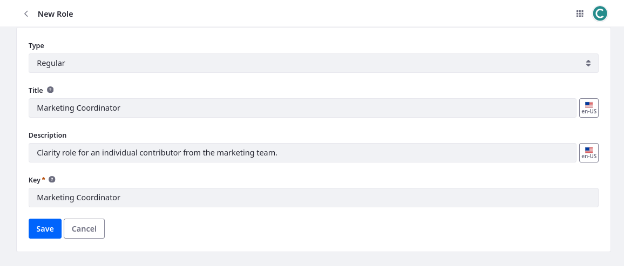

1. Haga clic en *Guardar*.

    Esto crea el rol, por lo que puede agregar permisos y asignarlo a los usuarios. Dado que este rol debe aplicarse a todos los miembros del equipo de marketing, puede asignarlo al grupo de usuarios de marketing.

1. Vaya a la pestaña *Asignados* y haga clic en *Grupos de usuarios*

    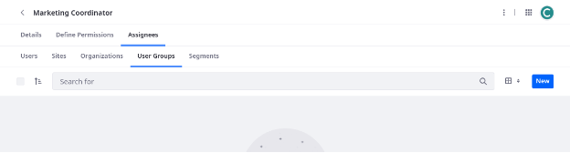

1. Haga clic en *Nuevo*.
1. Seleccione *Marketing*.

    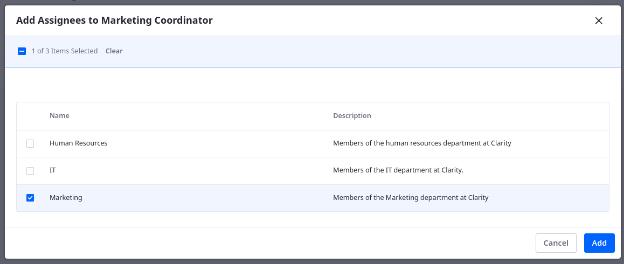

1. Haga clic en *Agregar*.

¡Excelente! Has creado y asignado un rol a los usuarios de marketing de Clarity. Sin embargo, el rol aún no tiene permisos. A continuación, agregará permisos al rol. Esto permite a cualquier persona con el rol cumplir con sus responsabilidades en el sitio web de Clarity.

## Definición de permisos de roles

Los permisos otorgan la capacidad de acceder a datos y realizar acciones específicas en una instancia de Liferay. Ahora que ha creado el rol del coordinador de marketing, comenzará a agregar permisos específicos asociados con el rol.

A lo largo de este proceso, se pasará por suplantar a Christian Carter a ver el efecto práctico de otorgar permisos adicionales del rol de coordinador de marketing.

Para hacer esto,

1. Abra el *menú global*(![Menú global]), vaya a la pestaña *Panel de control* y haga clic en *Usuarios y organizaciones*.
1. Haga clic en *Acciones*(![Botón de acciones]) para Christian Carter y seleccione *SUPLANTAR USUARIO*.

    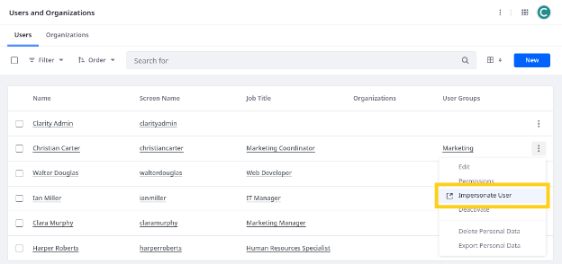

    Esto abre una nueva pestaña donde puede ver la instancia de Liferay utilizando los permisos de Christian Carter.

    Observe cómo no tiene acceso a ninguna de las aplicaciones o recursos que necesita como coordinador de marketing.

    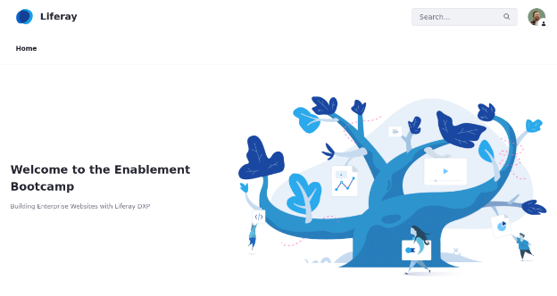
    
    Clarity necesita que todos los coordinadores de marketing tengan acceso al repositorio del equipo.

1. Regrese a la pestaña del navegador donde estas como Administador, vaya a la aplicación *roles* y haga clic en el rol *Coordinador de marketing* para comenzar a editarla.
1. Vaya a la pestaña *Definir permisos*.
1. En el menú izquierdo, vaya a *Menú de aplicaciones*→ *Contenido*→ *Repositorios*.

    **Consejo**: Ingrese "Repositorios" en la barra de búsqueda para localizar rápidamente esta sección.

    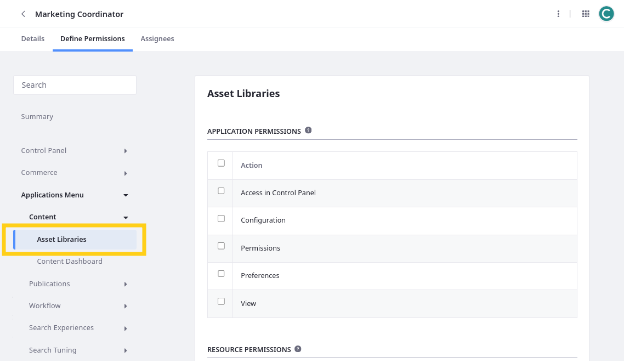

1. Seleccione estos permisos:

    | **Sección** |**Permiso** |
    |:- |:- |
    | Permisos de aplicación | Acceder desde el panel de control |
    | Permisos de aplicación | Ver |
    | Permisos de recursos> Entrada del repositorio | Ver y Ver Menú de Administración del sitio |

1. Haga clic en *Guardar*.

    Esto actualiza los permisos del rol del coordinador de marketing.

    **Nota**: Liferay asigna automáticamente el portal: Ver permiso del menú del panel de control cuando otorga el permiso de acceso del panel de control.

1. Actualiza la pestaña donde estás haciendo pasar por Christian Carter.

    Ahora puede acceder a la aplicación Repositorios en el menú global (![Menú global]).

    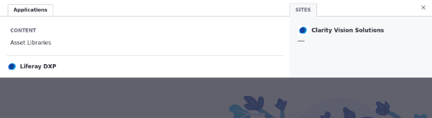

1. Vaya a la aplicación *Repositorios*.

    Aunque Christian Carter puede acceder a la aplicación, no puede ver ni acceder a ninguna biblioteca incluida en el espacio de trabajo:

    - Páginas de error
    - HR
    - Liderazgo
    - Legal
    - Marketing
    - Imágenes de productos

    Dado que Christian Carter y otros miembros del equipo de marketing necesitan acceso al repositorio de Marketing, otorguemos la membresía  utilizando el grupo de usuarios de marketing.

1. Regrese a la pestaña donde esta el usuario Administrador.
1. Abra el *menú global*(![Menú global]), vaya a la pestaña *Aplicaciones* y haga clic en *Repositorios*.
1. Haga clic en *Nuevo* e introduce el nombre de Marketing.
1. Haga clic en *Guardar*. Esto crea una biblioteca y lo redirige a su página de configuración.

    Mas tarde vinculara la biblioteca al sitio de Clarity.

Ahora asignaremos el grupo de usuarios al repositorio

 Una vez dentro del repositorio de Marqueting haga un clic en *membresías* y vaya a la pestaña *Grupos de usuarios*.

    14.A. Haga clic en *Nuevo*.
    14.B. Seleccione *Marketing* y haga clic en *Hecho*.

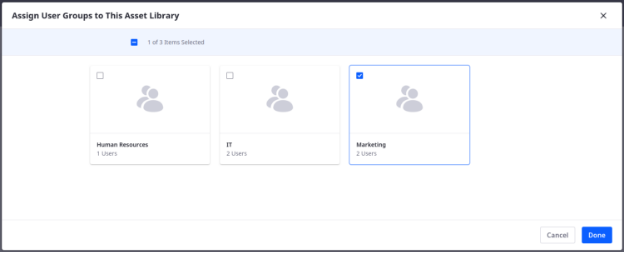


15. Actualiza la pestaña donde estás haciendo pasar por Christian Carter.

    Ahora puede acceder al repositorio de marketing, pero aún no puede acceder a las aplicaciones o datos del repositorio.

    Para resolver esto, asignemos el rol de *Asset Library Administrator* predeterminado al grupo de usuarios de marketing.

1. Regrese a la pestaña con el Administrador.
1. Haga clic en *Acciones*(![Botón de acciones]) para el grupo de usuarios de marketing y seleccione *Asignar roles*.

    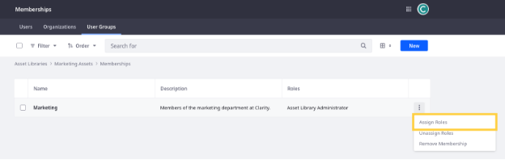

    Aquí puede seleccionar entre los roles de biblioteca o repositorios de activos disponibles. Estos roles otorgan permisos para bibliotecas o repositorios individuales.

1. Seleccione el role *Asset Library Administrator* y haga clic en *Hecho*.
1. Actualiza la pestaña donde estás haciendo pasar por Christian Carter.

    Ahora puede acceder a las aplicaciones de la biblioteca.

    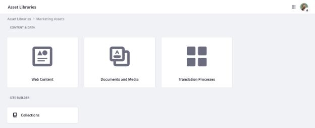

    Aunque Christian Carter puede acceder a las aplicaciones del repositorio, no tiene los permisos de aplicación necesarios para cumplir con sus responsabilidades (por ejemplo, cargar documentos, editar artículos).

    Agreguemos estos permisos al role de coordinador de marketing.

1. Regrese a la pestaña del Administrador, vaya a la aplicación *roles* y haga clic en el  rol *Coordinador de marketing* para comenzar a editarla.
1. Vaya a la pestaña *Definir permisos*.
1. En el menú izquierdo, vaya a *Administración de Repositorios y sitios*→ *Contenido*→ *Documentos y multimedia*.

    **Nota**: Si busca "Documentos y multimedia", aparecen dos opciones con el mismo nombre. Seleccione la opción en Contenido.

1. Seleccione estos permisos:

    | **Sección** |**Permiso** |
    |:- |:- |
    | Permisos generales | Ver menú de administración del sitio |
    | Permisos generales | Ver |
    | Permisos de recursos> Biblioteca de Documentos | Añadir documento |
    | Permisos de recursos> Biblioteca de documentos | Añadir carpeta |
    | Permisos de recursos> Biblioteca de Documentos | Modificar |
    | Permisos de recursos> Biblioteca de Documentos | Ver |
    | Permisos de recursos> Carpeta de documentos | Ver |

1. Haga clic en *Guardar*.
1. En el menú izquierdo, vaya a *Administración de Repositorios y sitios*→ *Contenido*→ *Contenido web*.

    **Nota**: Si busca "Contenido web", aparecen dos opciones con el mismo nombre.Seleccione la opción en Contenido.

1. Seleccione estos permisos:

    | **Sección** | **Permiso** |
    | :- | :- |
    | Permisos generales | Ver menú de administración del sitio |
    | Permisos generales | Ver |
    | Permisos de recursos> Contenido web | Añadir carpeta |
    | Permisos de recursos> Contenido web | Añadir estructura |
    | Permisos de recursos> Contenido web | Añadir plantilla |
    | Permisos de recursos> Contenido web | Añadir contenido web |
    | Permisos de recursos> Contenido web | Modificar |
    | Permisos de recursos> Contenido web | Ver |
    | Permisos de recursos> Artículo de contenido web | Modificar |
    | Permisos de recursos> Estructura de contenido web | Ver |
    | Permisos de recursos> Plantilla de contenido web | Ver |

1. Haga clic en *Guardar*.
1. En el menú izquierdo, vaya a *Administración de repositorios y sitios*→ *Categorización*→ *Categorías*.
1. Seleccione estos permisos:

    | **Sección** |**Permiso** |
    |:- |:- |
    | Permisos de recursos > Categorías de activos | Añadir una categoría |
    | Permisos de recursos > Categorías de activos | Añadir vocabulario |

1. Actualiza la pestaña donde estás haciendo pasar por Christian Carter.

    Ahora puede realizar todas las acciones de contenido necesarias para sus responsabilidades (por ejemplo, crear y editar contenido web).A continuación, los coordinadores de marketing necesitan la capacidad de actualizar las páginas del sitio.

1. Regrese a la pestaña del navegador con el usuario Administrador.
1. En el menú izquierdo, vaya a *Administración de repositorios y sitios*→ *Generador de sitio web*→ *Página*.

    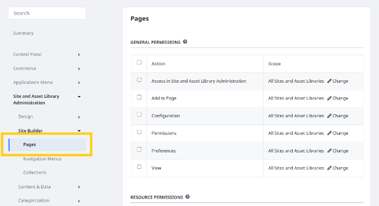

1. Seleccione este permiso.

    | **Sección** |**Permiso** |
    |:- |:- |
    | Permisos de recursos> Página | Modificar |

1. Haga clic en *Guardar*.
1. Actualiza la pestaña donde estás haciendo pasar por Christian Carter.

    Observe que ahora puede acceder a herramientas de edición para páginas del sitio.

    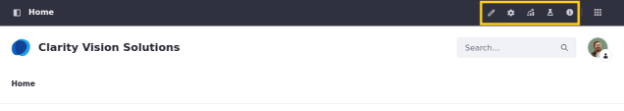

¡Bien hecho! Ahora todos los miembros del grupo de usuarios de marketing tienen los permisos base correctos. Al asignar roles adicionales, Clarity puede garantizar que tengan acceso a las aplicaciones y datos que necesitan.


## Permisos de administrador de ajuste fino

Hasta ahora ha estado utilizando el usuario Administrador para hacer cambios. Este usuario es el Omni-Administator y tiene todos los permisos de Liferay. En los escenarios del mundo real, las empresas deben proteger estrictamente el acceso a este usuario y restringir enormemente qué usuarios tienen privilegios de administración completos. Empresas como Clarity deben establecer roles gerentes que solo tengan los permisos necesarios para sus responsabilidades.

Aquí establecerá un grupo de gestión que tenga autoridad para configurar los permisos para los miembros de su equipo, sin otorgarles los privilegios de administración completos como el usuario administrador de claridad.

Para hacer esto,

1. Vaya a la aplicación *Grupos de usuarios* en el menú global.
1. Cree un grupo de usuarios de gerentes de marketing.
1. Agregue Clara Murphy al grupo.
1. Vaya a la aplicación *roles* en el menú global.
1. Cree un rol de gerente de marketing.
1. Mientras edita el rol *gerente de marketing* , vaya a la pestaña *Definir permisos*.
1. En el menú izquierdo, vaya a *Panel de control*→ *Usuarios*→ *Grupos de usuarios*.
1. Seleccione este permiso:

    | **Sección** |**Permisos** |
    |:- |:- |
    | Permisos de aplicación | Acceder desde el panel de control |

1. Haga clic en *Guardar*.
1. En el menú izquierdo, vaya a *Panel de control *→*Usuarios*→*Usuarios y organizaciones*.
1. Seleccione este permiso:

    | **Sección** |**Permiso** |
    |:- |:- |
    | Recurso> Usuario | Ver |

1. Haga clic en *Guardar*.
1. Vaya a la pestaña *Asignados* y asigne este rol al grupo de usuarios *Gerentes de marketing*.

    Estos permisos otorgan la capacidad de ver la aplicación de los grupos de usuarios y ver a los usuarios.A continuación, le dará permiso al gerente de marketing para ver y agregar miembros para el grupo de usuarios de marketing.

1. Vaya a la aplicación *Grupos de usuarios* en el menú global.
1. Haga clic en *Acciones*(![Botón de acciones]) para el grupo de usuarios de marketing y seleccione *permisos*.
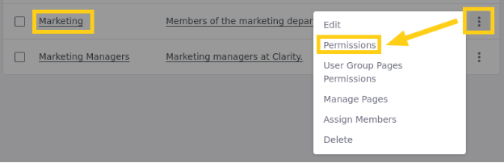


1. Para el rol del gerente de marketing, seleccione estos permisos y haga clic en *Guardar*:

    | **rol** |**Permiso** |
    |:- |:- |
    | Gerente de marketing | Asignar miembros |
    | Gerente de marketing | Buscar miembros |
    | Gerente de marketing | Ver |

    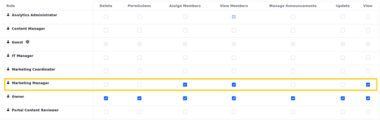

1. Vaya a la aplicación *Usuarios y organizaciones* en el menú global.
1. Suplante a Clara Murphy para verificar los permisos de roles del gerente de marketing.

    Clara debería ver el grupo de usuarios de marketing. También debería poder ver a los miembros del grupo de usuarios y agregar nuevos miembros al grupo.

    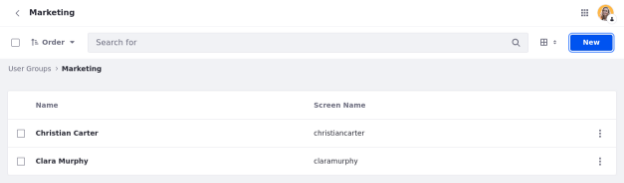

    **Nota**: Este es solo un ejemplo de los tipos de permisos que puede asignar a los roles del gerente.

¡Excelente! Por ahora, ha terminado de configurar los usuarios, grupos de usuarios y roles de Clarity. A continuación, dirigiremos nuestra atención al sitio web de Clarity.

## Crear un sitio


Cuando crea un sitio, puede comenzar desde cero o seleccionar entre plantillas e inicializadores disponibles. Crearemos un nuevo sitio de prueba como Ian Miller que es Gerente de TI por tanto deberemos haber creado el rol con los permisos adecuados para la creación de sitios y haberlos asignados a este usuario

Para hacer esto,

1. Inicie sesión como Ian Miller, Gerente de TI de Clarity.
    - Nombre de usuario: ian.
    - Correo miller@clarityvisionsolutions.com
    - Contraseña: aprender

    **Nota**: Hasta ahora hemos utilizado el usuario del administrador de Clarity, que tiene control completo sobre la instancia de Liferay. En la práctica, es mejor limitar el uso de cuentas de alto nivel para garantizar una seguridad óptima.

1. Abra el *menú global*(![Menú global]), vaya a la pestaña *Panel de control* y haga clic en *Sitios*.
1. Haga clic en *Nuevo*.

    Aquí puede seleccionar entre plantillas e inicializadores disponibles.

1. Seleccione la plantilla *Sitio en blanco*.
1. Tecleamos el nombre que le daremos al portal Clarity.
1. Haga clic en *Añadir*.

Esto crea un nuevo sitio vacío y lo redirige a su página de configuración.

Clarity podría usar este sitio para construir un canal para vender productos a sus distribuidores. Pero para este curso, nos centraremos en optimizar el *sitio web de Clarity*.

A continuación, aprenderá sobre la membresía del sitio y cómo puede otorgar a los usuarios roles específicos del sitio.

## Agregar usuarios a un sitio

Por defecto, cuando crea un sitio , todos los visitantes no autenticados pueden ver sus páginas y contenido públicos. Para los miembros del sitio autenticados, puede otorgar privilegios adicionales utilizando roles de ámbito del sitio. Asignaremos como  miembros del sitio web a, Christian Carter y Harper Robert .

Aquí los agregará al sitio como Ian Miller.

Para hacer esto,

1. Abra el *menú global* (![Menú global]) y seleccione *Sitio web de Clarity* en el panel correcto.
1. Abra el *menú del sitio*(![Menú del sitio]), expandir *miembros* y seleccione *membresía del sitio*.
1. Haga clic en *Nuevo*.
1. Seleccione *Christian Carter* y *Harper Roberts*.
1. Haga clic en *Hecho*.

    ¡Excelente! Ahora ambos usuarios son miembros del sitio y puede asignarles roles del sitio.

    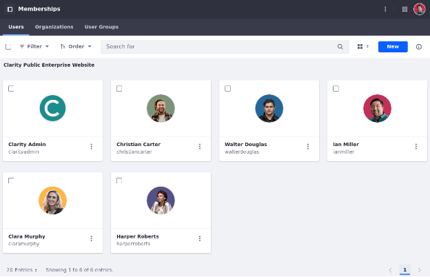

1. Haga clic en *Acciones*(![Botón de acciones]) para Christian Carter y seleccione *Asignar roles*.
1. Seleccione el rol *Contribuidor de contenido* en función del cometido a realizar y haga clic en *hecho*.

    Esto permite a Christian Carter hacer contribuciones al contenido del sitio web de Clarity.

1. Repita los pasos anteriores para asignar el rol de contribuidor de contenido del sitio a Harper Roberts también.

A continuación, comenzará a configurar el sitio web de Clarity para garantizar que sea público y accesible para su público objetivo.

## Asignamos el repositorio de Marketing al Sitio Clarity

Ahora puede vincular la biblioteca al sitio de Clarity.
1. Regrese a la pestaña donde esta el usuario Administrador.
1. Abra el *menú global*(![Menú global]), vaya a la pestaña *Aplicaciones* y haga clic en *Repositorios*.
1. Editamos el repositorio
1. Vaya a la pestaña *Sitios* en el menú de la barra lateral.
1. Haga clic en *Agregar* y seleccione *Sitio web de Clarity*.


## Configuración del sitio

Como se mencionó anteriormente, el propósito del sitio de Clarity es aumentar el conocimiento de la marca, mostrar sus productos y convertir a los visitantes en clientes. Para este fin, Clarity quiere

- Permita que los usuarios invitados se registren libremente como miembros del sitio.
- Establezcer el host virtual de su sitio.
- Configurar su configuración de lenguaje.
- Habilite las herramientas de accesibilidad de Liferay.

Aquí configurará estos ajustes como Clarity’s IT Manager, Ian Miller.

Para hacer esto,

1. Asegúrese de estar en el sitio web *Clarity*.
1. Abra el *Menú del sitio*(![Menú del sitio]), expandir *Configuración* y Seleccione *Ajustes del sitio*.
 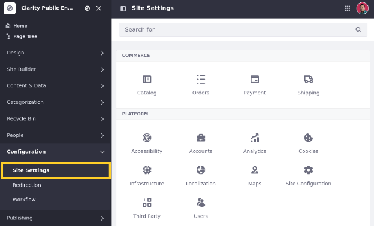

1. Vaya a *Configuración del sitio*→ *Detalles*.
1. Agregue esta descripción:

    Eleve su marca con gafas premium: descubra la artesanía premium, las lentes innovadoras y los diseños que ayuden a que su marca se destaque.

1. Para el tipo de registro de miembros, seleccione *Abierto*.

    Esto permite a los invitados convertirse libremente en los miembros del sitio y acceder a las páginas y contenido públicos del sitio.

    ![Establezca el tipo de membresía del sitio.]

1. Haga clic en *Guardar*.
1. Vaya a la pestaña * URL * del sitio *.
1. Establezca la URL amigable /inicio.

    Esta URL es utilizada por las páginas del sitio y se adjunta a http://localhost:8080/web.

1. Establezca el host virtual del sitio para el idioma predeterminado en www.clarity.com.

    La configuración del host virtual conecta un nombre de dominio (por ejemplo, www.helloworld.com) a un sitio.

    **Nota**: Antes de configurar el host virtual en Liferay, debe comunicarse con su proveedor y establecer el nombre de DNS para apuntar a la dirección IP para su instancia DXP de Liferay.

    Como medida supletoria ya que posiblemente no tengamos un nombre DNS o algún dns de pruebas donde configurarlo.
    Optaremos por modificarlo en el archivo hosts en linux o en windows para comprobar el funcionamiento

1. Haga clic en *Agregar* () para agregar un host virtual adicional para el español con la URL www.claridad.com.

    De esta manera, su audiencia de habla española puede acceder al sitio utilizando un nombre de dominio localizado.

    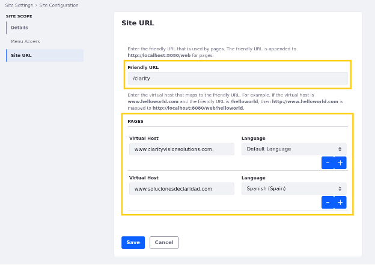

1. Haga clic en *Guardar*.
1. Regrese a la página *Configuración del sitio* y vaya a *Localización*.
1. Haga clic en *Defina un lenguaje predeterminado personalizado* y use el botón *Flecha izquierda*  para eliminar todos los idiomas exceptopara inglés y español.

    Por ahora, Clarity solo quiere dar soporte al inglés (Estados Unidos) y el español (España) para la localización de contenido en su sitio.

    **Consejo**: Para seleccionar varios idiomas a la vez, mantenga presionada la tecla CTRL.

    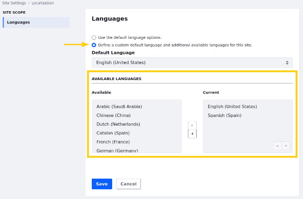

1. Haga clic en *Guardar*.
1. Regrese a la página *Configuración del sitio* y vaya a *Accesibilidad*.
1. Marque la casilla para habilitar el menú de accesibilidad.

    Esto significa que los usuarios pueden presionar TAB dos veces y presionar Enter para acceder a un menú para configurar su configuración de accesibilidad.

    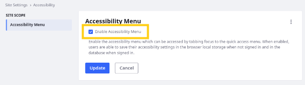

1. Haga clic en *Guardar*.

Juntas, estas configuraciones ayudan al sitio web de Clarity a cumplir su propósito previsto: promocionar sus productos a su audiencia internacional. Liferay proporciona muchas otras configuraciones del sitio, incluidos el manejo de cookies, los tiempos de espera de la sesión y el SEO. Por ahora, estas configuraciones satisfacen las necesidades básicas de Clarity.

Antes de avanzar más lejos, actualicemos la página de inicio predeterminada y la página de destino para la instancia de Clarity.

### Configuracion de las paginas de inicio y destino predeterminadas de la instancia

Actualmente, cuando visita http://localhost:8080/, está dirigido al sitio predeterminado, en lugar del  Sitio web Clarity . Aquí actualizará la raíz del donde te lleva el sitio y las páginas de destino predeterminados para su instancia como administrador de Clarity.

Para hacer esto,

1. Inicie sesión como el usuario administrador de clarity:
    - Nombre de usuario: test@liferay.com
    - Contraseña: (cambiada en primer acceso) o aprender
1. Abra el *menú global*(![Menú global]), vaya a la pestaña *Panel de control* y haga clic en *Configuración de instancia*.
1. En plataforma, haga clic en *Configuración de instancia* y vaya a la pestaña *General*.
1. Para URL de inicio, ingrese /web/clarity.

    Esto establece la página predeterminada que se muestra cuando accede a http://localhost:8080/.

1. Para la página de destino predeterminada, ingrese /web/clarity.

    Esto especifica la página predeterminada a la que se redirigen los usuarios después de iniciar sesión.

1. Para la página de inicio de sesión predeterminada, ingrese /web/clarity.
 Esto define la página predeterminada a la que se redirigen los usuarios después de la sesión.

    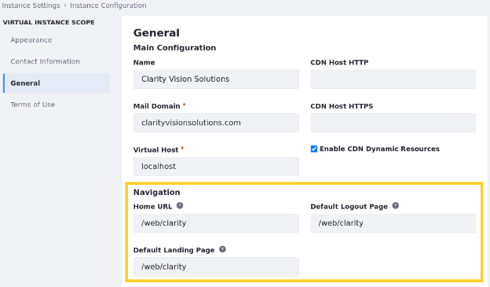

1. Haga clic en *Guardar*.

¡Excelente! Ahora, cuando los usuarios visitan http://localhost:8080/ e inicio de sesión o inician sesión, se dirigen a la página de inicio para el sitio web de Clarity Public.

A continuación, aprenderá cómo Analytics Cloud puede ayudar a las empresas como Clarity a mejorar su estrategia digital y admitir flujos de trabajo basados ​​en datos.


## Agregar páginas de contenido

El sitio web esta compuesto por un conjunto de páginas de diferentes tipos, inicialmente empezaremos con las de tipo contenido.
Como se mencionó anteriormente, Clarity quiere implementar esta jerarquía de página para su sitio web:

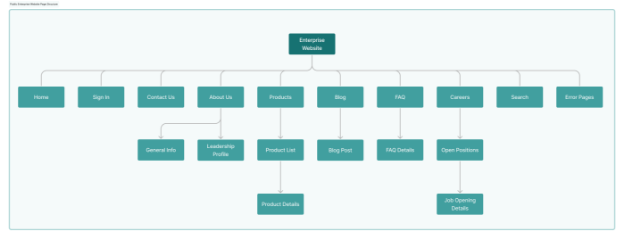

Algunas partes de esta estructura deben implementarse como páginas de contenido, mientras que otras deben ser páginas de visualización o páginas de utilidad. Mostraremos como crear la página de contenido *FAQ* y la página de visualización de *Perfil de liderazgo*.

Aquí agregará la página de contenido que falta como desarrollador web de Clarity, Walter Douglas.

Previamenente Walter Douglas le habremos asignado previamente el rol creado de desarrollador con sus respectivos permisos.

Antes de empezar a crear las páginas de contenido crearemos una 

Para agregar la página de contenido de preguntas frecuentes,

1. Inicie sesión como Walter Douglas.
    - Correo electrónico: walter.douglas@clarityvisionsolutions.com
    - Contraseña: aprender

    **Nota**: Como desarrollador web, Walter Douglas tiene el rol del administrador del sitio y realiza la mayoría de las acciones dentro del sitio web empresarial.

1. Abra el *menú del sitio*(![Menú del sitio]), expandir *Diseño* y hacer clic en *Plantilla de páginas*

1. En la pestaña Patrones, haga clic en *Nuevo* y cree un patrón llamado **maestra**. Este nos servirá posteriormente para proporcionar diseño a las páginas.

1. Abra el *menú del sitio*(![Menú del sitio]), expandir *Generador del Sitio* y hacer clic en *páginas*.

1. En la pestaña Páginas estáticas, haga clic en *Nuevo* y seleccione *Página*.

    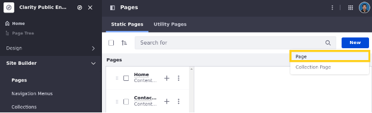

1. Seleccione la plantilla *maestra* previamente creada.

    **Nota**: Esto aplica una plantilla incompleta. Completarás esta plantilla en secciones posteriores.

    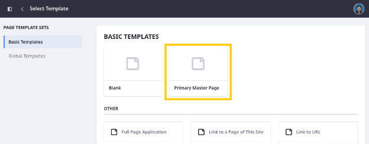

1. Para el nombre, ingrese las preguntas frecuentes y haga clic en *Añadir*.

    Esto crea una página de contenido en blanco y le dirige a la interfaz de usuario de la página de Page de Liferay. Aquí puede acceder a todas las herramientas de creación de páginas y opciones de configuración.

1. Por ahora, deje la página en blanco y haga clic en *publicar*.

    Esta es la página de contenido final que necesita clarity para la estructura de su sitio. Pero necesitan reorganizar algunas páginas para crear la jerarquía deseada.

1. Arrastre y suelte *Detalles del producto* en *Lista de productos* y luego arrastre y suelte *Lista de productos* en *Productos*.

    Esto crea una relación jerárquica entre estas páginas.

    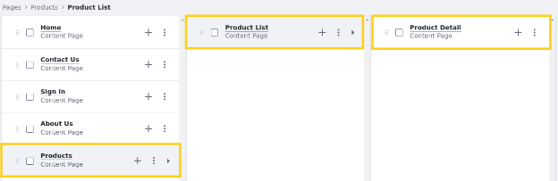

1. Arrastre y suelte *Abra las posiciones* en *carreras*.

Con estas páginas en su lugar, creemos la parte final de la estructura del sitio de Clarity: una página de visualización para sus perfiles de liderazgo.

## Agregar plantillas de páginas de visualización

Las plantillas de páginas de visualización definen estructuras para mostrar contenido en una URL dedicada. Cuando crea o carga elementos de contenido, Liferay genera una URL amigable única para acceder a ella. Sin embargo, solo puede usar esta URL para ver el contenido si crea una de estas plantillas para mostrarla. Las páginas de visualización se construyen utilizando la misma interfaz de usuario y características que las páginas de contenido.
Agregamos la plantilla de *Perfil de liderazgo*. Aquí agregará esta plantilla  como Walter Douglas.

Para hacer esto,

1. Abra el *menú del sitio* (![Menú del sitio]), expandir *diseño* y haga clic en *plantillas de página*.
1. Vaya a la pestaña *Plantilla de página de visualización*.
1. Haga clic en *Nuevo*.
1. Seleccione *en blanco*.
1. Para el nombre, ingrese el perfil de liderazgo.
1. Para el tipo de contenido, seleccione *Artículo de contenido web*.
1. Para el subtipo, seleccione contenido web pero posteriormente lo cambiaremos a *Perfil de liderazgo* una vez alcanzado el tema de contenido.

    **Nota**: El subtipo de perfil de liderazgo seproporcionara posteriormente Aprenderá más sobre los tipos de contenido web en una lección posterior.

    

1. Haga clic en *Guardar*.

    Esto crea una plantilla de página de pantalla en blanco que está vinculada al tipo de contenido seleccionado. Cada plantilla tiene las mismas herramientas de creación de páginas y opciones de configuración que las páginas de contenido.

1. Por ahora, deje la plantilla en blanco y haga clic en *publicar*.
1. Haga clic en *Acciones*(![Botón de Acciones]) para la plantilla de perfil de liderazgo y seleccione *Marque como predeterminado*.

    Esto garantiza que los artículos de *contenido web* posteriormete *perfil de liderazgo* usen esta plantilla.

    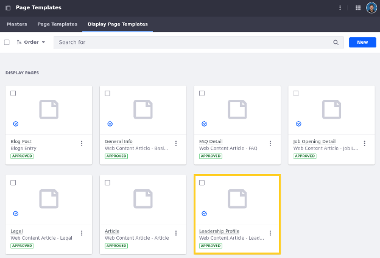

    Por ahora, dejaremos esta plantilla en blanco, pero la volveremos a visitar en un ejercicio posterior. Con la estructura de página de Clarity completa, terminemos de diseñar el encabezado para las páginas de Clarity.

---


[Liferay.com](https://www.liferay.com)

[Ask](https://liferay.dev/ask)

[Eventos](https://www.liferay.com/events)

[Encuentro](https://liferay.dev/meet)

---
Conectar

[](https://github.com/liferay)
[](https://www.linkedin.com/company/liferay-inc-)
[](https://www.youtube.com/user/liferayinc)
[](https://www.facebook.com/pages/liferay/45119213107)
[](https://www.instagram.com/liferayinc/)
[](https://www.twitter.com/liferay)

[Ref1]: img/liferay/Aspose.Words.5f3ba04a-e2dd-4320-bdee-832ac45207ea.002.png
[Ref2]: img/liferay/Aspose.Words.5f3ba04a-e2dd-4320-bdee-832ac45207ea.003.png
[Ref3]: img/liferay/Aspose.Words.5f3ba04a-e2dd-4320-bdee-832ac45207ea.004.png
[Ref4]: img/liferay/Aspose.Words.5f3ba04a-e2dd-4320-bdee-832ac45207ea.007.png
[Ref5]: img/liferay/Aspose.Words.5f3ba04a-e2dd-4320-bdee-832ac45207ea.012.png
[Menú global]: img/liferay/Aspose.Words.5f3ba04a-e2dd-4320-bdee-832ac45207ea.030.png
[Cambiar el botón de imagen]: img/liferay/Aspose.Words.5f3ba04a-e2dd-4320-bdee-832ac45207ea.033.png
[Botón de acciones]: img/liferay/Aspose.Words.5f3ba04a-e2dd-4320-bdee-832ac45207ea.043.png
[Menú del sitio]: img/liferay/Aspose.Words.5f3ba04a-e2dd-4320-bdee-832ac45207ea.056.png
[Fragmentos y widgets]: img/liferay/Aspose.Words.5f3ba04a-e2dd-4320-bdee-832ac45207ea.072.png
[Pestaña del navegador]: img/liferay/Aspose.Words.5f3ba04a-e2dd-4320-bdee-832ac45207ea.073.png