
# Construyendo  Sitios Web Empresariales con Liferay (Segunda Parte)

- [Introducción: Construyendo el sitio web de la empresa Clarity Segunda Parte](#introducción-construyendo-el-sitio-web-de-la-empresa-clarity-segunda-parte)

- [Diseño de las páginas maestras de Clarity](#diseño-de-las-páginas-maestras-de-clarity)
- [Configuración de fragmentos permitidos](#configuración-de-fragmentos-permitidos)
- [Creación de una página maestra secundaria](#creación-de-una-página-maestra-secundaria)
- [Aplicar las páginas maestras](#aplicar-las-páginas-maestras)
- [Creación de menús de navegación](#creación-de-menús-de-navegación)
- [Actualización de fragmentos de visualización del menú](#actualización-de-fragmentos-de-visualización-del-menú)
- [Creación de fragmentos personalizados](#creación-de-fragmentos-personalizados)
- [Importación de fragmentos](#importación-de-fragmentos)
- [Agregar fragmentos personalizados a las páginas maestras](#agregar-fragmentos-personalizados-a-las-páginas-maestras)
- [Agregar composiciones de fragmentos a las páginas](#agregar-composiciones-de-fragmentos-a-las-páginas)
- [Actualización del tema predeterminado, Favicon y logotipo de Clarity](#actualización-del-tema-predeterminado)

- [Creación de Repositorios](#creación-de-repositorios)
- [Agregar el logotipo de Clarity a las páginas maestras](#agregar-el-logotipo-de-clarity-a-las-páginas-maestras)

- [Creación de estructuras de contenido web](#creación-de-estructuras-de-contenido-web)
- [Creación de artículos de contenido web](#creación-de-artículos-de-contenido-web)
- [Mapeo de contenido a fragmentos](#mapeo-de-contenido-a-fragmentos)

---

## Introducción Construyendo el sitio web de la empresa Clarity Segunda Parte

A lo largo de este tema, continuaremos creando la web según las necesidades de Clarity tratando aspectos de diseño de marca así como de contenido.
Partiremos de una instancia docker de la práctica anterior.

 En el camino, actuará como diferentes usuarios de Clarity para demostrar cómo pueden contribuir a la solución.

## Diseño de las páginas maestras de Clarity

En Liferay, el diseño de encabezados y pies de página implica crear plantillas de página maestra. Estas plantillas están diseñadas utilizando las mismas herramientas y elementos que las páginas.

Ya tenemos creado la *Plantilla de página maestra*. Si bien esta plantilla inicialmente la dejamos en blanco por tanto incluiremos el pie de página, asi como el encabezado. Actuaremos como Walter Douglas.

Para hacer esto,

1. Mientras esté en la aplicación de plantillas de página, vaya a la pestaña *Patrones*.
1. Haga clic en la plantilla *maestra* para comenzar a editarla.
1. Abra los *fragmentos y widgets* Tab (![Fragmentos y widgets]) en el panel lateral izquierdo.
1. Arrastre y suelte un fragmento *contenedor* en la parte superior de la plantilla. Este contenedor es para el encabezado de la página.

    **Nota**: Al diseñar una página, se recomienda poner siempre elementos en sus propios contenedores. Esto puede ayudar a proporcionar más control sobre el estilo.

1. Vaya a la pestaña *navegador* en el panel lateral (![Pestaña del navegador]), haga doble clic en el nombre del contenedor y cambie el nombre del encabezado de la página.

    **Nota**: El nombramiento de fragmentos agrega un atributo de nombre personalizado al **div** que puede usar en su JavaScript y CSS. Esto puede ayudar a brindar claridad a las estructuras de página complejas y proporcionar más control sobre su sitio.

1. Agregue dos contenedores separados al contenedor de encabezado de la página y nombrelos como barra de anuncio de encabezado y barra de navegación del encabezado.
    - **Barra de anuncio de encabezado**: Este contenedor es para mostrar los anuncios de Clarity.
    - **Barra de navegación de encabezado**: Este contenedor es para elementos esenciales, incluido el logotipo de Clarity, el menú de navegación principal, la barra de búsqueda y el menú de usuario.

    **Consejo**: Para duplicar un elemento de página mientras se edita, presione Ctrl + D.

    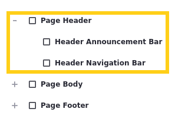

1. Seleccione la *barra de anuncio de encabezado* y configure estos ajustes en el panel de configuración del panel:

| **Tab** |**configuración** |**Valor** |
|:- |:- |:- |
| General | Visualización de contenido | Fila Flexible |
| General | Alinear elementos | Centro |
| General | Justificar contenido | Centro |
| Estilos | Espacio> Pading | Espaciador 2 (arriba e inferior) |

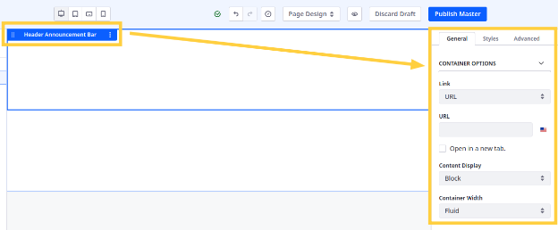

**Nota**: Use las cajas verdes para agregar relleno. Esto agrega espacio entre el contenedor y su contenido.

Verá que estas configuraciones entran en vigencia cuando agregue elementos de página al contenedor.

Por ahora, deje este contenedor vacío y cambia su visibilidad (); Lo volverás a visitar en un ejercicio posterior.

8. Seleccione el contenedor *Barra de navegación del encabezado* y configure estos ajustes:

| **Tab** |**configuración** |**Valor** |
|:- |:- |:- |
| General | Ancho del contenedor | Ancho fijo |
| Estilos | Espacio>Padding | Espaciador 3 (arriba e inferior)   espaciador 6 (izquierda y derecha) |

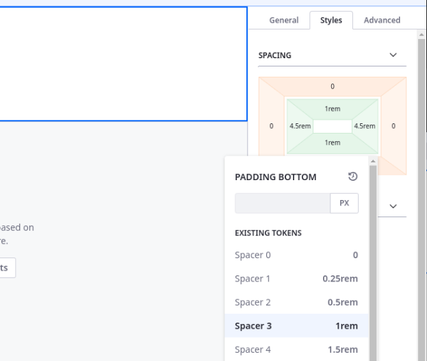

9. Agregue un elemento *cuadrícula* al contenedor de barra de navegación del encabezado.
1. Amplie el módulo central arrastrando los divisores hacia afuera un espacio en cada lado.

    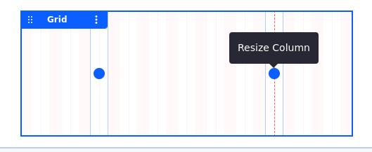

1. Seleccione la cuadrícula y configure estos ajustes:

| **Tab** |**configuración** |**Valor** |
|:- |:- |:- |
| General | Alineación vertical | Medio |
| General | Desbordamiento | Visible |

12. Agregue un contenedor a cada área de la cuadrícula y nombralos como marca del encabezado, navegación del encabezado y acciones del usuario del encabezado.
    - **Marca de encabezado**: Este contenedor es para el logotipo de Clarity.
    - **Navegación encabezado**: Este contenedor es para el menú de navegación de la página.
    - **Acciones del usuario del encabezado**: Este contenedor es para la barra de búsqueda y el inicio de sesión/menú del usuario.

    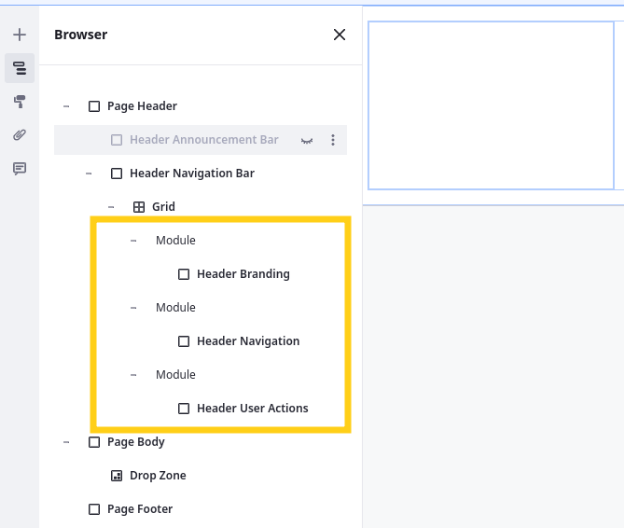

1. Seleccione el contenedor *Marca de encabezado* y configure estos ajustes:

| **Tab** |**configuración** |**Valor** |
|:- |:- |:- |
| General | Visualización de contenido | Fila Flexible |
| General | Alinear elementos | Centro |
| General | Justificar contenido | Comienzo |

14. Seleccione el contenedor *navegación encabezado* y configure estos ajustes:

| **Tab** |**configuración** |**Valor** |
|:- |:- |:- |
| General | Visualización de contenido | Fila Flexible |
| General | Alinear elementos | Centro |
| General | Justificar contenido | Centro |

15. Seleccione el contenedor *Acciones del usuario del encabezado* y configure estos ajustes:

| **Tab** |**configuración** |**Valor** |
|:- |:- |:- |
| General | Visualización de cotenido | Fila Flexible |
| General | Alinear elementos | Centro |
| General | Justificar contenido | Final |

16. Agregue estos fragmentos a los contenedores:

| **Contenedor** |**Fragmento** |
|:- |:- |
| Marca de encabezado | Imagen |
| Navegación de encabezado | Visualización del Menú |
| Acciones del usuario del encabezado | Widget Login "personalizado" |

**Nota**: En una lección posterior, creará un fragmento personalizado para el botón de búsqueda del encabezado.

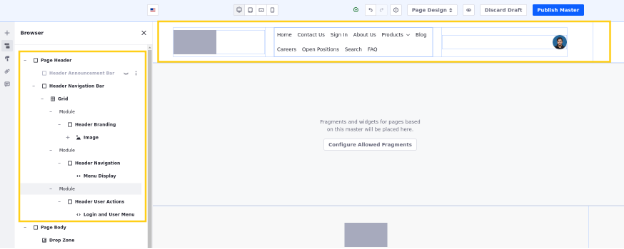

Por ahora, esto completa la distribución de la página maestra principal. Lo volverá a visitar nuevamente en las siguientes lecciones para actualizar sus menús y agregar la barra de búsqueda. A continuación, configurará los fragmentos permitidos de la plantilla.

## Configuración de Fragmentos permitidos

Al editar una plantilla de página maestra, puede configurar qué fragmentos están permitidos en las páginas que usan la plantilla. Esto ayuda a garantizar un diseño consistente y evita que los usuarios agregue elementos incorrectos a las páginas que usan la plantilla.

Para garantizar que los usuarios solo agreguen los fragmentos apropiados a las páginas con la plantilla de página principal maestra, Clarity quiere limitar los fragmentos disponibles. Aquí configurará los fragmentos permitidos para la plantilla de página principal principal como Walter Douglas.

Para hacer esto,
1. Mientras edita la plantilla de página maestra primaria, haga clic en *Configure los fragmentos permitidos* en el contenedor del cuerpo de la página.
1. Desmarca estos fragmentos para evitar que los usuarios los agregue a las páginas usando la plantilla:
    - Cuenta (conjunto de fragmentos)
    - Cesta de la compra (conjunto de fragmentos)
    - Pies de página (conjunto de fragmentos)
    - Barras de navegación (conjunto de fragmentos)
    -  Navegación por la base de conocimiento (fragmento)
    - Añadir a la cesta (fragmento)

    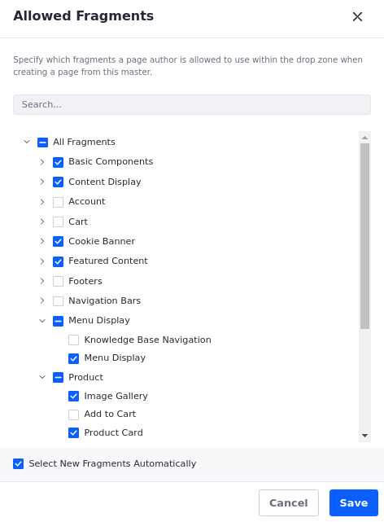

1. Haga clic en *Guardar*.
1. Haga clic en *Publicar maestro*.
1. Haga clic en *Aceptar* en la ventana emergente que indique:

Los cambios realizados en este maestro se propagarán a todas las plantillas de página, mostrar plantillas de página y páginas que lo usen. ¿Estás seguro de que quieres continuar?

Ahora, cuando la plantilla se aplica a una página, los usuarios solo pueden agregar los fragmentos permitidos a la página. Pero antes de aplicar la plantilla a cualquier página, creemos la página maestra secundaria que Clarity quiere usar para sus páginas de inicio de sesión y utilidad.

## Creación de una página maestra secundaria

Clarity necesita una página maestra simplificada para páginas que no deberían incluir el banner de anuncio y el pie de página detallado. Aquí crearás esa plantilla como Walter Douglas.

Para hacer esto,

1. Mientras esté en la pestaña Patrones de la aplicación de plantillas de página, haga clic en *Acciones*(![Botón de acciones]) para la página maestra primaria y seleccione *hacer una copia*→ *página maestra*.

    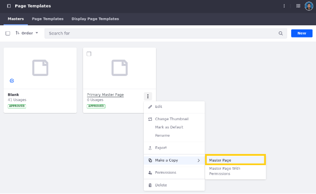

1. Haga clic en *Acciones*(![Botón de Acciones]) para la copia y seleccione *renombrar*.
1. Ingrese la página maestra secundaria y haga clic en *Guardar*.
1. Comience a editar la plantilla y retire estos contenedores:
    - Barra anunciadora de encabezado
    - Marca de pie de página
    - Navegación de pies

    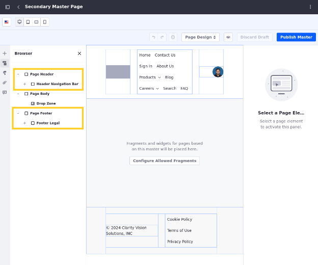

1. Haga clic en *Publicar maestro*.

¡Excelente! Clarity ahora tiene una plantilla de página maestra primaria y secundaria. Ahora puede aplicar ambas páginas maestras a sus respectivas páginas.

## Aplicar las páginas maestras

Cuando crea una página de contenido o una plantilla de página de visualización, debe seleccionar una página maestra. Si bien ya tenemos páginas que usan la página maestra correcta, varias páginas no.

Aquí configurará estas páginas que les asigará la página maestra correcta como Walter Douglas.

Para acceder a la plantilla de página de visualización, abra el menú *del sitio*(![Menú del sitio]), expandir *Diseño*, Haga clic en *Plantillas de página* y vaya a la pestaña *Plantilla de página de visualización*.

Para hacer esto,

1. Comience a editar una de estas páginas.
    - Inicio (página de contenido) (Home)
    - Iniciar sesión (página de contenido) (Sign in)
    - Perfil de liderazgo (plantilla de página de visualización) (LeaderShip Profile)

1. Vaya a las opciones de diseño *de la página* Tab () en el panel del lado izquierdo.
1. Seleccione la página maestra *apropiada*.
    - **Inicio**: Página maestra principal
    - **Iniciar sesión**: Página maestra secundaria
    - **Perfil de liderazgo**: Página maestra secundaria

    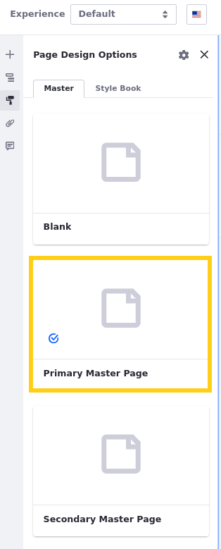

1. Haga clic en *publicar*.
1. Repita este proceso hasta que haya terminado de aplicar las páginas maestras. Una vez finalizado, cada página debe vincularse a la plantilla de página maestra correcta. Ahora cualquier cambio realizado en las plantillas se aplica automáticamente a cada página que la ha utilizando.

A continuación, creará menús de navegación personalizados y los usará para estas plantillas de página maestra para que solo incluyan las páginas deseadas.

## Creación de menús de navegación

La navegación es una parte integral del diseño de una experiencia de usuario clara e intuitiva. En Liferay, configurar la navegación implica crear menús y luego agregarlos a páginas usando widgets o fragmentos.

 Necesitan un menú para el encabezado de  página que solo incluye estas páginas: productos, sobre nosotros, blog, preguntas frecuentes, carreras y contáctenos.

Aquí creará este menú de navegación personalizado como Walter Douglas.

Para hacer esto,

1. Abra el *menú del sitio*(![Menú del sitio]), expandir *Generador del stio* y hacer clic en *Menús de navegación*.
1. Haga clic en *Nuevo*.
1. Para el nombre, ingrese el menú de la página del encabezado.

    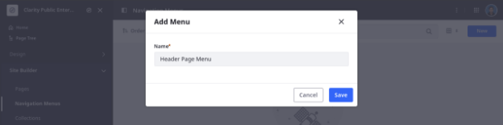

1. Haga clic en *Guardar*.

    Esto crea un menú en blanco y le dirige a su página de edición. Ahora puede agregarle páginas.

1. Haga clic en *Nuevo*. Esto muestra una lista de tipos disponibles de elementos que puede agregar al menú.
1. Seleccione el tipo de elemento *página*.

    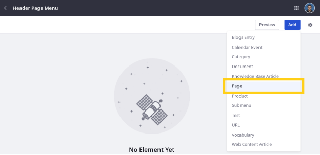

1. Verifique estas páginas:
- Acerca de nosotros
- Blog
- Carreras
- Contáctenos
- Preguntas frecuentes
- Productos

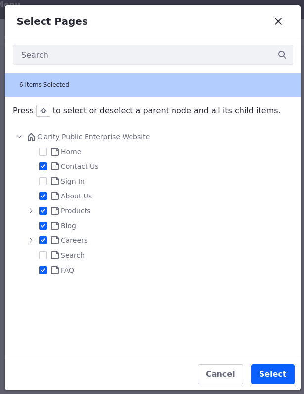

8. Haga clic en *Seleccionar*.Esto guarda sus cambios en el menú.
1. Haga clic en *Acciones*(![Botón Acciones]) para uno de los elementos del menú y seleccione *Ver información*. Esto abre un panel lateral donde puede actualizar el nombre que aparece en pantalla si lo desea.

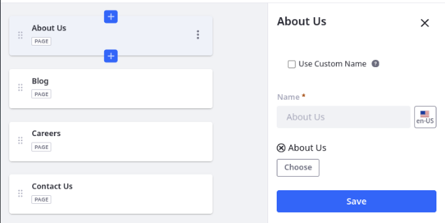

10. Arrastre y deje caer las páginas en este orden:
    - Productos
    - Acerca de nosotros
    - Blog
    - Preguntas frecuentes
    - Carreras
    - Contáctenos

Estos cambios se guardan automáticamente, por lo que el menú está listo para usar.

Ahora que se define el menú de la página del encabezado, puede actualizar el fragmento de visualización del menú en el encabezado que se aplicará a cada página que dependa de la plantilla maestra. Pero antes de regresar a las páginas maestras de Clarity, actualicemos su menú de recursos de pie de página para incluir la página FAQ creada recientemente.

11. Regrese a la página de descripción general *Menús de navegación*.
1. Seleccione *Menú de recursos de pie de página*.
1. Haga clic en *Agregar*.
1. Seleccione el tipo de elemento *página*.
1. Verifique *FAQ*.
1. Haga clic en *Seleccionar*.

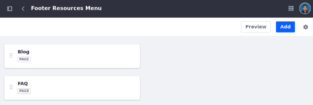

Con los menús de navegación de Clarity completos, volvamos a las plantillas de página maestra de Clarity y actualicen la sección de visualización de menú de encabezado para usar el menú de navegación correcto.

## Actualización de fragmentos de visualización del menú

Cuando agrega un fragmento o widget de visualización de menú a una página, puede determinar qué menú mostrar. Aquí actualizará el fragmento del menú de encabezado en las páginas maestras de Clarity como Walter Douglas.

Para hacer esto,

1. Comience a editar la plantilla *Página maestra principal*.
1. Seleccione la pantalla *Menú* Fragmento en el encabezado.
1. En el panel lateral de configuración, haga clic en *Origen* (![Cambiar el botón de imagen]) para cambiar la fuente del menú.
1. Haga clic en *Menú de la página de encabezado* y haga clic en *Seleccione este nivel*.

    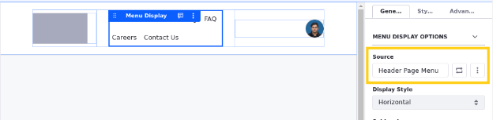

1. Click *Publicar Plantilla Maestra*
1. Repita este proceso para actualizar los fragmentos de visualización del menú de la página maestra secundaria.

Una vez terminado, navegue a la página de inicio para ver cómo sus cambios en la plantilla se aplicaron automáticamente a las páginas conectadas.

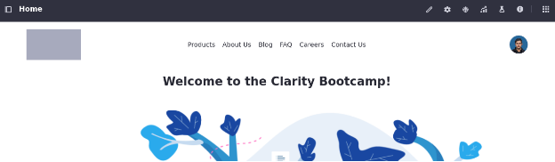

Las páginas maestras de Clarity casi están listas. Ahora solo necesitan un fragmento de botón de búsqueda personalizado para agregar al encabezado.

## Creación de fragmentos personalizados

Los fragmentos de página son elementos reutilizables de arrastrar y soltar para diseñar diseños de página, mostrar contenido, formularios de construcción y más. Se construyen utilizando HTML, CSS y JavaScript y pueden proporcionar tanto estructura como funcionalidad a las páginas. Liferay ofrece una variedad de fragmentos predeterminados, pero puede desarrollar el suyo propio.

Nuestra web necesitará un conjunto de fragmentos personalizados que llamaremos componentes de clarity. En este conjunto que crearemos previamente añadiremos  un fragmento de botón de búsqueda personalizado. Aquí lo crearás como Walter Douglas.

Para hacer esto,

1. Abra el *menú del sitio*(![Menú del sitio]), expandir *diseño* y haga clic en *fragmentos de página*.
1. Creamos el conjunto de fragmentos *Componentes de claridad*
1. En conjuntos de fragmentos, haga clic en *Componentes de claridad*.
1. Haga clic en *Nuevo*, seleccione *Fragmento básico* y haga clic en *Siguiente*.

    Ingrese el nombre botón de búsqueda y haga clic en *Agregar*.
1. Vaya a la pestaña *Configuración* y copie el contenido del archivo de búsqueda-botton-configuration.json en el editor. Este archivo está en la carpeta descargada de[Repositorio-Ejercicios](https://github.com/Ies2asixiaw/apuntes/tree/main/ejercicios/liferay/lesson-8).

    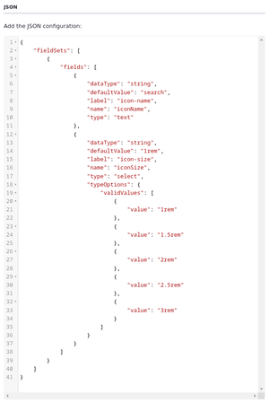

Esto define dos opciones de configuración para el fragmento: iconname e iconsize. Puede hacer referencia a estas opciones en el código del fragmento.

6. Regrese a la pestaña *Código* y reemplace el contenido de la ventana HTML con el contenido del archivo Search-Button.ftl. Este archivo también se encuentra en la carpeta descargada de [Repositorio-Ejercicios](https://github.com/Ies2asixiaw/apuntes/tree/main/ejercicios/liferay/lesson-8).

    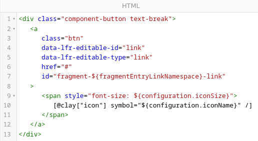

Observe que esto incluye referencias a las opciones de configuración que definió en el paso anterior: ${Configuration.iconsize} y ${Configuration.iconName}. De esta manera, puede configurar el nombre y el tamaño del icono cuando agrega el fragmento a una página.

7. Haga clic en *publicar*.

Ahora puede agregar este fragmento a las páginas maestras de Clarity. Pero antes de hacer esto, importemos algunos fragmentos adicionales que usará a lo largo de los siguientes ejercicios.

## Importación de fragmentos

Al construir páginas con fragmentos, puede guardar cualquier contenedor y su contenido como composición para la reutilización. El equipo de Clarity ha proporcionado algunos fragmentos para transmitir la página de inicio, la página de preguntas frecuentes y la página de visualización de perfil de liderazgo. Para usar estos fragmentos, primero debe importarlos a su sitio como Walter Douglas.

Mientras que en la aplicación de fragmentos,

1. En conjuntos de fragmentos, haga clic en *Composiciones de página de claridad*.
1. Haga clic en *Acciones *(![Botón Acciones]) para el conjunto de fragmentos y seleccione *import*.
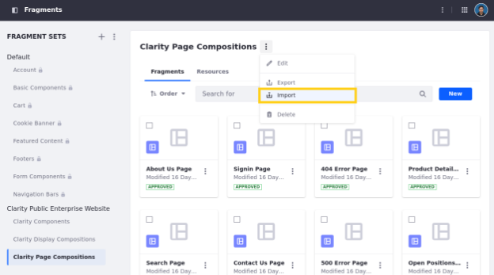

1. Haga clic en *Seleccione Archivo*, Descargue de [Repositorio-ejercicios](https://github.com/Ies2asixiaw/apuntes/tree/main/ejercicios/liferay/lesson-8), navegue a la carpeta descargada y seleccione Page-Composition-FAQ.zip File.
1. Haga clic en *Importar*.
1. Haga clic en *Hecho* Cuando termine.

    Esto agrega la composición de la página de preguntas frecuentes al conjunto de fragmentos actual. Ahora puede importar la composición de la página de visualización.

1. Repita los pasos anteriores para importar estas composiciones:

| **Conjunto de fragmentos** |**archivo** |
|:- |:- |
| Composiciones de página de claridad | Page-Composition-Home.zip |
| Composiciones de visualización de claridad | Pantalla-Composición-Ladership-Profile.zip |

¡Excelente! Ahora que ha creado e importado los fragmentos personalizados de Clarity, puede incorporarlo a las páginas.

## Agregar fragmentos personalizados a las páginas maestras

Después de crear el fragmento de botón de búsqueda, lo agregará a las páginas maestras primarias y secundarias como Walter Douglas.

Para hacer esto,

1. Abra las aplicación *plantillas de página* y comience a editar *Página maestra primaria*.
1. Agregue el botón *Fragamento Botón*  al contenedor de acciones del usuario del encabezado.

    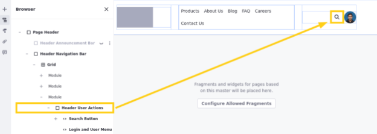

1. En el panel lateral del navegador (![Pestaña del navegador]), seleccione el subelemento *link* dentro de el fragmento del botón de búsqueda.
1. En el panel del lado de la configuración, vaya a la pestaña *link* y configure estos establecidostings:

      | **Tab** |**configuración** |**Valor** |
      |:- |:- |:- |
      | Enlace | Enlace | Página |
      | Enlace | Página | Búsqueda |

    Ahora, cuando los usuarios hacen clic en el botón, están dirigidos a la página de búsqueda de Clarity.

5. Haga clic en *Publicar plantilla maestra*.
1. Haga clic en *Aceptar* en la ventana emergente.
1. Repita estos pasos para actualizar *página maestra secundaria*.

¡Excelente! A continuación, agregemos las composiciones de fragmentos importados a las páginas de Clarity.

## Agregar composiciones de fragmentos a las páginas

Las composiciones de fragmentos son un conjunto reutilizable de elementos de página guardados dentro de un conjunto de fragmentos. Puede usarlos para duplicar rápidamente los diseños entre las páginas del sitio para acelerar el desarrollo y lograr un diseño más consistente.

Aquí agregará las composiciones de fragmentos a sus páginas correspondientes como Walter Douglas.

Para hacer esto,

1. Comience a editar una de estas páginas o página de visualización:
    - Inicio (página de contenido)
    - Preguntas frecuentes (página de contenido)
    - Perfil de liderazgo (plantilla de página de visualización)
1. Arrastre y suelte la composición del fragmento correspondiente en el área de contenido central de la página.

    **Nota**: Para la página de inicio, elimine su contenido predeterminado antes de agregar la composición del fragmento.

    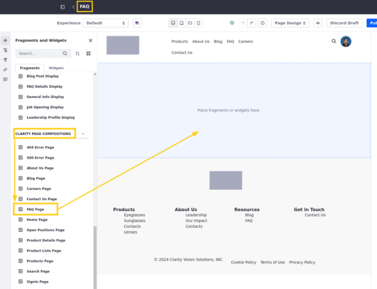

3. Haga clic en *publicar*.
1. Repita este proceso hasta que haya terminado de agregar las composiciones de la página a las otras páginas.

¡Felicidades! Has terminado de alzar las páginas de Clarity. A continuación, aplicará su marca al sitio.

## Actualización del tema predeterminado

Liferay empodera a los usuarios con un conjunto de potentes herramientas de estilo para usuarios técnicos y no técnicos, asegurando una identidad visual constante y una experiencia de usuario en su sitio web. Hasta ahora, hemos utilizado las opciones de estilo predeterminadas del tema clásico.

Aquí usará la extensión del cliente CSS del tema para sobrescribir estas opciones como Walter Douglas. También actualizará el favicon y el logotipo del sitio para que la plataforma se alinee más estrechamente con la marca Clarity.

Para hacer esto,

1. Abra el *menú del sitio*(![Menú del sitio]), expandir *Generador del sitio* y hacer clic en *páginas del sitio web*.
1. Haga clic en *Acciones*(![Botón de acciones]) en la barra de aplicación y seleccione *Configuración*.
1. Haga clic en *Cambiar el tema actual* y seleccione *Dialect*.

    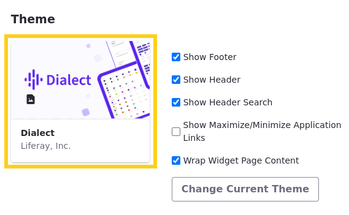

    **Nota**: Los temas determinan la apariencia de línea de base para su sitio web, incluidos esquemas de color, tipografía, espaciado y otras opciones de estilo. Sirven como punto de partida para configuraciones adicionales que puede hacer con libros de estilo y extensiones de clientes frontends.

1. En Configuración básica, haga clic en *Seleccione Icono de página* (![Seleccione Favicon][Cambiar el botón de imagen]) y agregue el archivo Clarity-Favicon.svg que se encuentra en la carpeta que se descarga de [Repositorio-Ejercicios](https://github.com/Ies2asixiaw/apuntes/tree/main/ejercicios/liferay/lesson-8).

    **Nota**: los favicones son imágenes utilizadas para identificar sitios en las pestañas del navegador.

1. Haga clic en *Cambiar logotipo* (![Cambiar el botón de imagen]) y seleccione el archivo Clarity-logo-c.png.

    **Nota**: El logotipo determina la imagen utilizada para identificar el sitio en la interfaz de usuario de Liferay.

    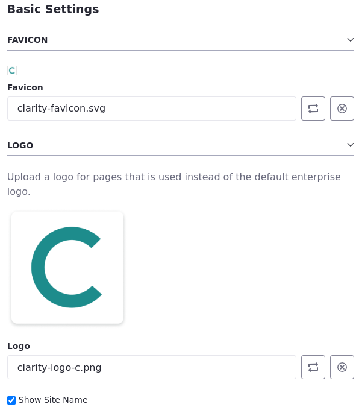

1. Desplácese hacia abajo hacia abajo y haga clic en *Guardar*.

Ahora puede explorar las páginas del sitio para ver cómo estas configuraciones han afectado el sitio.

## Creación de Repositorios

Las Repositorios son espacios para almacenar documentos, medios de comunicación y artículos de contenido web. Puede conectar cada biblioteca a varios sitios, lo que le permite compartir sus recursos en múltiples contextos.

Aquí, creará una biblioteca para los activos de marca como Walter Douglas.

Para hacer esto,

1. Abra el *menú global*(![Menú global]), vaya a la pestaña *Aplicaciones* y haga clic en *Repositorios*.
1. Haga clic en *Nuevo* e intoduce el nombre Clarity Marca y el logotipo.
1. Haga clic en *Guardar*. Esto crea una biblioteca y lo redirige a su página de configuración.

    Ahora puede vincular la biblioteca al sitio de Clarity.

1. Vaya a la pestaña *Sitios* en el menú de la barra lateral.
1. Haga clic en *Agregar* y seleccione *Sitio web de Clarity Public*.

    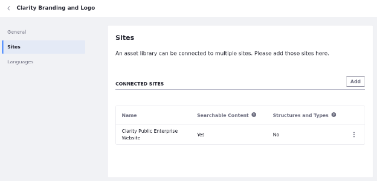

    Esto permite a los usuarios en el sitio acceder al contenido en la biblioteca de activos. A continuación, agregue contenido a la biblioteca.

1. Regrese a la página *Repositorios* Descripción general.
1. Haga clic en *Clarity Marca y el logotipo* para acceder a sus aplicaciones y comenzar a agregar contenido.
1. Seleccione *Documentos y multimedia*.
1. Haga clic en *Nuevo* y seleccione *Múltiples archivos Carga*.
1. Seleccione todas las imágenes de la carpeta de la descarga [Repositorio-Ejemplos](https://github.com/Ies2asixiaw/apuntes/tree/main/ejercicios/liferay/lesson-9).
1. Haga clic en *publicar*.

Después de completar este ejercicio, debe tener siete Repositorios con imágenes y contenido que puede usar en el sitio web de Clarity:

- Marca de claridad y logotipo
- Páginas de error
- RRHH
- Liderazgo- Legal
- Activos de marketing
- Imágenes de productos

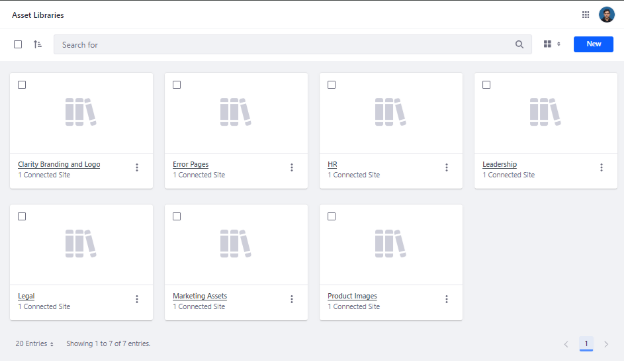

A continuación, volverá a las páginas maestras de Clarity y usará las imágenes de marca importadas.

## Agregar el logotipo de Clarity a las páginas maestras

Las plantillas de página maestra de Clarity no están completas. Necesitamos agregar el logotipo de Clarity al encabezado y el pie de página. Aquí agregarás estas imágenes como Walter Douglas.

Para hacer esto,

1. Vaya a *Sitio web de Clarity*.
1. Abra el *menú del sitio*(![Menú del sitio]), expandir *diseño* y seleccione *plantillas de página*.
1. En la pestaña Maestro, haga clic en *Página paatrón maestra * para comenzar a editarla.
1. Haga doble clic en el fragmento *Imagen del encabezado*.

    Esto selecciona el subelemento *cuadrado de imagen del fragmento* y abre sus opciones de configuración.

1. En el panel lateral de configuración, haga clic en *Seleccione Imagen* (![Fragmentos y widgets]).
1. Haga clic en *Sitios y bibliotecas* en el menú Breadcrumb.

    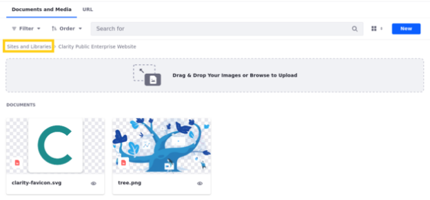

1. Vaya a la pestaña *Repositorio*.

    Ahora debería ver todas las Repositorios conectadas a este sitio.

1. Seleccione *Marca Clarity y logotipo*.
1. Seleccione Logo-Name-Vector para agregar la imagen al encabezado.

    **Consejo**: Si tiene dificultades para encontrar la imagen, use la barra de búsqueda.

1. En el panel del lado de la configuración, vaya a la pestaña *Enlace* y configure estos ajustes para el elemento cuadrado de imagen:

    | **Tab** |**configuración** |**Valor** |
    |:- |:- |:- |
    | Enlace | Enlace | Página |
    | Enlace | Página | Inicio |

Ahora, cuando los usuarios hacen clic en la imagen del encabezado, se dirigen a la página de inicio de Clarity.

11. Repita estos pasos para el fragmento de imagen de pie de página, seleccionando el vector de nombre de logotipo-full-name en su lugar.
1. Haga clic en *Publicar maestro* para guardar sus cambios en la plantilla de página maestra.

    Todas las páginas que usan la página maestra ahora se actualizan automáticamente.

    **IMPORTANTE**: Si la imagen no se actualiza para usted, debe borrar el caché del servidor Liferay. Para hacer esto, inicie sesión como usuario administrador de clarity, abra el menú *global*(![Menú global]), vaya a la pestaña *Panel de control* y haga clic en *Administración del servidor* .Luego, haga clic en *Ejecutar* para obtener el contenido de "Borrar el contenido almacenado en caché a través del clúster".

    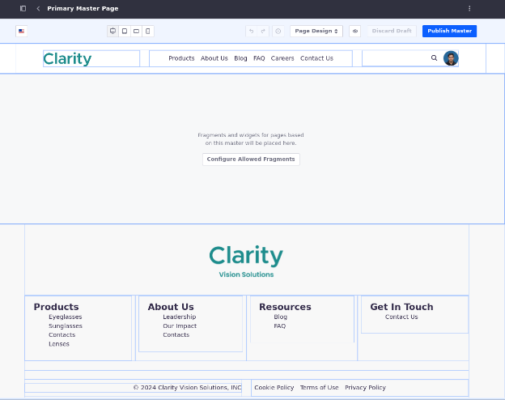

13. Repita los pasos 4-10 para actualizar la imagen del encabezado en la plantilla *Página maestra secundaria* para usar el vector de nombre del logotipo.

¡Excelente! Hasta ahora, ha aprendido cómo crear Repositorios, importar contenido y mostrarlo en páginas. A continuación, creará una estructura de contenido web único.

## Creación de estructuras de contenido web

Los artículos de contenido web son elementos de contenido que puede crear, editar y administrar a través del sistema de administración de contenido (CMS) incorporado de Liferay.También puede definir estructuras para el contenido web para crear diferentes tipos de contenido con diferentes campos.

 Aquí agregará la estructura de anuncios como Christian Carter.

Para hacer esto,

1. Inicie sesión como Christian Carter.
    - Correo electrónico: Christian.
    - carter@clarityvisionsolution.com
    - Contraseña: aprender
1. Abra el *menú global*(![Menú global]), vaya a la pestaña *Aplicaciones*y haga clic en *Repositorios*.
1. Seleccione el *Repositorio* de Marqueting *Contenido web*.
1. Vaya a la pestaña *Estructuras* y haga clic en *Nuevo*.
1. Teclea *anuncios*  como nombre.
1. Desde la barra lateral *Generador*, arrastre y suelte un campo *texto* en la estructura.
1. Seleccione el campo *Text* y configure estas opciones:

    | **Tab** |**campo** |**Valor** |
    |:- |:- |:- |
    |Basic|Etiqueta|Mensaje|
    | Básico | Campo obligatorio | SÍ |
    | Avanzado | Referencia de campo | Mensaje |

8. Haga clic en la flecha *Atrás* () para volver al menú de la barra lateral del generador.
1. Arrastre y suelte otro campo *texto* justo debajo del primero.
1. Seleccione el campo *Text* y configure estas opciones:

    | **Tab** |**campo** |**Valor** |
    |:- |:- |:- |
    | Básico | Etiqueta | Texto de enlace |
    | Básico | Campo requerido | SÍ |
    | Avanzado | Referencia de campo | LinkText |

11. Vuelva al menú de la barra lateral del constructor.
1. Arrastre y suelte un *enlace a la página* sobre el campo *Texto de enlace*.

Esto crea un grupo de *Campos* que contiene *texto de enlace * y *enlace a la página*.

13. Seleccione el campo *Enlace a la página* y configure estas opciones:

    | **Tab** |**campo** |**Valor** |
    |:- |:- |:- |
    | Avanzado | Referencia de campo | LinkPage |

14. Haga clic en *Guardar*.

    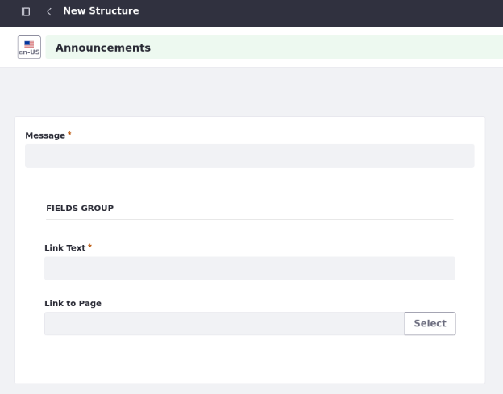

Los usuarios ahora pueden crear artículos de contenido web utilizando la estructura de anuncios . A continuación, creará algunos artículos de contenido web.

## Creación de artículos de contenido web

 Clarity también necesita algunas preguntas frecuentes y artículos de anuncio. Aquí los crearás como Christian Carter.

Para hacer esto,

1. Abra el *menú global*(![Menú global]), vaya a la pestaña *Aplicaciones* y haga clic en *Repositorios*.
1. Seleccione el *Repositorio de marketing* y haga clic en *Contenido web*.
1. Haga clic en *Nuevo*, seleccione *Carpeta*.
1. Ingrese estos valores:

    | **Campo** |**Valor** |
    |:- |:- |
    | Nombre | Anuncios |
    | Descripción | Artículos de anuncio de tiendas para el encabezado de la página.

    **Consejo**: Es la mejor práctica organizar su contenido web en carpetas en lugar de agregarlo a la carpeta de inicio.

5. Haga clic en *Guardar*.
1. Haga clic en la carpeta *Anuncios*.
1. Haga clic en *Nuevo* y seleccione *anuncios*.
1. Ingrese estos valores:

    | **Campo** |**Valor** |
    |:- |:- |
    | Título | Innovaciones de productos |
    | Mensaje | ¡Vea las últimas innovaciones de gafas de Clarity!
    | Texto de enlace | Aprende más |
    | Enlace a la página | Productos | **Nota **: Al seleccionar la página, haga clic en*Sitios y bibliotecas*en el menú Breadcrumb y seleccione*Sitio web de Clarity Public Enterprise*.

    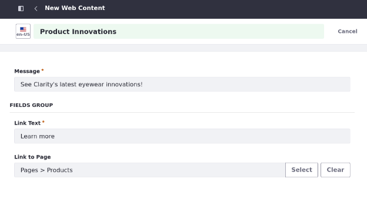

9. Haga clic en *publicar*.

A continuación, agregará algunos artículos de contenido web faltantes.

10. Haga clic en *Contenido web* en el menú Breadcrumb.
1. Cree carpeta y subcapeta y vaya a carpeta *FAQ* → Subcarpeta *Socios minoristas*.
1. Cree estos artículos de preguntas frecuentes del subtipo Faqs creado en la tarea:

    | **Título (Pregunta)** |**Respuesta** |
    |:- |:- |
    | ¿Puedo convertirme en un socio minorista? |Sí, siempre estamos buscando expandir nuestra red de socios minoristas. Si está interesado en almacenar nuestras gafas, comuníquese con nuestro equipo de ventas para obtener más información.
    | ¿Tiene socios minoristas donde pueda probar sus gafas?|Visite nuestro sitio web para encontrar la ubicación más cercana.
    | ¿Qué tipos de gafas ofrecen?|También tenemos una colección de marcos de diseñador para adaptarse a diferentes estilos y preferencias.

    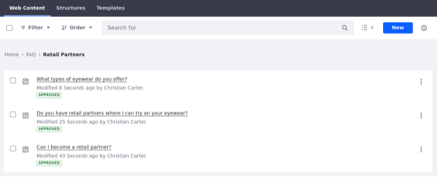

¡Excelente! Debe tener todas las necesidades de Clarity de contenido web para sus páginas. A continuación, mapeará algo de contenido a fragmentos en la página de inicio de Clarity.

## Mapeo de contenido a fragmentos

Muchos fragmentos incluyen subelementos con sus propias opciones de configuración, que dependen del tipo del subelemento. Los tipos disponibles incluyen

- Elemento de texto simple
- Elemento de texto rico
- Elemento de enlace
- Elemento HTML
- Elemento de imagen

Puede establecer el contenido de cada subelemento directamente, o puede asignarlos a los elementos de contenido existentes para que se actualicen dinámicamente. Aquí mapeará algunos elementos de imagen en la página de inicio a las imágenes de recursos como Walter Douglas.

Para hacer esto,

1. Inicie sesión como Walter Douglas.
    - Usuario: walter.
    - Correo : douglas@clarityvisionsolution.com
    - Contraseña: aprender
1. Comience a editar la página de Clarity *Home*.
1. En el panel lateral del navegador (![pestaña del navegador]), seleccione el contenedor *banner*.
1. Seleccione la *imagen* fragmento en el contenedor *banner*. Observe que el fragmento incluye un subelemento cuadrado de imágenes.
1. Seleccione el subelemento *cuadrado de imagen del fragmento* para acceder a sus opciones de mapeo.

    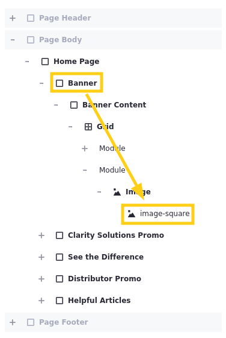

6. Para la selección de origen, seleccione *Mapeo*.
1. Para el artículo, haga clic en *Seleccione el artículo* (![Fragmentos y widgets]).
1. Vaya a la pestaña *Documentos y multimedia* y haga clic en *Sitios y bibliotecas* en el menú Breadcrumb.

    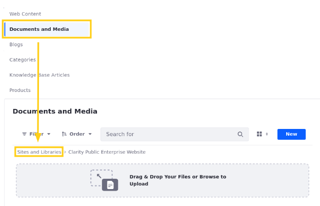

9. Vaya a la pestaña *Repositorio*, seleccione *Activos de marketing* y seleccione la imagen que quiera.
1. Para el campo, seleccione *URL de archivo*. La imagen debe aparecer en el banner de la página de inicio.

    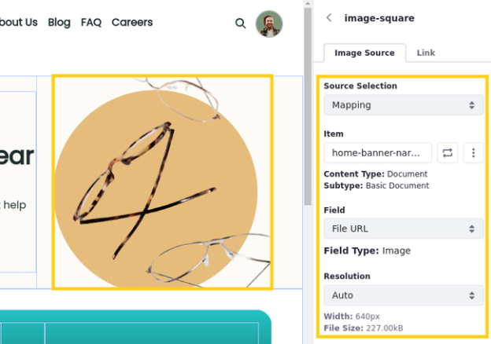

11. Repita los pasos 4-9 para el fragmento *Imagen* en el contenedor de promoción de Clarity Solutions y seleccione la imagen de gafas de sol en las hojas del repositorio de marketing.
1. En el panel lateral del navegador (![pestaña del navegador]), seleccione el *contenedor* dentro promoción de Clarity Solutions.
    Aquí usará una imagen de fondo en lugar de un subelemento de imagen.

1. En el panel lateral de configuración, vaya a la pestaña *estilos*.
1. En el fondo, configure la fuente de la imagen en *Mapeo* y seleccione la imagen de fondo de la Repositorio de marketing.
1. Para el campo, seleccione *URL de archivo* .La textura debe superponer la promoción de gradiente.

    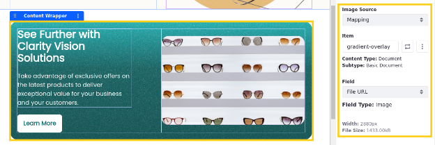

16. Repita los pasos 12-14 para el contenedor *Distribuidor Promocional* y seleccione la imagen de promoción de hogar del repositorio de marketing de activos.
Una vez que haya terminado, puede notar que las dimensiones de la imagen no coinciden el diseño de la página de inicio de Clarity.  Solucionemos esto.

1. Seleccione el contenedor *Contenido Banner* y configure esta configuración:

    | **Tab** | **configuración** | **Valor** |
    |:- |:- |:- |
    | General | Ancho del contenedor | Ancho fijo |

    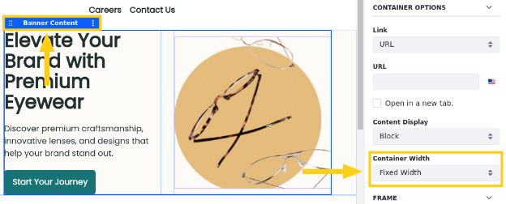

18. Repita el paso anterior para estos contenedores
1. *Promoción de soluciones de claridad*
1. *Contenedor de contenido* (en vea la diferencia)
1. *Artículos útiles*

    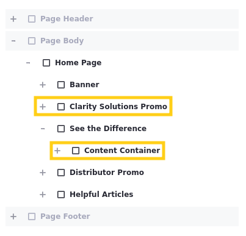

Ahora el contenido de estos contenedores debe ser fijado y las dimensiones deberían parecerse mejor a los diseños de Clarity.

Ahora ha asignado contenido de las Repositorios de Clarity a los fragmentos de imagen en su página de inicio.

Navegue a la página de inicio y confirme que cada campo se asigna correctamente.

[Liferay.com](https://www.liferay.com)

[Ask](https://liferay.dev/ask)

[Eventos](https://www.liferay.com/events)

[Encuentro](https://liferay.dev/meet)

---

Conectar

[Ref1]: img/liferay/Aspose.Words.5f3ba04a-e2dd-4320-bdee-832ac45207ea.002.png
[Ref2]: img/liferay/Aspose.Words.5f3ba04a-e2dd-4320-bdee-832ac45207ea.003.png
[Ref3]: img/liferay/Aspose.Words.5f3ba04a-e2dd-4320-bdee-832ac45207ea.004.png
[Ref4]: img/liferay/Aspose.Words.5f3ba04a-e2dd-4320-bdee-832ac45207ea.007.png
[Ref5]: img/liferay/Aspose.Words.5f3ba04a-e2dd-4320-bdee-832ac45207ea.012.png
[Menú global]: img/liferay/Aspose.Words.5f3ba04a-e2dd-4320-bdee-832ac45207ea.030.png
[Cambiar el botón de imagen]: img/liferay/Aspose.Words.5f3ba04a-e2dd-4320-bdee-832ac45207ea.033.png
[Botón de acciones]: img/liferay/Aspose.Words.5f3ba04a-e2dd-4320-bdee-832ac45207ea.043.png
[Menú del sitio]: img/liferay/Aspose.Words.5f3ba04a-e2dd-4320-bdee-832ac45207ea.056.png
[Fragmentos y widgets]: img/liferay/Aspose.Words.5f3ba04a-e2dd-4320-bdee-832ac45207ea.072.png
[Pestaña del navegador]: img/liferay/Aspose.Words.5f3ba04a-e2dd-4320-bdee-832ac45207ea.073.png
