
# **Desarrollo de módulos para Gestores de Contenido**

## ***Introducción***

Como vimos en la unidad anterior un gestor de contenidos nos ofrece la capacidad de personalizase, adaptarse y extenderse para alcanzar los objetivos que deseemos.

` `Si  bien con las capacidades de modificación interactivas ni con **módulos** ofrecidos por terceros encontramos la solución o la adaptación que deseamos obtener, lo habitual es que los gestores de contenido nos ofrezcan **algún kit de desarrollo** para poder hacer nosotros mismos los módulos o desarrollos necesarios.

` `Estas herramientas suelen ser especificas según la tecnología utilizada en el desarrollo base del gestor de contenido. De forma general como indicamos en unidades anteriores las tecnologías subyacentes de mayor uso están basadas en php o java por tanto los entornos de desarrollo integrados o IDEs que nos permiten un desarrollo rápido pueden ser utilizadas, ahora bien, cada gestor de contenido tiene una **arquitectura** específica y utiliza unos patrones y estructuras  determinadas para la creación de estos nuevos módulos o adaptaciones.

Algunos de ellos nos ofrecen utilidades que nos asisten en la creación de las estructuras de los módulos optimizando el tiempo de adaptación a los desarrolladores o adaptadores de los gestores de contenido. Por tanto antes de enfrentarnos a desarrollar por nuestra cuenta una adaptación o funcionalidad debemos asegurarnos de no poderla conseguir ni de forma interactiva ni por medio desarrollos contribuidos por terceros por un motivo que resulta esencial (los continuos **cambios de versión** del producto base).

El mundo tic tiene un nivel vertiginoso de cambio tecnológico por tanto los gestores de contenido están en una permanente evolución haciendo que los productores o lideres de desarrollo de estos  tengan una planificación de cambio de versión cada muy poco tiempo, provocando incompatibilidad o pérdida de funcionalidad en módulos no adaptados a sus últimas versiones base. Pese a que muchos de ellos suelen ofrecer herramientas de migración de versiones de módulos desarrollados de forma personal casi ninguno suele ser plenamente automático provocando así la obligación de migrar estos módulos cada vez que subamos la versión del gestor de contenido base, o bien mantener el gestor de contenido en una versión determinada cosa que no suele ser buena idea ya que en un porcentaje muy alto las nuevas revisiones suelen aportar rectificaciones sobre vulnerabilidades conocidas del  producto y suele ser la única forma de mantener un gestor de contenido **seguro** a lo largo  del tiempo.

Valorando todos los factores expuestos en los párrafos anteriores muchas veces nos vemos obligados a desarrollar estos módulos.

En función de nuestros conocimientos y de la complejidad de la necesidad debemos valorar si abordarlo o dejarlo en manos de algún desarrollador especializado en el gestor de contenido del que se trate.

Pero en todos los casos lo abordemos de forma personal o externa tendremos que hacer las pruebas de integración y funcionalidad oportunas del nuevo módulo validando la funcionalidad requerida manteniendo una estabilidad total de nuestro gestor de contenidos.

Con esto lo que queremos decir es que en ocasiones un módulo mal desarrollado puede afectar al gestor de contenido hasta dejarlo totalmente inestable, por ello la validación tanto funcional como de estabilidad y de rendimiento es un requisito inevitable. Algunos productores ofrecen la posibilidad de validar los desarrollos dando una conformidad o certificado de seguridad y de buen uso de sus patrones.

## ***Módulos en Liferay***
Realicemos una aproximación de todos estos conceptos sobre nuestro gestor de contenidos seleccionado (Liferay).

La terminología Liferay llama a los módulos plugins y como vimos en la unidad anterior los hay de varios tipos según el aspecto o funcionalidad que se debe cambiar:

- Themes
- Layouts
- Portlets
- Hooks
- Ext / Extlet

Respecto a la arquitectura que cualquier desarrollador de plugins en liferay debería conocer se puede resumir en el siguiente mapa:


Como observamos en la imagen en función del tipo de desarrollo que queramos hacer afectará a alguna de las parcelas del mapa donde deberemos conocer tanto la tecnología necesaria como también la estructura interna y sus guía de adaptación para estos desarrollos.Dado el grado de complejidad cada vez más se constata incluso dentro del cuerpo de  desarrolladores de Liferay el alto grado de especialidad que tienen los técnicos en ciertas parcelas tecnológicas como podemos ver en los siguientes mapas.


## ***Especificaciones técnicas***
En función de la parcela de trabajo o tarea a realizar sobre liferay deberemos conocer las especificaciones técnicas necesarias sobre las que se sustenta esta plataforma. Por tanto podemos identificar unas áreas de conocimiento que englobarían un conjunto de especificaciones o conocimientos :

- Compatibilidad en el despliegue
- Detalles del Portal
- Gestión de Contenidos
- Colaboración y Redes Sociales


## ***Versionado***
La incorporación constante de estas tecnologías que hace que el cms  consiga estar a la vanguardia y a la vez conseguir estabilidad obliga a tener un proceso de desarrollo evolutivo del software que se refleja en la publicación de sus versiones


|Version|Name|Edition|Date|Downloads|
| :- | :- | :- | :- | :- |
|7.0.1 GA2|Wilberforce|Community Edition|2016-06-10|~|
|7.0.0 GA1|Wilberforce|Community Edition|2016-03-31|~|
|6.2.3 GA5|Newton|Community Edition|2015-11-25|~|
|6.2.3 GA4|Newton|Community Edition|2015-04-17|~|
|6.2.2 GA3|Newton|Community Edition|2015-01-15|~|
|6.2.10 GA1|Newton|Enterprise Edition|2013-12-3|unknown|
|6.2.1 GA2|Newton|Community Edition|2014-02-28|~|
|6.2.0 GA1|Newton|Community Edition|2013-11-01|~|
|6.1.30 GA3|Paton|Enterprise Edition|2013-08-16|unknown|
|6.1.20 GA2|Paton|Enterprise Edition|2012-07-31|unknown|
|6.1.2 GA3|Paton|Community Edition|2013-08-23|42.000+|
|6.1.10 GA1|Paton|Enterprise Edition|2012-02-15|unknown|
|6.1.1 GA2|Paton|Community Edition|2012-07-31|336.614+|
|6.1.0 GA1|Paton|Community Edition|2012-01-01|265.718|
|6.0.6|Bunyan|Community Edition|2011-03-04|376.812|
|6.0.5|Bunyan|Community Edition|2010-08-16|300.560|
|6.0.4|Bunyan|Community Edition|2010-07-23|34.209|
|6.0.3|Bunyan|Community Edition|2010-07-20|16.263|
|6.0.2|Bunyan|Community Edition|2010-06-08|34.436|
|6.0.12 SP2|Bunyan|Enterprise Edition|2011-11-07|unknown|
|6.0.11 SP1|Bunyan|Enterprise Edition|2011-01-13|unknown|
|6.0.10|Bunyan|Enterprise Edition|2010-09-10|unknown|
|6.0.1|Bunyan|Community Edition|2010-04-20|27.565|
|6.0.0|Bunyan|Community Edition|2010-03-04|16.231|
|5.2.3|Augustine|Community Edition|2009-05-12|427.726|
|5.2.2|Augustine|Community Edition|2009-02-26|102.367|
|5.2.1|Augustine|Community Edition|2009-02-03|42.720|
|5.2.0|Augustine|Community Edition|2009-01-26|7.143|
|5.2 SP5|Augustine|Enterprise Edition|2010-10-20|unknown|
|5.2 SP4|Augustine|Enterprise Edition|2010-05-19|unknown|
|5.2 SP3|Augustine|Enterprise Edition|2010-01-07|unknown|
|5.2 SP2|Augustine|Enterprise Edition|2009-11-17|unknown|
|5.2 SP1|Augustine|Enterprise Edition|2009-08-07|unknown|
|5.2|Augustine|Enterprise Edition|2009-06-01|unknown|
|5.1.2|Calvin|Community Edition|2008-10-03|178.934|
|5.1.1|Calvin|Community Edition|2008-08-11|84.246|
|5.1.0|Calvin|Community Edition|2008-07-17|31.761|
|5.1 SP5|Calvin|Enterprise Edition|2010-03-12|unknown|
|5.1 SP4|Calvin|Enterprise Edition|2009-10-23|unknown|
|5.1 SP3|Calvin|Enterprise Edition|2009-07-20|unknown|
|5.1 SP2|Calvin|Enterprise Edition|2009-05-12|unknown|
|5.1 SP1|Calvin|Enterprise Edition|2009-02-18|unknown|
|5.1 SP|Calvin|Enterprise Edition|2008-12-16|unknown|
|5.0.1 RC|Luther|Community Edition|2008-04-14|101.543|
|5.0.0 RC|Luther|Community Edition|2008-04-09|10.704|


Todo este conjunto de versiones además de hacer evolucionar el producto tecnológicamente tiene como propósito paralelo salvaguardarlo de bugs de seguridad conocidos.

Por tanto hay versiones completas destinadas a ajustar su código para ser lo menos vulnerable posible. Al estar basado en código abierto esto hace que se puedan encontrar vulnerabilidades pero también corregirlas tanto por la empresa como por una comunidad extensa de desarrolladores.

Todo el control del código fuente se hace por medio de uno de los gestores de control de versiones más potente y abierto como es github.

Aquí podemos encontrarlo  <https://github.com/liferay>


## ***Seguridad***

Es habitual encontrarse en el los proyectos con actualizaciones dentro de la misma versión, ya sea por bug o seguridad. Por ello se generan piezas correctoras de código llamados fix packs (aunque mayoritariamente están disponibles bajo suscripción para la versión Empresarial que no es la que estamos actualmente utilizando).

Para facilitar el proceso de instalación y despliegue de los fix packs, Liferay proporciona un programa llamado patching tool (herramienta de parcheado). La patching tool viene instalada en las versiones bundle de Liferay (a partir de 6.0 EE SP2). Sin embargo, dicha versión debe ser sustituida con la versión que corresponda según la version:

- Paching Tool para versones anteriores a la 6.1 EE GA1: 
- Otra Paching Tool a partir de la versión 6.1 EE GA1: 

Para proceder con la actualización de la patching tool deben seguirse estos pasos:

1. Acceder a la carpeta 'patching-tool' (normalmente el directorio raíz del bundle) y mover los parches contenidos en la carpeta 'patches' a una carpeta temporal.
1. Ejecutar el proceso de instalación de parches definido más abajo para eliminar los parches del portal.
1. Disponer de la última versión de la patching tool.
1. Descomprimir el zip descargado sobrescribiendo los ficheros de la antigua patching-tool.
1. Desde línea de comandos, situarse en el directorio 'patching-tool' y ejecutar el comando "./patching-tool auto-discovery".
1. Copiar los parches de la carpeta temporal en 'patching-tool/patches/'
1. Desde línea de comandos, situarse en el directorio 'patching-tool' y ejecutar el comando "./patching-tool info". Esto nos dará la información de los parches a instalar y si tiene conflictos con jsp modificados con Hooks.
1. En caso de existir conflictos con los jsp de los Hooks será necesario actualizar dichos jsp siguiendo la guía Actualización JSP (plugins) para aplicación de Parches.
1. Desde la línea de comandos, situarse en el directorio 'patching-tool' y ejecutar el comando "./patching-tool install".
1. En caso de haber existido conflictos con los jsp de los Hooks será necesario volver a subir las nuevas versiones de los Hook (con los JSP actualizados) al portal.
1. Es posible que de algunos problemas con los plugins. En ese caso se ejecuta con el parametro update-plugins.

De momento no aplicaremos ninguno de estos pasos por tratar con una versión community.

## ***Kits de Desarrollo***
Como adelantamos en la introducción cualquier sistema gestor de contenidos provee de utilidades y kits de desarrollo que ayudan a los desarrolladores a adaptar,ampliar o contribuir código al proyecto. Aunque ya hemos indicado que existen módulos realizados por terceros que podemos instalar con relativa facilidad nos centraremos en crear una adaptación con el kit de desarrollo que nos proporciona liferay con el fin de crear las estructuras necesarias así como seguir las guías y patrones que nos indica el productor.

La herramienta que nos proporciona liferay se denomina liferay-plugins-sdk y es dependiente de la versión en la que queramos desarrollar nuestros módulos.

Por tanto si queremos hacer alguna adaptación nos descargaremos uno de estos kits de desarrollo para la versión que tenemos instalada que en nuestro caso es 6.2.CE

<https://sourceforge.net/projects/lportal/files/Liferay%20Portal/6.2.5%20GA6/>

De la lista descargar el archivo que empieza por [liferay-plugins-sdk-6.2-ce-ga6-](https://sourceforge.net/projects/lportal/files/Liferay%20Portal/6.2.5%20GA6/liferay-plugins-sdk-6.2-ce-ga6-20171101150212422.zip/download)?????


La descargamos y la copiamos en la carpeta /home/nombreusuario/liferay que es  donde teníamos instalado nuestro liferay en prácticas anteriores.

Procederemos a descomprimirlo y nos creará una carpeta con todo el kit de desarrollo.

/home/nombreusuario/liferay/liferay-plugins-sdk-6.2

Como casi todas las herramientas de desarrollo estas tienen algunas dependencias de otras para poder construir los plugins o módulos. En este caso esta depende de Ant (version 1.7 o posterior) instalada en tu máquina.

Podemos bajar  la última versión de Ant desde <http://ant.apache.org/> o si lo estamos haciendo en nuestra máquina en linux viene en la paquetería de la distribución

Nuestra versión en Ubuntu 16.04 es la 1.9.6 la podemos instalar con el comando

`	`**apt-get install ant**

Una vez instalado Ant crearemos las variables de entorno ANT\_HOME para dar a conocer la ruta donde esta instalado ant. Después debemos añadir el directorio ejecutable bin  (ejemplo., $ANT\_HOME/bin) a tu path.  

En sistemas Linux localizamos la ubicación donde está instalado ant. Si tu instalación esta en la ruta /usr/share/ant  y tu  shell es Bash, establece ANT\_HOME  y ajusta su path especificando lo siguiente en  /etc/.profile o desde el terminal:

**export ANT\_HOME=/usr/share/ant**

**export PATH=$PATH:$ANT\_HOME/bin**

Tu Plugins SDK necesita saber la localización de tu instalación de liferay para poder compilar los plugins con los jars de liferay y desplegar los nuevos plugins en la instancia de liferay. El Plugins SDK contiene un fichero llamado build.properties  que contiene los parámetros por defecto con los parámetros de estas rutas. Puedes utilizar este documento como referencia,aunque no debes modificarlo directamente (veras el mensaje “DO NOT EDIT THIS FILE” en su cabecera). Para sobrescribir los parámetros por defecto, crea un nuevo fichero con el formato **build.[username].properties** en la misma carpeta, donde [username] es tu user ID en tu máquina. Por ejemplo , si tu nombre es  alumno, tu nombre de fichero sería  build.alumno.properties.

Edita este fichero y añade las siguientes lineas:

app.server.type=[Establecemos el servidor de aplicaciones utilizado  ]

app.server.parent.dir=[El directorio donde está el bundle de Liferay]

app.server.tomcat.dir=[El directorio donde esta tu servidor de aplicaciones]

Si estas utilzando Liferay Portal bundled con Tomcat 7.0.62 y tu  bundle está en el directorio /home/nombredeusuario/liferay/liferay-portal-6.2-ce-ga6 debes especificar las siguientes lineas teniendo en cuenta que liferay preestablece una variable llamada

sdk.dir = Directorio raiz del plugins sdk (se determina por la ubicación donde se encuentra el archivo build-common.xml )

`	`**app.server.type=tomcat**

`	`**app.server.parent.dir=${sdk.dir}/../liferay-portal-6.2-ce-ga6**

`	`**app.server.tomcat.dir=${app.server.parent.dir}/tomcat-7.0.62**

En este ejemplo por tanto especificamos el uso de tomcat como servidor de aplicaciones  estableciéndolo en el app.server.type a tomcat y el directorio donde se encuentra estableciendo la propiedad  app.server.tomcat.dir.

Guarda tus cambios en el fichero  **build.[username].properties**.

Hay dos detalles más que nos evitarán dolores de cabeza que debemos tener en cuenta antes de proceder con el uso de Liferay.

1 (Aplicar sólo en caso de problemas de ubicación de esta dependencia ya que en versiones posteriores esta correcta)Debido al cambio de ruta de una de las dependencias que existe de este kit de desarrollo se hace necesario incluir la linea
```
ivy.jar.url=https://repository.liferay.com/nexus/content/repositories/liferay-public-snapshots/com/liferay/org.apache.ivy/${ivy.version}/org.apache.ivy-${ivy.version}.jar
```


2 En caso de trabajar en linux deberemos cambiar los archivos que utilicemos acabados en .sh para tener permiso de ejecución

3 En caso de linux también podemos encontrarnos un problema cuando se intenta copiar el archivo ecj en el directorio donde anteriormente hemos instalado la utilidad ant. En la versión 16.04 de Ubuntu tomada del repositorio en la carpeta /usr/share/ant/lib debe tener permisos para que otros usuarios puedan añadir archivos

Ya estas listo para poder usar  Liferay Plugins SDK.

### **Themes**
Imaginemos que nos han encargado un proyecto web y que por el conjunto de requisitos lo decidimos abordar con un gestor de contenidos liferay. Pero lo primero que nos pide la empresa es cambiarle el aspecto general que presenta el portal y además no parece convencerle ningún estilo de los que se pueden descargar del marketplace. Por tanto nos solicitan que nosotros mismos adaptemos ciertos aspectos visuales que desean del portal.

Por tanto con los conocimientos adquiridos nos decidimos a crear un nuevo tema de apariencia para cubrir estas necesidades.

Una vez tengamos nuestro Liferay con sus carpetas bien organizadas, procedemos a arrancar nuestro portal. Nosotros al instalar  un Liferay bajo tomcat, iremos a nuestra carpeta "liferay-portal-6.2-ce-6.2→tomcat-7.0.62→bin" y ejecutamos el "startup" (.bat o .sh dependiendo de la plataforma bajo la que estemos).

Cuando haya arrancado procedemos a crear nuestro nuevo tema de apariencia (theme) de Liferay.  Bien, **abrimos nuestra línea de comandos y nos situamos sobre la carpeta "liferay-plugins-sdk-6.2->themes"**. Procedemos a ejecutar el siguiente comando: **create id\_tema "nombre\_tema"**, donde *id\_tema* será el identificador que queramos darle a nuestro tema y *nombre\_tema* será el nombre que se muestre a la hora de utilizarlo en el portal.

Ejemplo : ./create.sh temaPrueba “Mi tema de prueba”

Para la versión Liferay 6.2 **la primera vez** que creas un tema **tarda un poquito**, independientemente de lo potente que sea tu ordenador.

Ya que se descarga unas librerías de las que depende por tanto la máquina debe tener conexión a internet.

Además puede que te toque repetir la tarea debido a que el ECJ No este instalado lo cual obliga a repetir la ejecución.

Una vez pasada esta primera vez los temas se crean de forma mucho más ágil. Si todo ha ido bien, nos encontraremos con el siguiente mensaje en línea de comandos: "BUILD SUCCESSFUL Total Time: x seconds" y dentro de nuestra carpeta "themes" nos aparecerá una nueva carpeta con el nombre "***id\_tema-theme***". Si no ha ido bien, lo más probable es que no tengas bien configuradas las variables de entorno de ant.

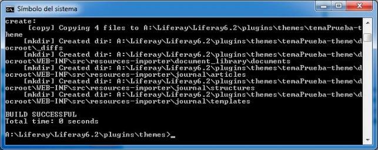

Ya tenemos nuestro nuevo tema de Liferay creado. Veamos ahora los primeros pasos a seguir. En primer lugar tenemos que **decidir en qué tema nos vamos a basar**, es decir, cuál va a ser nuestro tema padre. Para ello vamos a la carpeta raíz de nuestro tema y **abrimos el fichero "*build.xml*".**


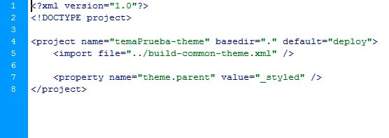

Podemos heredar de cualquier tema que tengamos desplegado en nuestro Liferay, pero habitualmente lo haremos del **classic, welcome (versión 6.2), \_styled o \_unstyled**. Si **heredamos del classic o el welcome**, nuestro nuevo tema inicialmente tendrá visualmente un aspecto igual al del tema que hayamos heredado. Heredar de estos temas puede ser **útil para hacer pruebas**, o alguna **demo** rápida (o que casualmente queramos un tema muy parecido a alguno de ellos). Si lo hacemos para temas completamente diferentes nos pasaremos todo el rato sobrescribiendo los estilos del tema del que estemos heredando. En caso de fuertes personalizaciones **heredaríamos del tema \_styled**, que es un tema que viene prácticamente “plano”, **solamente tiene los estilos básicos de Liferay** relacionados con configuraciones, el dock, etc. Por otro lado podemos **heredar del tema “\_unstyled” que nos dejará un Liferay completamente “desnudo”**, es decir, habría que maquetarlo absolutamente todo. Veamos con una captura después de heredar del “\_styled” y del “\_unstyled” respectivamente para ver de lo que hablamos.

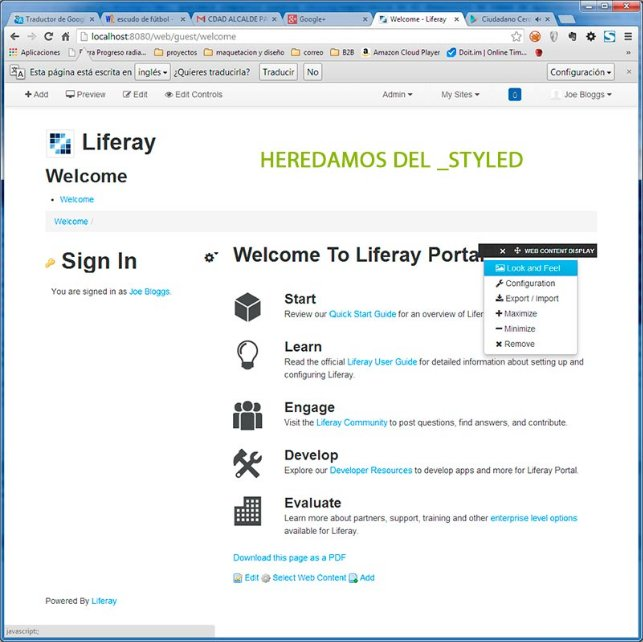


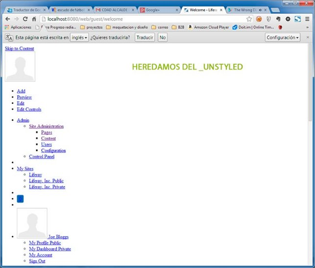

Como podemos ver **el tema styled nos ayuda con la maquetación básica del portal y su funcionalidad**, y a su vez apenas lleva estilos que haya que ir sobrescribiendo. Lanzarse a heredar del tema \_unstyled sólo lo recomendamos para aquellos que necesiten un lavado de cara completo de Liferay, en el que incluso haya que cambiar los estilos que sólo va a ver el administrador o gestor de contenidos.

Ya tenemos decidido de qué tema vamos a heredar. Supongamos que heredamos del styled. ¿Cuál es el siguiente paso? Ahora vamos a **compilar nuestro tema y desplegarlo en el portal.** Para ello abrimos línea de comandos y nos situamos sobre la carpeta raiz de nuestro tema e introducimos el siguiente comando: ***ant clean deploy .*** El "clean" es opcional pero recomendable pues en alguna ocasión nos puede evitar problemas de que no se sobrescriban bien los cambios que vayamos haciendo en nuestro tema. Si todo ha ido bien nos encontraremos con algo como sigue.


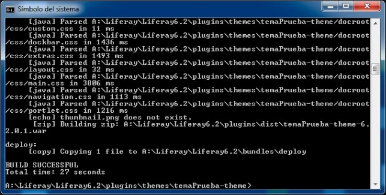

Una vez ha terminado la compilación, en nuestra ventana del tomcat de Liferay veremos que ha detectado la presencia de un nuevo tema y procede a desplegarlo. Cuando termine nos encontraremos con un mensaje como este.

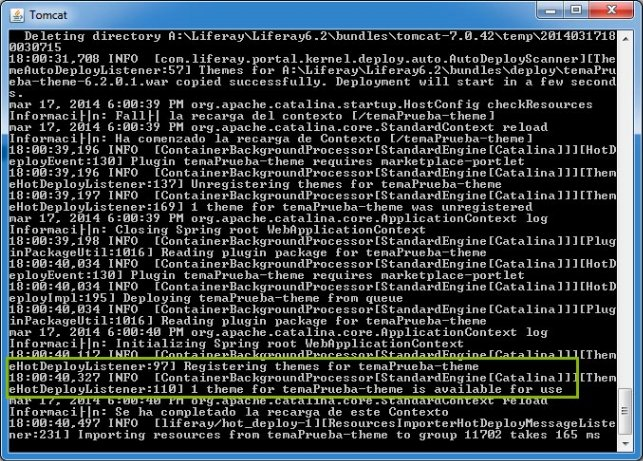

Si en alguno de estos puntos hemos tenido problemas de compilación o despliegue miraremos los errores que nos pueda dar la tarea del ant o el tomcat al desplegar. **El error más habitual podría ser que no hayas seguido la estructura y nomenclatura de carpetas**  mencionadas anteriormente.

Ya tenemos nuestro tema desplegado, y al realizar las tareas del ant nos han aparecido nuevas carpetas y ficheros en el tema. Estos se copian automáticamente del tema que hayamos heredado. Vamos a ver cómo nos aparece el tema en nuestro portal, y algunos detalles que debemos pulir antes de seguir adelante y **explicar la estructura de un tema por dentro**.


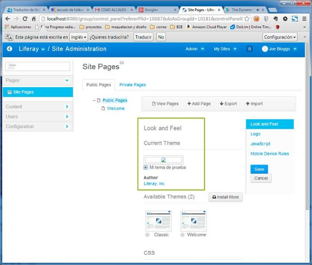

Podemos ver que aparece nuestro tema de Liferay, pero carece de thumbnail y el autor del mismo aparece como Liferay. Vamos a proceder a cambiar esto. Para ello vamos a personalizar 4 aspectos.

- Thumbnail del tema.
- Screenshot del tema.
- Favicon del tema.
- Autor del tema.

Para el screenshot, el thumbnail crearemos dos .png con el aspecto final de nuestro portal: screenshot.png (el ancho que queramos, 1024px recomendado) y thumbnail.png (de 150px de ancho recomendado). Además tendremos nuestro favicon.ico personalizado. Para **ubicarlos iremos a la carpeta “docroot->diffs”, crearemos una nueva carpeta dentro llamada “images” y allí los colocaremos**. En la próxima compilación y despliegue del tema (ant clean deploy) aparecerán cambiados (el favicon es posible que se quede cacheado una buena temporada).

Para terminar con los cuatro puntos mencionados anteriormente debemos modificar el fichero “***liferay-plugin-package.properties***“. Para ello crearemos dentro de la carpeta "docroot->diffs" una nueva carpeta llamada "WEB-INF" en la que duplicaremos el fichero "***liferay-plugin-package.properties***" que nos podemos encontrar en la carpeta "docroot->WEB\_INF" de nuestro tema. Editaremos este fichero duplicado (el que hemos copiado en "docroot->diffs->WEB-INF" no el original) con cualquier editor y pondremos nuestros datos.


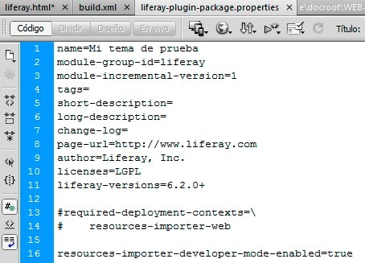

Una vez modificado al seleccionar nuestro tema ya nos aparece todo correctamente.

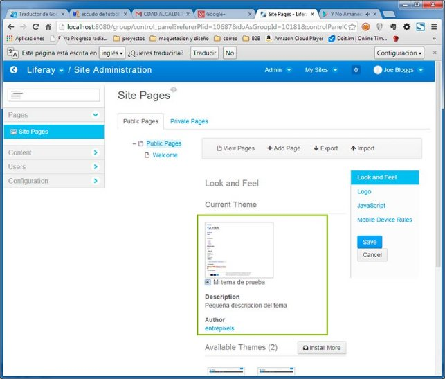


Una vez llegados a este punto ya tenemos un tema creado por nosotros mismos con el que poder empezar a trabajar. A continuación explicaremos la **estructura básica de un tema de Liferay**. Pero antes hay un **tema importante que hay que tener en cuenta. Siempre vamos a trabajar y a modificar ficheros dentro de la carpeta diffs (dentro de docroot).** En la carpeta ráiz de docroot tenemos las carpetas base del tema del que hemos heredado. Si trabajamos sobre ellas, cada nueva compilación nos machacará los cambios que hayamos hecho con el código del tema que hayamos heredado. **Si queremos cambiar cualquier fichero debemos crear la misma estructura de directorios dentro de la carpeta diffs y sobrescribir el fichero que deseemos**. **Sólo así nuestros cambios tendrán efecto**. Por poner un ejemplo concreto, si quiero sobrescribir la "custom.css" del tema del que he heredado, debería crear dentro de diffs la carpeta "css", copiar el fichero custom.css y a partir de ahí comenzar a realizar los cambios oportunos. En este punto os recomendamos hacer algunas pruebas para que veáis de primera mano los resultados.

Empezamos, en primer lugar con las css. El tema styled de Liferay viene por defecto con las siguientes css.


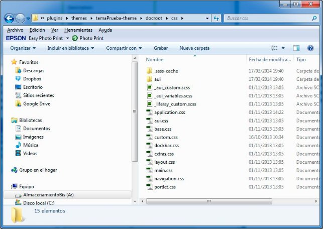

Como se puede observar, los nombres de las css, si estamos familiarizados con Liferay, son bastante intuitivos. Por norma general sólo modificaremos dos ficheros respecto a los originales (aunque por supuesto podremos incluir más). Los ficheros a modificar serían ***main.css*** y ***custom.css***. **El primero** de ellos es el que **incluye** con "imports" **todas las css que se utilizan**. Podemos necesitar modificarlo para quitar alguna css de las que se importan (poco habitual), o para añadir ficheros css nuevos. Por otro lado **“custom.css” es un fichero originalmente vacío**, que **se importa en último lugar en la main.css y es donde meteremos nuestro código personalizado**. Al ser importado en último lugar en la “main.css” los estilos sobrescribirán cualquier clase definida anteriormente en cualquier otro fichero.

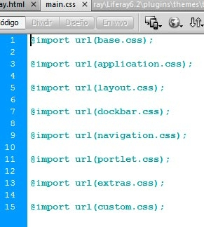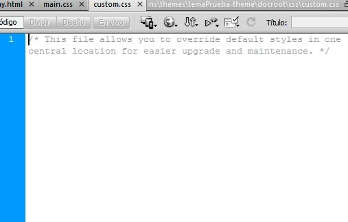

La carpeta imágenes tiene poco que explicar. En ella se almacenan las imágenes que vienen con el tema que hayamos heredado. **Si queremos sobrescribir alguna imagen simplemente hemos de buscarla, replicar dentro de la carpeta diffs aquella estructura de carpetas donde se encuentre y poner nuestra nueva imagen con el mismo nombre que la imagen que queramos machacar**. Es común y buena práctica crearnos una nueva carpeta (o varias) dentro de “images” donde metamos la imágenes nuevas que vayamos a usar para maquetar nuestro portal.

Pasamos ahora a la carpeta **templates**. En ella nos vamos a encontrar en ficheros [velocity](http://velocity.apache.org/) las diferentes estructuras html del portal. **Es donde tendremos que tocar si queremos modificar la estructura HTML de nuestro portal**.

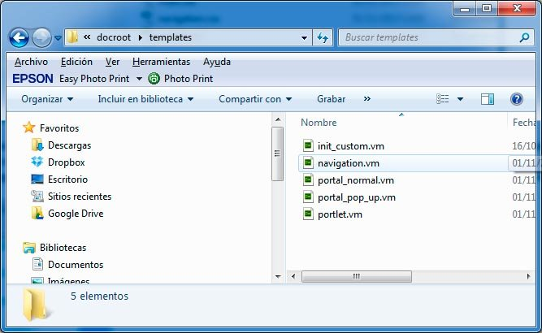

El fichero ***init\_custom.vm*** si no programamos velocity no lo tocaremos para nada. Se utiliza para declarar variables de dicho lenguaje que posterioremente queremos utilizar en cualquiera de los otros ficheros velocity. El fichero ***portal\_normal.vm*** es el que contiene el marcado HTML con la estructura general de todas las páginas de la parte pública del portal. Es decir, cabecera con sus elementos, cuerpo (sólo se define el contenedor), y pie de página.

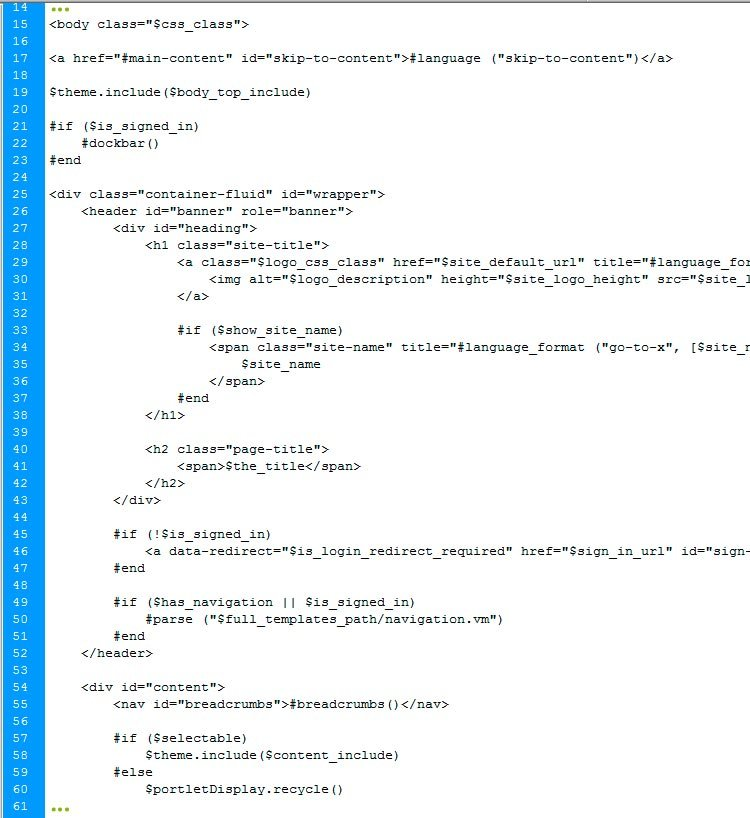

Al que no esté acostumbrado se le hará un poco raro ver el lenguaje velocity metido entre el html, pero se le coge el truco rápido. **Desde portal\_normal.vm se hace la llamada a la navegación principal** con el siguiente comando ***#parse (“$full\_templates\_path/navigation.vm”)*** que viene a ser lo equivalente a un import, en este caso del fichero ***navigation.vm*** que contiene el menú principal de navegación de Liferay. Dentro de la capa con ***id="content"***, **dentro de la portal\_normal.vm también se hace una llamada al contenido central** correspondiente de cada página con los siguientes comandos.

#if ($selectable) $theme.include($content\_include) #else $portletDisplay.recycle()

$portletDisplay.setTitle($the\_title)

$theme.wrapPortlet("portlet.vm", $content\_include) #end

Nos quedan dos plantillas velocity por ver. ***portlet.vm*** contiene la estructura HTML de cada uno de los portlets. Básicamente es un section con su encabezado, el menú de opciones de cada portlet y el contenido del mismo. Si necesitamos cambiar algo de su estructura HTML es aquí donde debemos tocar. Por último ***portal\_pop\_up.vm*** contiene la estructura HTML de los popups que nos encontramos dentro del portal.

Vamos por último con la última carpeta que vamos a analizar. Se trata de la **carpeta** ***js***. En ella nos encontraremos con un fichero ***main.js***. Este fichero se ejecuta siempre que se carga una página y nos ***viene preparado con tres funciones interesantes que podemos utilizar.*** Recordamos que Liferay desde su versión 6.0 viene con su propio framework javascript incrustado por defecto, [Alloy UI (AUI)](http://alloyui.com/).

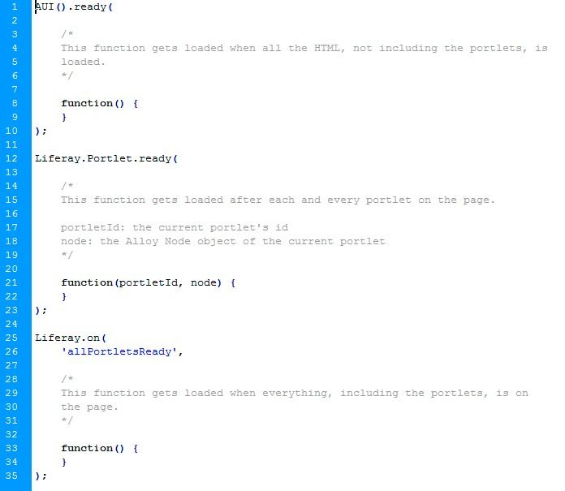

Todo el código que metamos dentro de la primera función se ejecutará al cargar la página. ***Es equivalente a un jQuery(ready)*** y similar (no igual) al window.load() de javascript. El código que incluyamos en la segunda función se ejecutará cada vez que se cargue un portlet de la página actual. Por último aquel código incluido dentro de la tercera función se ejecutará después de que todos los portltes de la página estén cargados.

**Si queremos añadir nuevos ficheros javascript a nuestro portal, lo haremos directamente en la template portal\_normal.vm**, como si lo estuviesemos incluyendo en cualquier otro tipo de proyecto "<script src="…>


## ***Layouts***
Al igual que creamos temas de aspecto podemos también crear nuevas distribuciones para las aplicaciones o portlets de nuestras páginas.

Desde el terminal posiciónate en tu Plugins SDK en la subcarpeta layouttpl .Debes ejecutar el script *create*. A continuación tienes la sintaxis:

create.[sh|bat] [nombre del proyecto] "[Título del Nombre de la Distribución]"

En Linux el comando sería similar al del siguiente ejemplo:

./create.sh mi-distro "Mi Distribucion"

Los scripts de creación generan la estructura del proyecto en el directorio Plugin SDK’s layouttpl . El Plugins SDK añade automáticamente “-layouttpl” a tu nombre de proyecto.

La estructura quedaría como esta:

- [project-name]-layouttpl/
  - docroot/
    - META-INF/
    - WEB-INF/
      - liferay-layout-templates.xml
      - liferay-plugin-package.properties
    - [project-name].png
    - [project-name].tpl
    - [project-name].wap.tpl
  - build.xml

Un proyecto de distribuciones puede contener varias distribuciones. La estructura del directorio es compartida pero los ficheros .png, .tpl, and .wap.tpl file para cada distribución se definen en otro fichero. Los ficheros liferay-\* describen las distribuciones y el empaquetado y despliegue.

Repasamos lo que hace cada fichero:

- [project-name].tpl: Genera la estructura HTML structure de la plantilla.
- [project-name].wap.tpl: Plantilla para dispositivos móviles. WAP .
- [project-name].png: Thumbnail representación de la plantilla. Puedes crear una imagen de miniatura personalizada para tu plantilla o bien usar la que viene por defecto como punto de partida.


En el fichero tpl es donde definimos la estructurar como ejemplo una de 1-2-1


<div class="columns-1-2-1" id="main-content" role="main">

`    `<div class="portlet-layout row-fluid">

`        `<div class="portlet-column portlet-column-only span12" id="column-1">

`            `$processor.processColumn("column-1", "portlet-column-content portlet-column-content-only")

`        `</div>

`    `</div>

`    `<div class="portlet-layout row-fluid">

`        `<div class="portlet-column portlet-column-first span8" id="column-2">

`            `$processor.processColumn("column-2", "portlet-column-content portlet-column-content-first")

`        `</div>

`        `<div class="portlet-column portlet-column-last span4" id="column-3">

`            `$processor.processColumn("column-3", "portlet-column-content portlet-column-content-last")

`        `</div>

`    `</div>

`    `<div class="portlet-layout row-fluid">

`        `<div class="portlet-column portlet-column-only span12" id="column-4">

`            `$processor.processColumn("column-4", "portlet-column-content portlet-column-content-only")

`        `</div>

`    `</div>

</div>


Además tenemos unos archivos adicionales, estos archivos definen la configuración:

- liferay-layout-templates.xml: Especifica el nombre de las plantillas de distribución y donde localizar sus TPL y ficheros PNG .
- liferay-plugin-package.properties: Describe el desplegado en caliente.

## ***Portlets (Aplicaciones)***
Una de las ventajas de usar una arquitectura potente es que podemos también crear nuestras propias aplicaciones web aprovechando todos los marcos de trabajo que nos ofrece el portal por ellos de la misma forma crearíamos portlets  

Para crear la estructura de partida de nuestra aplicación nos iríamos al directorio portlets y ejecutaríamos  los comandos oportunos siguiendo la sintaxis

**./create.sh [project-name] ["Portlet Display Name"]**

Debes obtener un mensaje BUILD SUCCESSFUL de Ant,. Aparecerá un nuevo directorio dentro de la carpeta portlets en tu Plugins SDK. Esta carpeta contiene tu proyecto. Aquí dentro deberás programar tu propia funcionalidad. Se añadirá la palabra “-portlet” al nombre del proyecto cuando se crea este portlet.

Las dependencias de los jars para que el proyecto se construya correctamente están en el fichero build-common.xml del Plugins SDK . Las puedes obtener de las propiedades plugin.classpath y  portal.classpath .

**Tip**: Si deseas utilizar un control de versiones es un buen momento para hacer el check-in ya que para el proceso de despliegue posterior generará un montón de ficheros que no necesitan estar bajo un control de versiones.

Un proyecto de este tipo esta compuesto al menos de tres componentes:

1. código Java .
1. Ficheros de configuración .
1. Fichero de la parte cliente (.jsp, .css, .js, graphics files, etc.).

Cuando usamos Liferay’s Plugins SDK, estos ficheros se almacenan en una estructura estandarizada:

- PORTLET-NAME/
  - build.xml
  - docroot/
    - css/
    - js/
    - META-INF/
    - WEB-INF/
      - lib/
      - src/ - este no se crea por defecto.
      - tld/
      - liferay-display.xml
      - liferay-plugin-package.properties
      - liferay-portlet.xml
      - portlet.xml
      - web.xml
    - icon.png
    - view.jsp

Por defecto, los portlets utilizan el marco de trabajo MVCPortlet framework, un marco de trabajo ligero que esconde parte de la complejidad de trabajar con portlets haciendo las operaciones más comunes sencillas.  MVCPortlet usa de forma separada los JSPs para cada uno de los modos de un portlet:. Por ejemplo, ‘edit.jsp’ es para el modo edición y ‘help.jsp’ es para el modo ayuda.

El código java se guarda en el directorio docroot/WEB-INF/src .

Los archivos de configuración en docroot/WEB-INF . Los archivos de configuración incluyen los  standard JSR-286 fichero portlet.xml, al igual que otros específicos de Liferay. Los archivos de configuración específicos de liferay aunque optativos son importantes si los portlets se van a desplegar en liferay, a continuación se detallan estos archivos específicos:

- liferay-display.xml- Describe la categoría donde aparece el portlet en la sección de Añadir del la Barra  flotante (el menú horizontal que aparece en la parte superior de cada página de los usuarios registrados).
- liferay-plugin-package.properties- Describe el descriptor de despliegue en caliente . Puedes configurar control de lista de acceso (PACL) ,  dependencias .jar.
- liferay-portlet.xml- Describe mejoras sobre JSR-286 portlets instalados en Liferay Portal server. Por ejemplo, el icono que representa el app, lanzadores de tareas planificadas, y mas. Una lista de los DTD de definition del código del portal.

*Los ficheros de la parte cliente* .jsp, .css, and .js que se utilizan para escribir la interfaz de usuario. Estos fichero deben ir en el directorio docroot ; .los jsp pueden ir en la raiz mientras .css and .js  tienen su subdirectorios en docroot. Recuerda, que los portlet sólo gestionan una porción del html final. Por tanto el HTML generado en tu cliente debe estar libre de tags globales <html> or <head>. Adicionalmente se crean dominios de nombres para todas las clases css  y elementos IDs para prevenir los conflictos con otros portlets. Liferay provee dos herramientas, una taglib y métodos API , para generar espacios de nombres por ti.

## ***Hooks, Ext / Extlet***
` `Las herramientas de liferay también nos permiten crear este tipo de componentes pero dada la necesidad de una base de conocimiento mayor que excede los límites de este módulo no vamos a ver con este nivel de detalle.

Por tanto acabaremos resumiendo que a mayor personalización mayor dificultad de actualización ofreciendo unas franjas verdes y otra rojas para tenerlas en cuenta en futuras prácticas

Nivel de dificultad en la actualización

Puntos de dificultad en la actualización incrementando según la diferenciación de los estándares (ej. JSR-286) y el uso de "malas" prácticas a la hora de personalizar los plugins, hooks y portal.


