# Construyendo Sitios Web Empresariales con Liferay (Tercera Parte)

- [Creación de un vocabulario](#creación-de-un-vocabulario)
- [Agregar categorías a un vocabulario](#agregar-categorías-a-un-vocabulario)
- [Creación de una colección manual](#creación-de-una-colección-manual)
- [Creación de una colección dinámica](#creación-de-una-colección-dinámica)
- [Mostrar contenido en la página de preguntas frecuentes](#mostrar-contenido-en-la-página-de-preguntas-frecuentes)
- [Agregar anuncios al encabezado](#agregar-anuncios-al-encabezado)

## Creación de un vocabulario
Liferay proporciona vocabularios para clasificar el contenido, lo que facilita la búsqueda y muestra el contenido que necesita.

Aquí definirá un vocabulario con categorías para el contenido web de las preguntas frecuentes como Christian Carter.

Para hacer esto,

1. Inicie sesión como Christian Carter.
    - Nombre de usuario: Christian.carter@clarityVisionsolutions.com
    - Contraseña: aprender
1. Abra el *menú global*(![Menú global]), vaya a la pestaña *Aplicaciones* y haga clic en *Repositorios*.
1. Seleccione el repositorio de *Marketing* y haga clic en *Categorías*.
1. Haga clic en *Agregar* (![Añadir]) junto a *Vocabularios* para crear un nuevo vocabulario.
1. Ingrese estos detalles:

| **Campo** | **Valor** |
|:- |:- |
| Nombre | Preguntas frecuentes |
| Descripción | Categorías para los artículos de preguntas frecuentes.
| Permitir múltiples categorías | SÍ |
| Visibilidad | Público |
| Tipos de activos | Artículo de contenido web |
| Subtipo | FAQ |
| Requerido | no requerido |

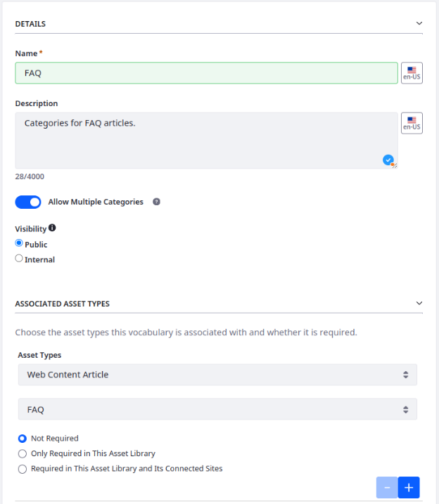

6. Haga clic en *Guardar* para crear el vocabulario.

Ahora tiene un vocabulario para contener categorías de preguntas frecuentes.

## Agregar categorías a un vocabulario
Después de crear un vocabulario, puede agregar categorías y subcategorías para establecer el esquema organizacional deseado para su contenido.

Aquí agregará categorías al vocabulario de preguntas frecuentes que creó en el ejercicio anterior como Christian Carter.

Para hacer esto,

1. En la aplicación Categorías, seleccione el vocabulario *FAQ* en la barra lateral de vocabularios.
1. Haga clic en *Nuevo* e introduce socios minoristas como nombre.
1. Haga clic en *Guardar* para agregar la categoría.
1. Repita los pasos anteriores para agregar tres categorías más al vocabulario de preguntas frecuentes:
    - Productos y servicios
    - Precios y pedidos
    - Devoluciones e intercambios

    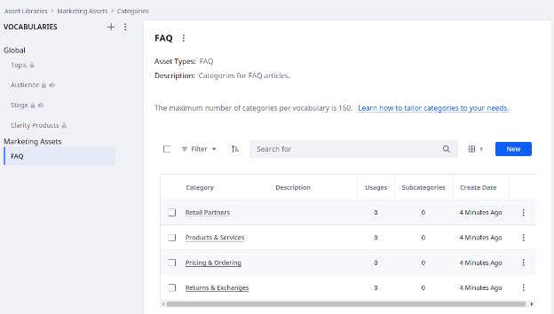

1. **desafío** Asigne la categoría correcta a cada artículo de contenido web de preguntas frecuentes. Las preguntas frecuentes se clasifican en carpetas correspondientes a sus categorías.

    **Sugerencia**: Mire en la barra lateral de propiedades para cada pregunta frecuente.

Ahora ha definido y asignado categorías a su contenido web de preguntas frecuentes.

## Creación de una colección manual
Las colecciones de Liferay son listas de elementos de contenido que puede mostrar en las páginas de su sitio. Puede agrupar diferentes tipos de contenido juntos, lo que facilita encontrar y mostrar elementos relacionados. Cada lista se puede definir manual o dinámicamente.

Aquí agregará artículos de contenido web a una colección manual y los asignará a la página de inicio de Clarity como Walter Douglas.

**Nota** Estos artículos de ayuda deberás crearlos al igual que su estructura siguiendo la guia del tema anterior en el ejemplo de creación de tipos y contenido de los anuncios.
Los artículos tendrán este nombre:
- *Innovación adoptiva: las tendencias clave que dan forma a la fabricación de gafas*
- *Revolucionar la industria de las gafas: cómo los materiales innovadores marcan la diferencia*
- *Mejora de la eficiencia en la fabricación de gafas: un enfoque integral*

Para hacer esto,

1. Inicie sesión como Walter Douglas.
    - Correo electrónico: walter.douglas@clarityvisionsolutions.com
    - Contraseña: aprender
1. Abra el *menú del sitio*(![Menú del sitio]), expandir *Generador del Sitio*->*Conjunto de contenidos* y seleccionar *Colecciones*.
1. Haga clic en *Nuevo* y seleccione *Colección manual*.
1. Para el título, ingrese *artículos útiles* y haga clic en *Guardar*.
1. Para el tipo de elemento, seleccione *Artículo de contenido web*.
1. Para el subtipo de elemento, seleccione *Artículo de ayuda*.
1. Haga clic en *Guardar*.
1. En la sección de elementos de colección, haga clic en *Seleccione* y seleccione *Artículo de ayuda*.
1. Vaya a la carpeta *Artículos de ayuda*, seleccione estos tres artículos:
    - *Innovación adoptiva: las tendencias clave que dan forma a la fabricación de gafas*
    - *Revolucionar la industria de las gafas: cómo los materiales innovadores marcan la diferencia*
    - *Mejora de la eficiencia en la fabricación de gafas: un enfoque integral*
1. Haga clic en *Agregar*.

    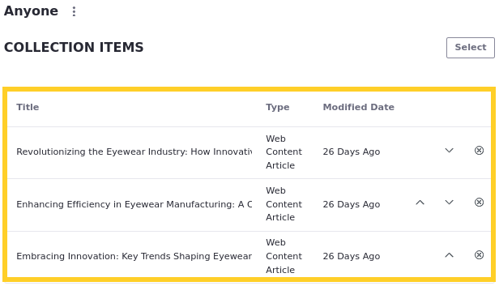

    La colección manual ahora está llena de contenido y está lista para usar en las páginas del sitio.

1. Vaya a la página *Inicio* y haga clic en *Editar* (![Botón Editar]).
1. Seleccione el fragmento *Visualización de la colección* en el contenedor de artículos útiles.
1. En el panel lateral de configuración en colección, haga clic en *Mas* (![Botón más]) para agregar  la colección y seleccione la colección *Artículos útiles*.

    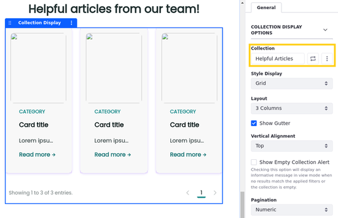
1. Una vez seleccionada la colección nos falta añadir el fragmento Tarjeta para visualizar los elementos de la colección. Arrastramos un nuevo fragmento *Tarjeta* sobre la colección.

    El fragmento colección ahora obtiene su contenido de la colección de artículos útiles. La composición proporcionada ya aplica el fragmento de la tarjeta a la visualización de la colección para representar cada elemento. Para mostrar el contenido del artículo de la colección, deberá asignar los subelementos de la tarjeta a los campos en los artículos. Pero antes de mapear los subelementos de la tarjeta a los campos de contenido, cambiemos la paginación de la pantalla de colección.

1. Para la paginación, seleccione *Ninguno*.

    Ahora mapeemos los subelementos de la tarjeta a sus campos correspondientes en los artículos.

1. Seleccione el fragmento *tarjeta* y mapee los subelementos incluidos:
    - Imagen de la tarjeta
    - Título de la tarjeta
    - Resumen
    - Link de tarjetas
1. Seleccione cada uno de los siguientes elementos, establezca su selección de origen en *Mapeo* y seleccione el campo correspondiente:
    - Imagen de la tarjeta: *Imagen pequeña* del artículo
    - Título de la tarjeta: *Título* bajo Información básica
    - Resumen: campo de estructura *Articulo de ayuda* tipo Contenido (Nombre estructura)
1. Seleccione el subelemento *de enlace de tarjeta*, vaya a la pestaña *Enlace*.
1. Para el enlace, seleccione *URL asignada*.
1. Para el campo, seleccione *predeterminado*.
1. Haga clic en *Publicar* para guardar sus cambios en la página de inicio.

    La sección *Artículos útiles* de la página de inicio ahora debe mostrar contenido web de la colección que creó. Sin embargo, un elemento no funciona como se esperaba: enlace de tarjeta. Esto se debe a que los artículos no tienen una plantilla de página de visualización predeterminada. Solucionemos estos problemas.

1. Vaya a la aplicación *Plantillas de página*, vaya a la pestaña *Plantillas de página de visualización* cree y configure la plantilla de página de visualización creada *Artículo de ayuda* y establezca como plantilla de visualización predeterminada para su tipo.
1. Regrese a la página de inicio y verifique todos los trabajos de las asignaciones.

    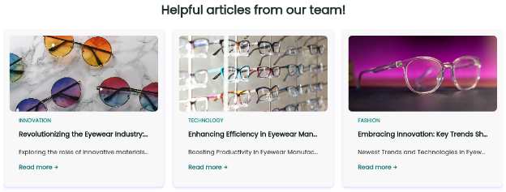

¡Excelente! Creó una colección manual y la mostró en la página de inicio de Clarity. A continuación, aprenderá a crear una colección dinámica.
## Creación de una colección dinámica
Después de clasificar sus artículos de contenido web de preguntas frecuentes anteriormente, aquí usará esas categorías para construir colecciones dinámicas de preguntas frecuentes como Walter Douglas.

Para hacer esto,

1. Abra el *menú del sitio*(![Menú del sitio]), expandir *Generador del sitio* Conjunto de colecciones y seleccionar *colecciones*.
1. Haga clic en *Nuevo* y seleccione *colección dinámica*.
1. Para el título, ingrese las preguntas frecuentes - Socios minoristas y haga clic *Guardar*.
1. Para el tipo de elemento, seleccione *Artículo de contenido web*.
1. Para el subtipo de elemento, seleccione *FAQ*.

    Esto limita la colección a los artículos de contenido web de preguntas frecuentes. A continuación, definirá el alcance y el filtro de la colección para limitar qué preguntas frecuentes se incluyen en la colección.

1. En el ámbito, haga clic en *Seleccione* y seleccione *Otro sitio o repositorio*.
1. Vaya a la pestaña *Repositorios* y haga clic en *Marketing*.

    Esto asegura que la colección utilice artículos de preguntas frecuentes del Repositorio de Marketing.

1. En filtro, establecer la regla en contiene \*all\* de las siguientes categorías.
1. En el campo Categorías, busque socios minoristas y seleccione.

    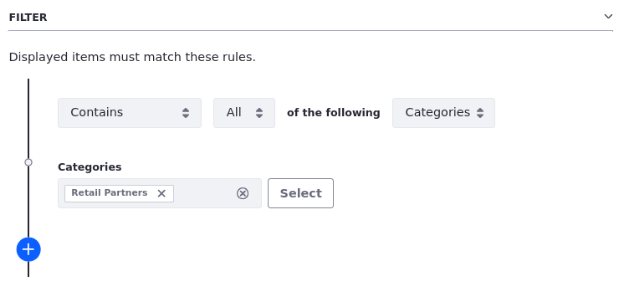

1. Haga clic en *Guardar* para crear la colección.
1. Repita los pasos anteriores para crear estas colecciones:
1. Preguntas frecuentes - Productos y servicios
1. Preguntas frecuentes - Precios y pedidos
1. Preguntas frecuentes - Devuelve e intercambios

    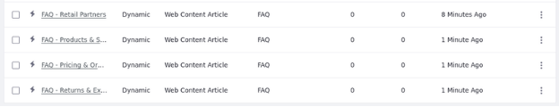

Para cada colección, filtre los resultados utilizando su categoría correspondiente.

Ahora tienes cuatro colecciones de preguntas frecuentes. A continuación, los usará para mostrar contenido en la página de preguntas frecuentes de Clarity.
## Mostrar contenido en la página de preguntas frecuentes
Usando lo que ha aprendido en los ejercicios anteriores, asignemos el contenido a la página de preguntas frecuentes como Walter Douglas.

Para hacer esto,

1. Comience a editar la página *FAQ*.
1. Haga doble clic en el fragmento *Imagen* para configurar su subelemento cuadrado de imágenes.
1. Establezca la imagen en gafas-banner-banner-with-text-lg del repositorio de marketing.
1. El bloque de la derecha contiene un título de página y cuatro composiciones de la sección de preguntas frecuentes. Cada sección de preguntas frecuentes contendrá un fragmento de encabezado y un fragmento de visualización de colección. Cada visualizacion de colección contiene un fragmento de Título para la preguntas de preguntas frecuentes y un párrafo para las respuestas. Primero mapea la colección de preguntas frecuentes que construyó anteriormente .Asegúrese de que cada colección corresponda al encabezado para su sección.

    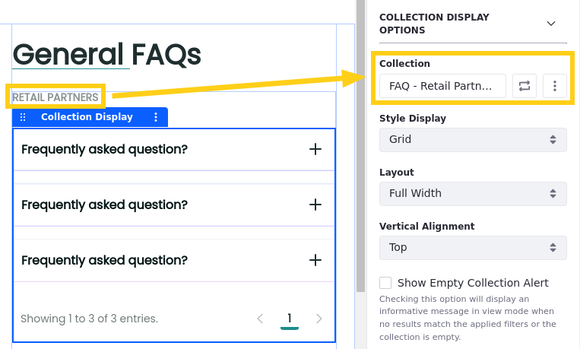

1. Para la paginación, seleccione *Ninguno*.
1. Verifique *Muestre todos los elementos de la colección*.
1. Mapee los campos correctos para cada par de preguntas y respuestas de preguntas frecuentes para que el contenido se presente correctamente en las visualizaciones de la colección.
1. En el contenedor de artículos promovidos, asigne la exhibición de la colección a colección de artículos de ayuda.
1. Configure esta configuración para el Contenido *FAQ* y *Artículos promovidos* Contenedores:

|**Tab**|**configuración**|**Valor**|
|:- |:- |:- |
| General | Ancho del contenedor |*Ancho fijo*|

10. Haga clic en *Publicar* para guardar sus cambios en la página FAQ.

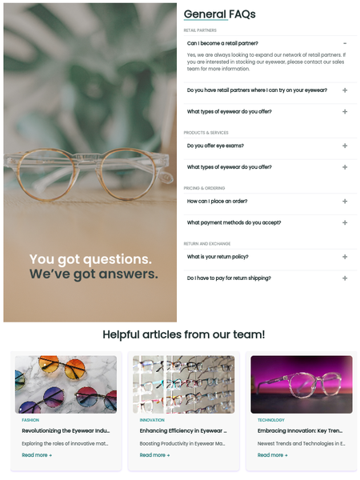

Usando pantallas de recopilación y fragmentos personalizados, ha presentado contenido web de preguntas frecuentes en la página de preguntas frecuentes de Clarity. A continuación, agregemos contenido a la barra de anuncios del encabezado.
## Agregar anuncios al encabezado
Aquí aplicará lo que ha aprendido sobre el contenido web, las colecciones y las plantillas de página para agregar un anuncio a la barra de encabezado de Clarity como Walter Douglas.

Para hacer esto,

1. Abra el *menú del sitio*(![Menú del sitio]), expandir *Generador de sitios->Conjunto de contenidos* y seleccionar pestaña *colecciones*.
1. Cree una nueva colección dinámica titulada anuncios.
1. En el menú de configuración de la colección, establezca el tipo de elemento en *Artículo de contenido web* y el subtipo de elemento a *anuncios*.
1. Para el alcance o ámbito, seleccione otro sitio o repositorio *Marketing*.
1. Haga clic en *Guardar* para publicar la colección.

    Ahora que ha creado la colección, agregemos a la plantilla de página maestra principal.

1. Abra el *menú del sitio*(![Menú del sitio]), expandir *diseño* y seleccione *plantillas de página*.
1. Comience a editar la plantilla *Página maestra principal*.

    **Nota**: Puede notar que los estilos aplicados a la página maestra son diferentes de los aplicados en las páginas del sitio. Esto se debe a que puede haber una extensión del cliente CSS de tema aplicado a las páginas del sitio y no a las páginas domésticas. Si lo desea, puede aplicar directamente el tema y la extensión del cliente a la página maestra. Asegúrese de desmarcar todas las propiedades del tema (por ejemplo, pie de página de espectáculos, encabezado del espectáculo, etc.).

1. Alterne la *Visibilidad* () del contenedor *Barra de anuncio de encabezado*.
1. Seleccione la *barra de anuncio de encabezado* Contenedor y configure esta configuración:

|**Tab**|**Campo**|**Valor**|
|:- |:- |:- |
| Estilos | fondo> color |*marca de color primaria*|

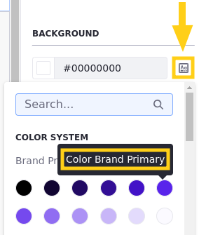

**Nota**: Las opciones de color se definen por el libro de estilo del tema.A menos que haya aplicado la extensión del cliente CSS del tema a la plantilla de página maestra, la opción principal de la marca de color aparece púrpura. Este valor se anula en las páginas del sitio por posible extensión del cliente CSS del tema.

10. Agregue un fragmento *visualización de colección* al contenedor, seleccione y configure estos ajustes:

|**Tab**|**Campo**|**Valor**|
|:- |:- |:- |
| General | Colección |*Anuncios*|
| General | Paginación |*Ninguno*|
| General | Número máximo de elementos a mostrar |*1*|

11. Agregue un fragmento *contenedor* a la pantalla de colección, cambie el nombre del anuncio y configure estos ajustes:

|**Tab**|**Campo**|**Valor**|
|:- |:- |:- |
| General | Visualización del contenido |*Fila flexible*|
| General | Alinear elementos |*Centro*|
| General | Justificar contenido |*Centro*|

12. Agregue un fragmento *párrafo* al contenedor, seleccione y configure estos ajustes:

|**Tab**|**Campo**|**Valor**|
|:- |:- |:- |
| Estilos | texto> color |*color blanco 0*|

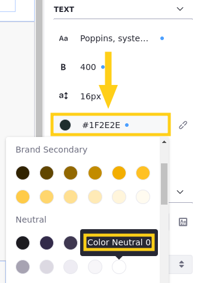

13. Seleccione el subelemento *Elemento-Text* del párrafo y configure esta configuración:

|**Tab**|**campo**|**Valor**|
|:- |:- |:- |
| Mapeo | Campo |*Mensaje*|

1. Agregue un *botón de claridad* fragmento al contenedor de anuncio después del párrafo, seleccione y configure estos ajustes:

|**Tab**|**campo**|**Valor**|
|:- |:- |:- |
| General | Tipo |*Enlace*|
| General | Estilo |*Primario*|
| General | Tamaño |*pequeño*|

14. Seleccione el subelemento *enlace del botón* y configure estos ajustes:

|**Tab**|**campo**|**Valor**|
|:- |:- |:- |
| Mapeo | Campo |*Texto de enlace*|
| Enlace | Enlace |*URL asignada*|
| Enlace | Campo |*Enlace a la página*|

15. Ajuste los márgenes y el relleno para los elementos de la barra de anuncios hasta que esté satisfecho con él.

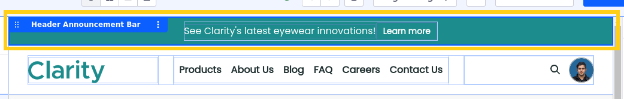

16. Haga clic en *Publicar maestro* para guardar sus cambios.

    La barra de anuncio de encabezado ahora es visible en todas las páginas que usan la plantilla de página principal principal.A continuación, usemos las funciones de comercio de Liferay para crear el catálogo de productos de Clarity.

[ref1]: img/liferay/Aspose.Words.f57361b9-0afa-49b1-bfb7-ad0c25e27a99.002.png
[ref2]: img/liferay/Aspose.Words.f57361b9-0afa-49b1-bfb7-ad0c25e27a99.003.png
[ref3]: img/liferay/Aspose.Words.f57361b9-0afa-49b1-bfb7-ad0c25e27a99.004.png
[ref4]: img/liferay/Aspose.Words.f57361b9-0afa-49b1-bfb7-ad0c25e27a99.007.png
[ref5]: img/liferay/Aspose.Words.f57361b9-0afa-49b1-bfb7-ad0c25e27a99.012.png
[Menú Global]: img/liferay/Aspose.Words.f57361b9-0afa-49b1-bfb7-ad0c25e27a99.029.png
[Botón AI Creator]: img/liferay/Aspose.Words.f57361b9-0afa-49b1-bfb7-ad0c25e27a99.030.png
[Añadir]: img/liferay/Aspose.Words.f57361b9-0afa-49b1-bfb7-ad0c25e27a99.032.png
[Menú del sitio]: img/liferay/Aspose.Words.f57361b9-0afa-49b1-bfb7-ad0c25e27a99.035.png
[Botón editar]: img/liferay/Aspose.Words.f57361b9-0afa-49b1-bfb7-ad0c25e27a99.037.png
[Botón más]: img/liferay/Aspose.Words.f57361b9-0afa-49b1-bfb7-ad0c25e27a99.048.png
[Botón Acciones]: img/liferay/Aspose.Words.f57361b9-0afa-49b1-bfb7-ad0c25e27a99.055.png
