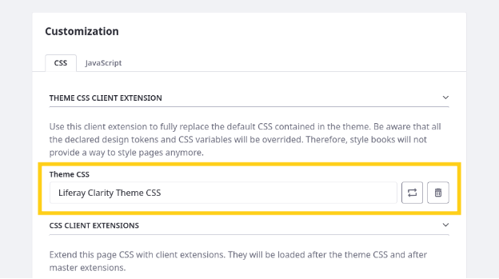
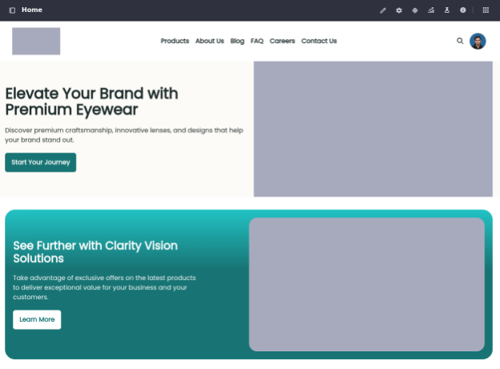

- [Implementar y aplicar la extensión del cliente CSS del tema de Clarity](#implementar-y-aplicar-la-extensión-del-cliente-css-del-tema-de-clarity)

- [Contenido automático](#contenido-automático)

## Implementar y aplicar la extensión del cliente CSS del tema de Clarity

**Necesita entorno de desarrollo**

Liferay ofrece extensiones de clientes frontend para proporcionar una forma flexible y segura de personalizar la apariencia de tu sitio web. Con el, tu puedes incorporar elementos de diseño directamente en tus páginas, Empoderarlo para lograr la apariencia deseada sin modificar el código central de Liferay.

El espacio de trabajo de capacitación incluye una extensión de cliente CSS de tema para anular los archivos CSS del tema actual. Aquí lo implementará como Walter Douglas.

Para implementar la extensión del cliente CSS de clarity :

1. Abra una nueva ventana de terminal y vaya a la carpeta Liferay-Clarity-Theme-CSS en su copia local del espacio de trabajo de capacitación (es decir, [Repositorio-Ejercicio](https://github.com/Ies2asixiaw/apuntes/tree/main/ejercicios/liferay/Client-Extensions/Liferay-Clarity-Theme-CSS)

1. Ejecute este comando para construir e implementar la extensión del cliente:

**Blade**:

Blade GW Clean Deploy

**Sistemas basados ​​en UNIX**:

../../Gradlew Clean Deploy

** Windows **:

..\..\gradlew.bat desplegable limpio

1. Verifique que el comando se ejecute correctamente en los registros de su instancia.

2024-05-09 16: 17: 41.233 INFO [FileInstall-Directory-Watcher] [BundlStartStoplogger: 68] Comenzó LiferayClarityThemecss \*7.4.13 [1449]

Ahora que ha implementado la extensión del cliente, puede aplicarla a sus páginas.

1. En el sitio de Clarity, abra el *menú del sitio*(![Menú del sitio]), expandir *Builder *Site*y haga clic en *Páginas*.
1. Haga clic en *Acciones*(![Botón de acciones]) en la barra de aplicación y seleccione *Configuración*.
1. En Personalización, haga clic en *Mas*(![Fragmentos y widgets]) para CSS de tema y seleccione *Liferay Clarity Tema CSS*.

1. Haga clic en *Guardar*.

Esto aplica el tema a todas las páginas de Clarity.

**Nota**: Después de aplicar la extensión del cliente, es posible que deba borrar el caché de su navegador para que las páginas aparezcan según lo previsto.

Ahora puede explorar el sitio de Clarity para ver cómo la aplicación del tema ha actualizado el estilo de los elementos de la página.

¡Felicidades! Has terminado de establecer la arquitectura y el estilo del sitio de Clarity.A continuación, comenzará a agregar contenido.

## Contenido automático
Puede etiquetar manualmente la mayoría de los activos de Liferay, pero etiquetar manualmente el contenido puede llevar mucho tiempo. Liferay también proporciona características e integraciones de etiquetado automático para simplificar este proceso. Por defecto, el etiquetado automático está deshabilitado.

Aquí habilitará la etiqueta automática de texto e imágenes como el usuario de Clarity Admin.

Para hacer esto,

1. Abra el *menú global*(![Menú global]), vaya a la pestaña *Panel de control* y haga clic en *Configuración de instancia*.
1. En Contenido y datos, haga clic en *Activos*.
1. Haga clic en *Etiquetado automático de activos de instancias virtuales* en el menú izquierdo.
1. Asegúrese de verificar estas opciones
      -  *Habilitar etiquetado automático de activos*
      - *Actualizar etiquetas automáticas*
      - Establezca el número máximo de etiquetas en 3.

    **Nota**: dejar el campo en blanco deshabilita automáticamente. Establecer el valor en 0 elimina cualquier límite automático.

1. Haga clic en *Modificar*.

    Ahora que está habilitado, necesitamos configurar nuestros proveedores de etiquetado para artículos e imágenes de contenido web.

1. Haga clic en *Etiquetado automático de documentos OpenNLP* en el menú izquierdo.
1. Seleccione *Artículo de contenido web* en el menú desplegable.

    Si el menú desplegable no aparece, ingrese com.liferay.journal.model.journalarticle.

    **Nota**: También puede hacer clic en el botón Más para habilitar el etiquetado automático de OpenNLP para tipos adicionales de contenido de texto (es decir, entradas de blog = com.liferay.blogs.model.blogsentry; documents = com.liferay.document.library.kernel.model.dlfileEntry).

1. Haga clic en *Modificar*.
1. Haga clic en *Etiquetado automático de imágenes deTensorFlow* en el menú izquierdo.
1. Compruebe *Habilitar el etiquetado automático de la imagen TensorFlow*.
1. Haga clic en *Guardar*.

    **Consejo**: puede verificar que todas las configuraciones sean correctas para el sitio de claridad yendo al*menú del sitio*→*Configuración*→*Configuración del sitio*→*Activos* y validación de ese etiquetado automático está habilitado.

1. Vaya a la *Biblioteca* de marketing y seleccione *Contenido web*.
1. Haga clic en *Nuevo* y seleccione *Contenido web básico*.
1. Ingrese un *título* y si tuvieramos activo un APIKEY de chatgpt o Deepseek creariamos con el *AI Creator* (![Botón AI Creator]) para generar contenido de artículo con más de 500 palabras.

    Por ejemplo,

|**Campo**|**Valor**|
|:- |:- |
| Descripción | Escriba un artículo convincente sobre la importancia de los exámenes oculares anuales es para la salud ocular continua.
| Tono | Friendly |
| Recuento de palabras | 2000 |

**IMPORTANTE**: Como no lo tenemos lo podemos obtener directamente via web de chat gpt.El título y el contenido del artículo deben ser significativos para que funcione automáticamente. No use "lorem ipsum".

18. Haga clic en *publicar*.
1. Comience a editar el artículo. En el panel lateral derecho, debería ver las etiquetas configuradas para el contenido.

    **Nota**: Si no ve ninguna etiqueta, agregue más contenido al artículo y haga clic en *Actualizar*.
